# 🃏 Wiki มายากลไพ่ (Card Magic Wiki)

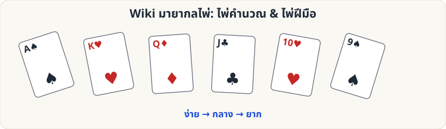

**55 กล** · ไพ่คำนวณ 46 กล · ไพ่ฝีมือ 9 กล · ทุกกลมีภาพประกอบ และเปิดอ่านได้ทีละกล

| 🚀 เริ่มต้น | คำอธิบาย |
|---|---|
| 📖 [พื้นฐานและศัพท์](Basics.md) | อุปกรณ์ ศัพท์ หลักการแสดง วิธีฝึก (อ่าน 10 นาที) |
| 🗺 [เส้นทางการเรียน 8 สัปดาห์](Learning-Path.md) | แผนฝึกเป็นสัปดาห์ ไล่ง่าย → ยาก |
| 🔎 [หากลตามเงื่อนไข](#filter) | ผู้ชมสับได้ / ไม่ต้องจัดสำรับ / ต้องมีผู้ช่วย … |

สัญลักษณ์ในการ์ด: ⏱ เวลาเรียนโดยประมาณ · 🔀 ผู้ชมสับสำรับได้ · 🔧 ต้องจัดสำรับล่วงหน้า · 🎴 ใช้ไพ่ไม่กี่ใบ · 👥 ต้องมีผู้ช่วย · 🧠 ต้องท่องจำ · ✋ ต้องฝึกมือ · 📝 เล่นแบบทำนายได้ · 🔢 มีการคำนวณ

| ไปที่ | 🟢 ง่าย | 🟡 กลาง | 🔴 ยาก |
|---|---|---|---|
| **🧮 ไพ่คำนวณ** | [15 กล](#sw-1) | [16 กล](#sw-2) | [15 กล](#sw-3) |
| **✋ ไพ่ฝีมือ** | [3 กล](#sl-1) | [3 กล](#sl-2) | [3 กล](#sl-3) |

---

## 🧮 ไพ่คำนวณ (Self-Working)

ผลลัพธ์เกิดจากหลักการ/การจัดสำรับ ไม่ต้องใช้ฝีมือ

### 🟢 ระดับง่าย — 15 กล

<table>
<tr><td width="33%" valign="top"> <b><a href="tricks/sw-easy-key-card.md">ไพ่คีย์</a></b> ผู้ชมเลือกไพ่ เสียบกลับ ตัดสำรับ — คุณทายได้ว่าใบไหน ⏱ 10 นาที</td><td width="33%" valign="top"> <b><a href="tricks/sw-easy-nine-cards.md">ไพ่ 9 ใบ</a></b> คิดไพ่ในใจจาก 9 ใบ ถามแค่ 2 ครั้งก็หาเจอ ⏱ 10 นาที  🔀 🎴</td><td width="33%" valign="top"> <b><a href="tricks/sw-easy-spelling.md">ไพ่สะกดชื่อ</a></b> สะกด O-N-E เปิดได้ A, T-W-O เปิดได้ 2 … จนถึง 10 ⏱ 15 นาที  🔧 🎴</td></tr>
<tr><td width="33%" valign="top"> <b><a href="tricks/sw-easy-four-aces.md">เอซ 4 กอง</a></b> ผู้ชมแจก 4 กอง แล้วใบบนสุดของทุกกองเป็นเอซ ⏱ 10 นาที  🔧</td><td width="33%" valign="top"> <b><a href="tricks/sw-easy-parity.md">คว่ำ–หงาย (คู่–คี่)</a></b> ผู้ชมพลิกไพ่ทีละ 2 ใบโดยคุณไม่มอง แต่คุณทายด้านของไพ่ที่ปิดไว้ได้ ⏱ 15 นาที  🎴 🔢</td><td width="33%" valign="top"> <b><a href="tricks/sw-easy-missing-card.md">ไพ่ที่หายไป</a></b> ผู้ชมซ่อนไพ่ 1 ใบ คุณบวกเลขที่เหลือก็รู้ว่าหายใบไหน ⏱ 15 นาที  🎴 🔢</td></tr>
<tr><td width="33%" valign="top"> <b><a href="tricks/sw-easy-secret-number.md">เลขลับจากไพ่</a></b> ผู้ชมคำนวณเงียบ ๆ แล้วคุณบอกได้ว่าเป็นไพ่ใบไหน ⏱ 15 นาที  🔀 🔢</td><td width="33%" valign="top"> <b><a href="tricks/sw-easy-alternating-deal.md">แยกสีแจกสลับ</a></b> ตัดสำรับกี่ครั้งก็ได้ แจก 2 กอง ได้กองแดงล้วนกับดำล้วน ⏱ 15 นาที  🔧</td><td width="33%" valign="top"> <b><a href="tricks/sw-easy-color-balance.md">สมดุลสี</a></b> แดงในกองของผู้ชม = ดำในกองของคุณ เสมอ แม้ผู้ชมสับเอง ⏱ 10 นาที  🔀 📝</td></tr>
<tr><td width="33%" valign="top"> <b><a href="tricks/sw-easy-magic-square.md">สี่เหลี่ยมมหัศจรรย์</a></b> ไพ่ A–9 วาง 3×3 ทุกแถว สดมภ์ แนวทแยงรวม 15 ⏱ 20 นาที  🎴 🧠</td><td width="33%" valign="top"> <b><a href="tricks/sw-easy-digit-sum.md">ไพ่ใบที่ 9</a></b> ผู้ชมนับไพ่เอง บวกเลขสองหลัก หยิบออก เหลือ 9 ใบ — คุณทายไพ่ใบบนสุดได้ ⏱ 15 นาที  📝</td><td width="33%" valign="top"> <b><a href="tricks/sw-easy-equal-faces.md">หงายเท่ากัน</a></b> แยกไพ่ 4 ใบแล้วพลิก ทั้งที่มองไม่เห็น — สองกองหงายเท่ากันพอดี ⏱ 10 นาที  🎴</td></tr>
<tr><td width="33%" valign="top"> <b><a href="tricks/sw-easy-sixteen-cards.md">ไพ่ 16 ใบ ถาม 4 ครั้ง</a></b> ตอบซ้าย/ขวา 4 ครั้ง ไพ่ที่คิดไว้ไปอยู่ตำแหน่งที่ต้องการ ⏱ 20 นาที  🔀 🎴 🔢</td><td width="33%" valign="top"> <b><a href="tricks/sw-easy-akqj-square.md">สี่เหลี่ยม A K Q J</a></b> ตาราง 16 ใบ ทุกกลุ่ม 4 ใบครบทั้ง 4 เลขและ 4 ดอก ⏱ 20 นาที  🎴 🧠</td><td width="33%" valign="top"> <b><a href="tricks/sw-easy-multiply-11.md">คูณ 11 ทันที</a></b> ผู้ชมเรียงไพ่เป็นเลข คุณบอกผลคูณ 11 ได้ทันที ⏱ 15 นาที  🎴 🔢</td></tr>
</table>

[📋 ดูแบบรายการ: ไพ่คำนวณ ระดับง่าย](Self-Working-Easy.md)

### 🟡 ระดับกลาง — 16 กล

<table>
<tr><td width="33%" valign="top"><a href="tricks/sw-medium-21-cards.md">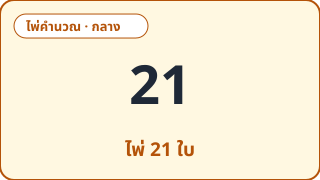</a> <b><a href="tricks/sw-medium-21-cards.md">ไพ่ 21 ใบ</a></b> ถามแค่ 3 ครั้ง ไพ่ที่คิดไว้อยู่ใบที่ 11 เสมอ ⏱ 20 นาที  🔀</td><td width="33%" valign="top"><a href="tricks/sw-medium-gilbreath.md">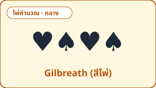</a> <b><a href="tricks/sw-medium-gilbreath.md">Gilbreath (สีไพ่)</a></b> ผู้ชมริฟเฟิลเอง แต่ทุกคู่มีแดง 1 ใบ ดำ 1 ใบ ⏱ 30 นาที  🔧</td><td width="33%" valign="top"><a href="tricks/sw-medium-stebbins.md">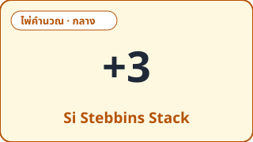</a> <b><a href="tricks/sw-medium-stebbins.md">Si Stebbins Stack</a></b> สำรับเรียงเลข +3 วนดอก — ทายไพ่ที่เลือกจากไพ่ใบเดียวที่แอบดู ⏱ 1–3 วัน  🔧 🧠 🔢</td></tr>
<tr><td width="33%" valign="top"><a href="tricks/sw-medium-kruskal.md">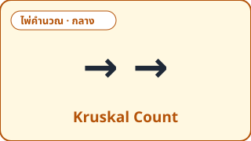</a> <b><a href="tricks/sw-medium-kruskal.md">Kruskal Count</a></b> ผู้ชมสับเอง กระโดดนับตามค่าไพ่ แล้วไปจบที่ใบเดียวกับคุณ (≈85%) ⏱ 20 นาที  🔀 📝 🔢</td><td width="33%" valign="top"><a href="tricks/sw-medium-binary-cards.md">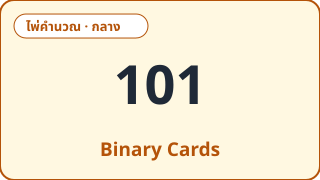</a> <b><a href="tricks/sw-medium-binary-cards.md">Binary Cards</a></b> ไพ่ตัวเลข 6 ใบ ทายเลข 1–63 ที่ผู้ชมคิดไว้ ⏱ 30 นาที  🎴 🔢</td><td width="33%" valign="top"><a href="tricks/sw-medium-gilbreath-suit.md">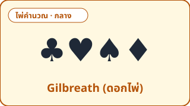</a> <b><a href="tricks/sw-medium-gilbreath-suit.md">Gilbreath (ดอกไพ่)</a></b> ทุกกลุ่ม 4 ใบมีครบ 4 ดอกหลังผู้ชมริฟเฟิล ⏱ 30 นาที  🔧</td></tr>
<tr><td width="33%" valign="top"><a href="tricks/sw-medium-1089.md">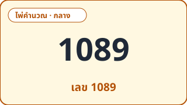</a> <b><a href="tricks/sw-medium-1089.md">เลข 1089</a></b> ไพ่ 3 ใบ กลับด้านลบบวก ได้ 1089 เสมอ ⏱ 15 นาที  🎴 🔢 📝</td><td width="33%" valign="top"><a href="tricks/sw-medium-27-cards.md">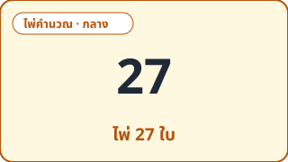</a> <b><a href="tricks/sw-medium-27-cards.md">ไพ่ 27 ใบ</a></b> ส่งไพ่ที่คิดไว้ไปอยู่ตำแหน่งใดก็ได้ใน 3 รอบ ⏱ 1 ชั่วโมง  🔀 🔢</td><td width="33%" valign="top"><a href="tricks/sw-medium-25-cards.md">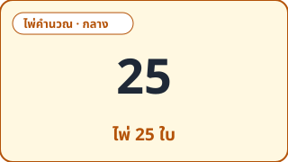</a> <b><a href="tricks/sw-medium-25-cards.md">ไพ่ 25 ใบ</a></b> 5 กอง 2 รอบ คุมตำแหน่งของไพ่ที่คิดไว้ได้ ⏱ 30 นาที  🔀 🔢</td></tr>
<tr><td width="33%" valign="top"><a href="tricks/sw-medium-stebbins-formula.md">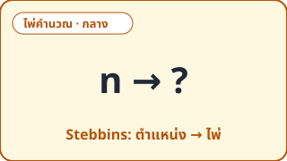</a> <b><a href="tricks/sw-medium-stebbins-formula.md">Stebbins: ตำแหน่ง → ไพ่</a></b> ผู้ชมบอกเลข 1–52 คุณบอกไพ่ตำแหน่งนั้นได้ทันที ⏱ 1 วัน  🔧 🧠 🔢</td><td width="33%" valign="top"><a href="tricks/sw-medium-poker-deal.md">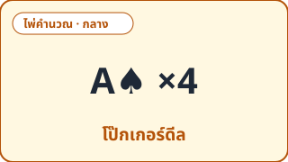</a> <b><a href="tricks/sw-medium-poker-deal.md">โป๊กเกอร์ดีล</a></b> แจกไพ่ 4 มือตามปกติ แต่มือของคุณได้เอซครบ 4 ใบ ⏱ 10 นาที  🔧</td><td width="33%" valign="top"><a href="tricks/sw-medium-nim-21.md">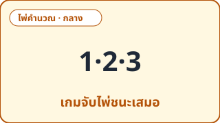</a> <b><a href="tricks/sw-medium-nim-21.md">เกมจับไพ่ชนะเสมอ</a></b> ผลัดกันหยิบไพ่ 1–3 ใบ ใครหยิบใบสุดท้ายชนะ — คุณชนะทุกครั้ง ⏱ 20 นาที  🔢</td></tr>
<tr><td width="33%" valign="top"><a href="tricks/sw-medium-1001.md">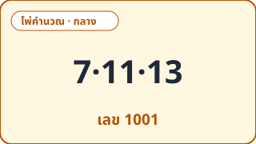</a> <b><a href="tricks/sw-medium-1001.md">เลข 1001</a></b> เลข 3 หลักจากไพ่ เขียนซ้ำ แล้วหาร 7, 11, 13 ได้เลขเดิมกลับมา ⏱ 15 นาที  🎴 🔢 📝</td><td width="33%" valign="top"><a href="tricks/sw-medium-fibonacci-sum.md">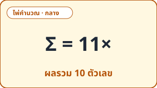</a> <b><a href="tricks/sw-medium-fibonacci-sum.md">ผลรวม 10 ตัวเลข</a></b> ผู้ชมบวกต่อเป็นชุด 10 ตัว คุณบอกผลรวมก่อนเริ่มบวก ⏱ 15 นาที  🎴 🔢 📝</td><td width="33%" valign="top"><a href="tricks/sw-medium-parity-grid.md">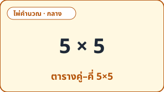</a> <b><a href="tricks/sw-medium-parity-grid.md">ตารางคู่–คี่ 5×5</a></b> ผู้ชมพลิกไพ่ 1 ใบในตาราง คุณชี้ได้ว่าใบไหนถูกพลิก ⏱ 30 นาที  🔢</td></tr>
<tr><td width="33%" valign="top"><a href="tricks/sw-medium-pile-to-ten.md">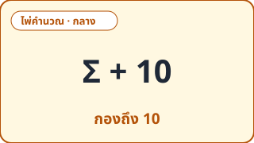</a> <b><a href="tricks/sw-medium-pile-to-ten.md">กองถึง 10</a></b> ผู้ชมสับเองแล้วแจกเป็นแถว คุณทายจำนวนไพ่ที่เหลือจากไพ่หงายหัวแถว ⏱ 30 นาที  🔀 🔢 📝</td><td width="33%"></td><td width="33%"></td></tr>
</table>

[📋 ดูแบบรายการ: ไพ่คำนวณ ระดับกลาง](Self-Working-Medium.md)

### 🔴 ระดับยาก — 15 กล

<table>
<tr><td width="33%" valign="top"><a href="tricks/sw-hard-fitch-cheney.md">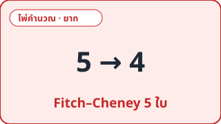</a> <b><a href="tricks/sw-hard-fitch-cheney.md">Fitch–Cheney 5 ใบ</a></b> ผู้ช่วยวางไพ่ 4 ใบ คุณบอกใบที่ 5 ที่ซ่อนอยู่ ⏱ 2–3 วัน  🔀 👥 🔢 🧠</td><td width="33%" valign="top"><a href="tricks/sw-hard-faro-math.md">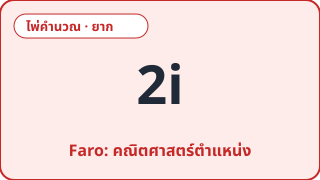</a> <b><a href="tricks/sw-hard-faro-math.md">Faro: คณิตศาสตร์ตำแหน่ง</a></b> สูตรตำแหน่งไพ่หลัง In/Out-shuffle และข้อเท็จจริง 8/52/26 รอบ ⏱ 1 ชั่วโมง  🔢</td><td width="33%" valign="top"><a href="tricks/sw-hard-fitch-drill.md">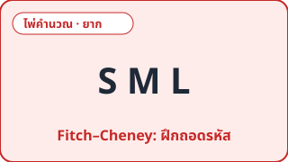</a> <b><a href="tricks/sw-hard-fitch-drill.md">Fitch–Cheney: ฝึกถอดรหัส</a></b> แบบฝึกถอดรหัสให้ได้ใน 5 วินาที พร้อมสคริปต์สร้างโจทย์ ⏱ 1 สัปดาห์  👥 🧠 🔢</td></tr>
<tr><td width="33%" valign="top"><a href="tricks/sw-hard-mnemonica.md">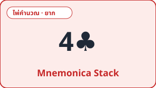</a> <b><a href="tricks/sw-hard-mnemonica.md">Mnemonica Stack</a></b> สำรับท่องจำ 52 ใบของ Tamariz ใช้เล่นได้หลายกล ⏱ 2–4 สัปดาห์  🔧 🧠</td><td width="33%" valign="top"><a href="tricks/sw-hard-monge.md">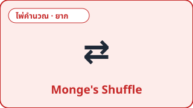</a> <b><a href="tricks/sw-hard-monge.md">Monge's Shuffle</a></b> สับแบบคำนวณตำแหน่งได้ครบ 12 รอบสำรับกลับเป็นเดิม ⏱ 1–3 วัน  🔢</td><td width="33%" valign="top"><a href="tricks/sw-hard-faro-binary.md">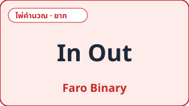</a> <b><a href="tricks/sw-hard-faro-binary.md">Faro Binary</a></b> นำไพ่บนสุดไปตำแหน่งใดก็ได้ด้วยเลขฐานสอง ⏱ หลายสัปดาห์  ✋ 🔢 🧠</td></tr>
<tr><td width="33%" valign="top"><a href="tricks/sw-hard-mod9.md">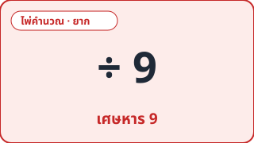</a> <b><a href="tricks/sw-hard-mod9.md">เศษหาร 9</a></b> ทายเลขที่ผู้ชมปิดไว้จากผลรวมหลักที่เหลือ ⏱ 30 นาที  🎴 🔢</td><td width="33%" valign="top"><a href="tricks/sw-hard-josephus.md">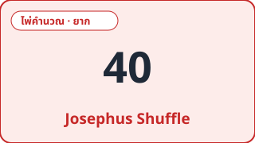</a> <b><a href="tricks/sw-hard-josephus.md">Josephus Shuffle</a></b> ทิ้ง-ย้ายไปเรื่อย ๆ ใบสุดท้ายที่เหลือคือไพ่ที่เลือก ⏱ 1 ชั่วโมง  🔧 🔢</td><td width="33%" valign="top"><a href="tricks/sw-hard-base-n.md">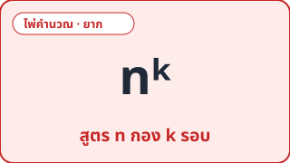</a> <b><a href="tricks/sw-hard-base-n.md">สูตร n กอง k รอบ</a></b> สูตรทั่วไปของไพ่ 9/16/25/27/36/49 ใบ ใช้คุมตำแหน่งไพ่ได้ทุกแบบ ⏱ 1 ชั่วโมง  🔀 🔢</td></tr>
<tr><td width="33%" valign="top"><a href="tricks/sw-hard-stebbins-crt.md">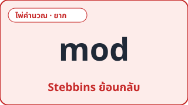</a> <b><a href="tricks/sw-hard-stebbins-crt.md">Stebbins ย้อนกลับ</a></b> ไพ่ใบไหนก็ได้ → บอกได้ว่าอยู่ตำแหน่งที่เท่าไรในสำรับ ⏱ 1–2 วัน  🔧 🧠 🔢</td><td width="33%" valign="top"><a href="tricks/sw-hard-de-bruijn.md">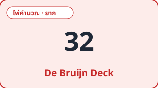</a> <b><a href="tricks/sw-hard-de-bruijn.md">De Bruijn Deck</a></b> ผู้ชม 5 คนบอกแค่สีไพ่ คุณบอกไพ่ทุกใบ ⏱ 1–2 สัปดาห์  🔧 🧠</td><td width="33%" valign="top"><a href="tricks/sw-hard-hamming-7.md">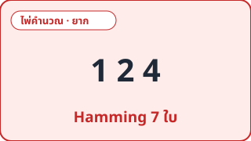</a> <b><a href="tricks/sw-hard-hamming-7.md">Hamming 7 ใบ</a></b> ผู้ชมพลิกไพ่ 1 ใบจาก 7 ใบ คุณบอกว่าใบที่เท่าไร ⏱ 1 วัน  🎴 🔢</td></tr>
<tr><td width="33%" valign="top"><a href="tricks/sw-hard-parity-hats.md">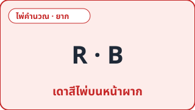</a> <b><a href="tricks/sw-hard-parity-hats.md">เดาสีไพ่บนหน้าผาก</a></b> ทุกคนเดาสีไพ่บนหน้าผากตัวเอง ถูกหมดยกเว้นคนแรก ⏱ 1 วัน  👥 🔢</td><td width="33%" valign="top"><a href="tricks/sw-hard-nim-sum.md">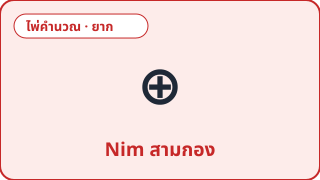</a> <b><a href="tricks/sw-hard-nim-sum.md">Nim สามกอง</a></b> ใช้ XOR เลขฐานสองหาท่าชนะเสมอในเกมหยิบไพ่สามกอง ⏱ 1–2 วัน  🔢</td><td width="33%" valign="top"><a href="tricks/sw-hard-fano-plane.md">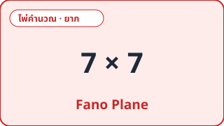</a> <b><a href="tricks/sw-hard-fano-plane.md">Fano Plane</a></b> ไพ่ 7 ใบ สองใบใดมีสัญลักษณ์ร่วมกัน 1 ตัวเสมอ และคุณบอกได้ก่อนเปิด ⏱ 2–3 วัน  🎴 🔢 🧠</td></tr>
</table>

[📋 ดูแบบรายการ: ไพ่คำนวณ ระดับยาก](Self-Working-Hard.md)

---

## ✋ ไพ่ฝีมือ (Sleight)

ใช้เทคนิคมือควบคุมไพ่ ต้องฝึกหน้ากระจก

### 🟢 ระดับง่าย — 3 กล

<table>
<tr><td width="33%" valign="top"><a href="tricks/sl-easy-overhand.md">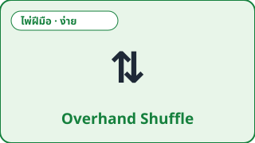</a> <b><a href="tricks/sl-easy-overhand.md">Overhand Shuffle</a></b> สับแบบมือ พร้อมส่งไพ่บนสุด↔ล่างสุดตามต้องการ ⏱ 3–7 วัน  ✋</td><td width="33%" valign="top"><a href="tricks/sl-easy-glimpse.md">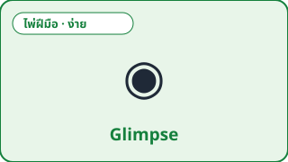</a> <b><a href="tricks/sl-easy-glimpse.md">Glimpse</a></b> แอบดูไพ่ใบล่างสุดตอนเคาะสำรับให้เรียบ ⏱ 1–3 วัน  ✋</td><td width="33%" valign="top"><a href="tricks/sl-easy-cross-cut-force.md">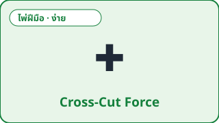</a> <b><a href="tricks/sl-easy-cross-cut-force.md">Cross-Cut Force</a></b> ผู้ชมตัดสำรับ 'อย่างอิสระ' แต่ได้ไพ่ที่คุณรู้อยู่แล้ว ⏱ 1 สัปดาห์  ✋</td></tr>
</table>

[📋 ดูแบบรายการ: ไพ่ฝีมือ ระดับง่าย](Sleight-Easy.md)

### 🟡 ระดับกลาง — 3 กล

<table>
<tr><td width="33%" valign="top"> <b><a href="tricks/sl-medium-double-lift.md">Double Lift</a></b> พลิกไพ่ 2 ใบให้เหมือนใบเดียว ⏱ 2–4 สัปดาห์  ✋</td><td width="33%" valign="top"> <b><a href="tricks/sl-medium-hindu-force.md">Pinky Break &amp; Hindu Force</a></b> ให้ผู้ชมสั่งหยุดเองตอนไหนก็ได้ แต่ได้ไพ่ที่คุณรู้ ⏱ 2–3 สัปดาห์  ✋</td><td width="33%" valign="top"> <b><a href="tricks/sl-medium-riffle-bridge.md">Riffle &amp; Bridge</a></b> สับริฟเฟิล ดัดสะพาน และคุมใบล่าง/บนสุดได้ ⏱ 2–4 สัปดาห์  ✋</td></tr>
</table>

[📋 ดูแบบรายการ: ไพ่ฝีมือ ระดับกลาง](Sleight-Medium.md)

### 🔴 ระดับยาก — 3 กล

<table>
<tr><td width="33%" valign="top"> <b><a href="tricks/sl-hard-classic-pass.md">Classic Pass</a></b> สลับครึ่งสำรับในพริบตา ไพ่ที่เลือกขึ้นมาอยู่บนสุด ⏱ หลายเดือน  ✋</td><td width="33%" valign="top"> <b><a href="tricks/sl-hard-palm.md">Top-Card Palm</a></b> ซ่อนไพ่ 1 ใบไว้ในอุ้งมือ ⏱ หลายเดือน  ✋</td><td width="33%" valign="top"> <b><a href="tricks/sl-hard-faro-shuffle.md">Faro Shuffle (ลงมือจริง)</a></b> สอดไพ่สองครึ่งสลับทีละใบสมบูรณ์ ⏱ หลายเดือน  ✋</td></tr>
</table>

[📋 ดูแบบรายการ: ไพ่ฝีมือ ระดับยาก](Sleight-Hard.md)

---

## 🔎 หากลตามเงื่อนไข

| อยากได้กลที่… | กล |
|---|---|
| 🔀 ผู้ชมสับสำรับได้ | [ไพ่ 9 ใบ](tricks/sw-easy-nine-cards.md) · [เลขลับจากไพ่](tricks/sw-easy-secret-number.md) · [สมดุลสี](tricks/sw-easy-color-balance.md) · [ไพ่ 16 ใบ ถาม 4 ครั้ง](tricks/sw-easy-sixteen-cards.md) · [ไพ่ 21 ใบ](tricks/sw-medium-21-cards.md) · [Kruskal Count](tricks/sw-medium-kruskal.md) · [ไพ่ 27 ใบ](tricks/sw-medium-27-cards.md) · [ไพ่ 25 ใบ](tricks/sw-medium-25-cards.md) · [กองถึง 10](tricks/sw-medium-pile-to-ten.md) · [Fitch–Cheney 5 ใบ](tricks/sw-hard-fitch-cheney.md) · [สูตร n กอง k รอบ](tricks/sw-hard-base-n.md) |
| 🔧 ต้องจัดสำรับล่วงหน้า | [ไพ่สะกดชื่อ](tricks/sw-easy-spelling.md) · [เอซ 4 กอง](tricks/sw-easy-four-aces.md) · [แยกสีแจกสลับ](tricks/sw-easy-alternating-deal.md) · [Gilbreath (สีไพ่)](tricks/sw-medium-gilbreath.md) · [Si Stebbins Stack](tricks/sw-medium-stebbins.md) · [Gilbreath (ดอกไพ่)](tricks/sw-medium-gilbreath-suit.md) · [Stebbins: ตำแหน่ง → ไพ่](tricks/sw-medium-stebbins-formula.md) · [โป๊กเกอร์ดีล](tricks/sw-medium-poker-deal.md) · [Mnemonica Stack](tricks/sw-hard-mnemonica.md) · [Josephus Shuffle](tricks/sw-hard-josephus.md) · [Stebbins ย้อนกลับ](tricks/sw-hard-stebbins-crt.md) · [De Bruijn Deck](tricks/sw-hard-de-bruijn.md) |
| 🎴 ใช้ไพ่ไม่กี่ใบ | [ไพ่ 9 ใบ](tricks/sw-easy-nine-cards.md) · [ไพ่สะกดชื่อ](tricks/sw-easy-spelling.md) · [คว่ำ–หงาย (คู่–คี่)](tricks/sw-easy-parity.md) · [ไพ่ที่หายไป](tricks/sw-easy-missing-card.md) · [สี่เหลี่ยมมหัศจรรย์](tricks/sw-easy-magic-square.md) · [หงายเท่ากัน](tricks/sw-easy-equal-faces.md) · [ไพ่ 16 ใบ ถาม 4 ครั้ง](tricks/sw-easy-sixteen-cards.md) · [สี่เหลี่ยม A K Q J](tricks/sw-easy-akqj-square.md) · [คูณ 11 ทันที](tricks/sw-easy-multiply-11.md) · [Binary Cards](tricks/sw-medium-binary-cards.md) · [เลข 1089](tricks/sw-medium-1089.md) · [เลข 1001](tricks/sw-medium-1001.md) · [ผลรวม 10 ตัวเลข](tricks/sw-medium-fibonacci-sum.md) · [เศษหาร 9](tricks/sw-hard-mod9.md) · [Hamming 7 ใบ](tricks/sw-hard-hamming-7.md) · [Fano Plane](tricks/sw-hard-fano-plane.md) |
| 👥 ต้องมีผู้ช่วย | [Fitch–Cheney 5 ใบ](tricks/sw-hard-fitch-cheney.md) · [Fitch–Cheney: ฝึกถอดรหัส](tricks/sw-hard-fitch-drill.md) · [เดาสีไพ่บนหน้าผาก](tricks/sw-hard-parity-hats.md) |
| 🧠 ต้องท่องจำ | [สี่เหลี่ยมมหัศจรรย์](tricks/sw-easy-magic-square.md) · [สี่เหลี่ยม A K Q J](tricks/sw-easy-akqj-square.md) · [Si Stebbins Stack](tricks/sw-medium-stebbins.md) · [Stebbins: ตำแหน่ง → ไพ่](tricks/sw-medium-stebbins-formula.md) · [Fitch–Cheney 5 ใบ](tricks/sw-hard-fitch-cheney.md) · [Fitch–Cheney: ฝึกถอดรหัส](tricks/sw-hard-fitch-drill.md) · [Mnemonica Stack](tricks/sw-hard-mnemonica.md) · [Faro Binary](tricks/sw-hard-faro-binary.md) · [Stebbins ย้อนกลับ](tricks/sw-hard-stebbins-crt.md) · [De Bruijn Deck](tricks/sw-hard-de-bruijn.md) · [Fano Plane](tricks/sw-hard-fano-plane.md) |
| ✋ ต้องฝึกมือ | [Faro Binary](tricks/sw-hard-faro-binary.md) · [Overhand Shuffle](tricks/sl-easy-overhand.md) · [Glimpse](tricks/sl-easy-glimpse.md) · [Cross-Cut Force](tricks/sl-easy-cross-cut-force.md) · [Double Lift](tricks/sl-medium-double-lift.md) · [Pinky Break & Hindu Force](tricks/sl-medium-hindu-force.md) · [Riffle & Bridge](tricks/sl-medium-riffle-bridge.md) · [Classic Pass](tricks/sl-hard-classic-pass.md) · [Top-Card Palm](tricks/sl-hard-palm.md) · [Faro Shuffle (ลงมือจริง)](tricks/sl-hard-faro-shuffle.md) |
| 📝 เล่นแบบทำนายได้ | [สมดุลสี](tricks/sw-easy-color-balance.md) · [ไพ่ใบที่ 9](tricks/sw-easy-digit-sum.md) · [Kruskal Count](tricks/sw-medium-kruskal.md) · [เลข 1089](tricks/sw-medium-1089.md) · [เลข 1001](tricks/sw-medium-1001.md) · [ผลรวม 10 ตัวเลข](tricks/sw-medium-fibonacci-sum.md) · [กองถึง 10](tricks/sw-medium-pile-to-ten.md) |
| 🔢 มีการคำนวณ | [คว่ำ–หงาย (คู่–คี่)](tricks/sw-easy-parity.md) · [ไพ่ที่หายไป](tricks/sw-easy-missing-card.md) · [เลขลับจากไพ่](tricks/sw-easy-secret-number.md) · [ไพ่ 16 ใบ ถาม 4 ครั้ง](tricks/sw-easy-sixteen-cards.md) · [คูณ 11 ทันที](tricks/sw-easy-multiply-11.md) · [Si Stebbins Stack](tricks/sw-medium-stebbins.md) · [Kruskal Count](tricks/sw-medium-kruskal.md) · [Binary Cards](tricks/sw-medium-binary-cards.md) · [เลข 1089](tricks/sw-medium-1089.md) · [ไพ่ 27 ใบ](tricks/sw-medium-27-cards.md) · [ไพ่ 25 ใบ](tricks/sw-medium-25-cards.md) · [Stebbins: ตำแหน่ง → ไพ่](tricks/sw-medium-stebbins-formula.md) · [เกมจับไพ่ชนะเสมอ](tricks/sw-medium-nim-21.md) · [เลข 1001](tricks/sw-medium-1001.md) · [ผลรวม 10 ตัวเลข](tricks/sw-medium-fibonacci-sum.md) · [ตารางคู่–คี่ 5×5](tricks/sw-medium-parity-grid.md) · [กองถึง 10](tricks/sw-medium-pile-to-ten.md) · [Fitch–Cheney 5 ใบ](tricks/sw-hard-fitch-cheney.md) · [Faro: คณิตศาสตร์ตำแหน่ง](tricks/sw-hard-faro-math.md) · [Fitch–Cheney: ฝึกถอดรหัส](tricks/sw-hard-fitch-drill.md) · [Monge's Shuffle](tricks/sw-hard-monge.md) · [Faro Binary](tricks/sw-hard-faro-binary.md) · [เศษหาร 9](tricks/sw-hard-mod9.md) · [Josephus Shuffle](tricks/sw-hard-josephus.md) · [สูตร n กอง k รอบ](tricks/sw-hard-base-n.md) · [Stebbins ย้อนกลับ](tricks/sw-hard-stebbins-crt.md) · [Hamming 7 ใบ](tricks/sw-hard-hamming-7.md) · [เดาสีไพ่บนหน้าผาก](tricks/sw-hard-parity-hats.md) · [Nim สามกอง](tricks/sw-hard-nim-sum.md) · [Fano Plane](tricks/sw-hard-fano-plane.md) |

## ⚖️ ไพ่คำนวณ vs ไพ่ฝีมือ

| | ไพ่คำนวณ | ไพ่ฝีมือ |
|---|---|---|
| หลักการ | คณิตศาสตร์ / การจัดสำรับ / หลักการสับ | การควบคุมไพ่ด้วยมือ |
| ต้องฝึกมือ | น้อย–ปานกลาง | มาก |
| ต้องฝึกพูด/จังหวะ | **มาก** (วิธีเรียบง่าย ต้องใช้ศิลปะการแสดง) | **มาก** |
| ข้อดี | เริ่มเล่นได้ในวันเดียว สำรับยืมได้ | ผลลัพธ์ดูเหลือเชื่อ ยืดหยุ่น |
| ข้อควรระวัง | เล่นซ้ำคนจับทางได้ง่าย | ฝึกไม่พอ = เห็นเทคนิค |

> ⚠️ **จริยธรรมนักมายากล:** ความสนุกอยู่ที่ "ความอัศจรรย์ใจ" ไม่ใช่การหลอกลวงเอาประโยชน์ อย่านำไปใช้กับการพนัน/การโกงเงิน และอย่าเฉลยวิธีให้ผู้ชมระหว่างการแสดง

## 🧪 เครื่องมือตรวจสอบและฝึกซ้อม (`wiki/tools/`)

| สคริปต์ | หน้าที่ |
|---|---|
| `verify_tricks.py [--fitch]` | ตรวจความถูกต้องของกลไพ่คำนวณทุกกลด้วยการจำลอง (`--fitch` ตรวจครบทุก 2.6 ล้านมือ) |
| `fitch_drill.py` | สร้างโจทย์ฝึกถอดรหัส Fitch–Cheney |
| `mnemonica_drill.py` | ฝึกท่องตำแหน่ง Mnemonica / Si Stebbins |
| `generate_images.py` | สร้างภาพประกอบ SVG ของแต่ละกล |
| `build_wiki.py` | สร้างหน้า Home / รายการระดับ / ภาพปก / ปุ่มนำทางจาก `tricks_meta.py` |
