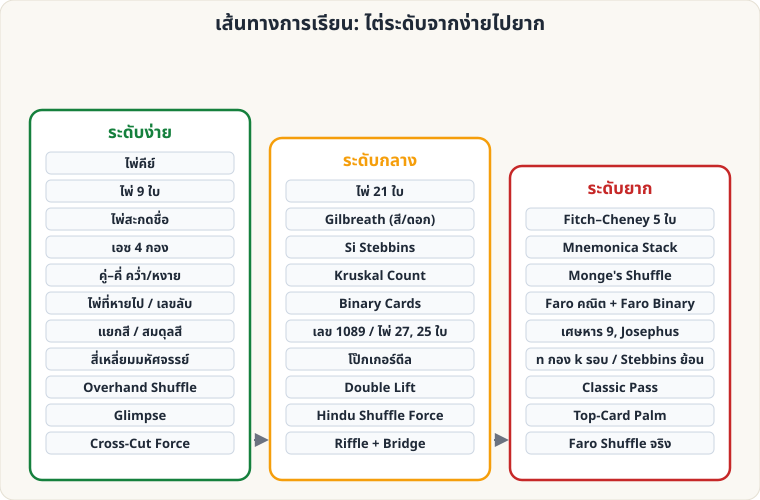

# เส้นทางการเรียนแนะนำ

[← หน้าหลัก](Home.md)

## แผน 8 สัปดาห์ (ฝึกวันละ 15–30 นาที)

| สัปดาห์ | หัวข้อ | เป้าหมาย |
|---|---|---|
| 1 | [พื้นฐาน](Basics.md), [ไพ่คีย์](tricks/sw-easy-key-card.md), [ไพ่ 9 ใบ](tricks/sw-easy-nine-cards.md), [ไพ่สะกดชื่อ](tricks/sw-easy-spelling.md) | เล่นให้เพื่อนดู 2 กล พร้อมบทพูด |
| 2 | [Overhand](tricks/sl-easy-overhand.md), [Glimpse](tricks/sl-easy-glimpse.md), [ไพ่ที่หายไป](tricks/sw-easy-missing-card.md), [เลขลับจากไพ่](tricks/sw-easy-secret-number.md) | ส่งใบบนสุด↔ล่างสุดได้ โดยไม่มองมือ · ทำ 2 กลคำนวณได้ไม่พลาด |
| 3 | [Cross-Cut Force](tricks/sl-easy-cross-cut-force.md), [ไพ่ 21 ใบ](tricks/sw-medium-21-cards.md), [คว่ำ–หงาย](tricks/sw-easy-parity.md), [เอซ 4 กอง](tricks/sw-easy-four-aces.md), [แยกสีแจกสลับ](tricks/sw-easy-alternating-deal.md) | เล่นกลทำนายไพ่ได้ต่อเนื่อง 2 กล |
| 4 | [Gilbreath](tricks/sw-medium-gilbreath.md) / [แบบดอก](tricks/sw-medium-gilbreath-suit.md), [Riffle & Bridge](tricks/sl-medium-riffle-bridge.md), [สมดุลสี](tricks/sw-easy-color-balance.md), [สี่เหลี่ยมมหัศจรรย์](tricks/sw-easy-magic-square.md) | สับริฟเฟิลเรียบ ไม่กระเด็น |
| 5 | [Double Lift](tricks/sl-medium-double-lift.md), [Hindu Force](tricks/sl-medium-hindu-force.md), [เลข 1089](tricks/sw-medium-1089.md) | พลิก 2 ใบเป็นใบเดียวให้เนียนต่อหน้ากระจก |
| 6 | [Si Stebbins](tricks/sw-medium-stebbins.md), [ตำแหน่ง→ไพ่](tricks/sw-medium-stebbins-formula.md), [Kruskal Count](tricks/sw-medium-kruskal.md), [Binary Cards](tricks/sw-medium-binary-cards.md) | คำนวณใบถัดไปได้ใน 2 วินาที / ทำ Binary Cards ให้คล่อง |
| 7 | [ไพ่ 27 ใบ](tricks/sw-medium-27-cards.md), [ไพ่ 25 ใบ](tricks/sw-medium-25-cards.md), [โป๊กเกอร์ดีล](tricks/sw-medium-poker-deal.md), [Fitch–Cheney](tricks/sw-hard-fitch-cheney.md) + [แบบฝึกถอดรหัส](tricks/sw-hard-fitch-drill.md) (ต้องมีเพื่อนช่วย) | คุมไพ่ไปตำแหน่งที่ต้องการได้ · ถอดถูก 10 ข้อติดใน 5 วินาที/ข้อ |
| 8+ | [Mnemonica](tricks/sw-hard-mnemonica.md), [Monge](tricks/sw-hard-monge.md), [Faro Binary](tricks/sw-hard-faro-binary.md), [เศษหาร 9](tricks/sw-hard-mod9.md), [Josephus](tricks/sw-hard-josephus.md), [n กอง k รอบ](tricks/sw-hard-base-n.md), [Stebbins ย้อนกลับ](tricks/sw-hard-stebbins-crt.md), [Classic Pass](tricks/sl-hard-classic-pass.md), [Palm](tricks/sl-hard-palm.md), [Faro](tricks/sl-hard-faro-shuffle.md) | ฝึกต่อเนื่องหลายเดือน |

## ข้อแนะนำ

- เลือก **1 ไพ่คำนวณ + 1 ไพ่ฝีมือ** ต่อสัปดาห์ ผสมกันจะไม่เบื่อ
- ซ้อมการแสดงจริง (พูด + ทำ) อย่างน้อย 5 รอบก่อนเล่นให้ใครดู
- จดว่าผู้ชมแต่ละคนตอบสนองอย่างไร แล้วปรับบทพูด

## กลเสริม (เลือกเพิ่มตามความสนใจ)

| ระดับ | กล |
|---|---|
| 🟢 ง่าย | [ไพ่ใบที่ 9](tricks/sw-easy-digit-sum.md), [หงายเท่ากัน](tricks/sw-easy-equal-faces.md), [ไพ่ 16 ใบ ถาม 4 ครั้ง](tricks/sw-easy-sixteen-cards.md), [สี่เหลี่ยม A K Q J](tricks/sw-easy-akqj-square.md), [คูณ 11 ทันที](tricks/sw-easy-multiply-11.md) |
| 🟡 กลาง | [เกมจับไพ่ชนะเสมอ](tricks/sw-medium-nim-21.md), [เลข 1001](tricks/sw-medium-1001.md), [ผลรวม 10 ตัวเลข](tricks/sw-medium-fibonacci-sum.md), [ตารางคู่–คี่ 5×5](tricks/sw-medium-parity-grid.md), [กองถึง 10](tricks/sw-medium-pile-to-ten.md) |
| 🔴 ยาก | [De Bruijn Deck](tricks/sw-hard-de-bruijn.md), [Hamming 7 ใบ](tricks/sw-hard-hamming-7.md), [เดาสีไพ่บนหน้าผาก](tricks/sw-hard-parity-hats.md), [Nim สามกอง](tricks/sw-hard-nim-sum.md), [Fano Plane](tricks/sw-hard-fano-plane.md) |

> ทุกกลเปิดอ่านได้จาก [หน้าแรก](Home.md) พร้อมตัวกรองตามเงื่อนไข (ผู้ชมสับได้ / ต้องจัดสำรับ / ต้องท่องจำ ฯลฯ)
