[🏠 หน้าแรก](Home.md) › 🧮 ไพ่คำนวณ › ระดับง่าย

# 🧮 ไพ่คำนวณ — 🟢 ระดับง่าย (15 กล)

คลิกที่การ์ดเพื่อเปิดอ่านทีละกล

<table>
<tr><td width="33%" valign="top"><a href="tricks/sw-easy-key-card.md">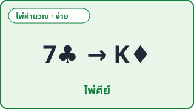</a> <b><a href="tricks/sw-easy-key-card.md">ไพ่คีย์</a></b> ผู้ชมเลือกไพ่ เสียบกลับ ตัดสำรับ — คุณทายได้ว่าใบไหน ⏱ 10 นาที</td><td width="33%" valign="top"><a href="tricks/sw-easy-nine-cards.md">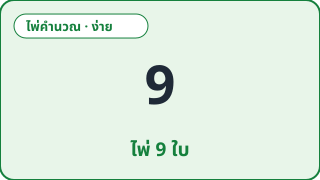</a> <b><a href="tricks/sw-easy-nine-cards.md">ไพ่ 9 ใบ</a></b> คิดไพ่ในใจจาก 9 ใบ ถามแค่ 2 ครั้งก็หาเจอ ⏱ 10 นาที  🔀 🎴</td><td width="33%" valign="top"><a href="tricks/sw-easy-spelling.md">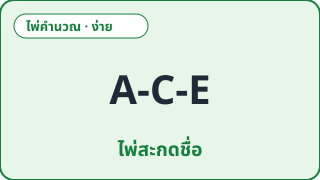</a> <b><a href="tricks/sw-easy-spelling.md">ไพ่สะกดชื่อ</a></b> สะกด O-N-E เปิดได้ A, T-W-O เปิดได้ 2 … จนถึง 10 ⏱ 15 นาที  🔧 🎴</td></tr>
<tr><td width="33%" valign="top"><a href="tricks/sw-easy-four-aces.md">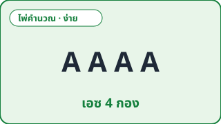</a> <b><a href="tricks/sw-easy-four-aces.md">เอซ 4 กอง</a></b> ผู้ชมแจก 4 กอง แล้วใบบนสุดของทุกกองเป็นเอซ ⏱ 10 นาที  🔧</td><td width="33%" valign="top"><a href="tricks/sw-easy-parity.md">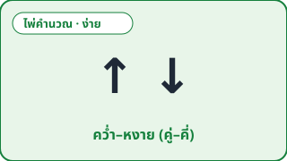</a> <b><a href="tricks/sw-easy-parity.md">คว่ำ–หงาย (คู่–คี่)</a></b> ผู้ชมพลิกไพ่ทีละ 2 ใบโดยคุณไม่มอง แต่คุณทายด้านของไพ่ที่ปิดไว้ได้ ⏱ 15 นาที  🎴 🔢</td><td width="33%" valign="top"><a href="tricks/sw-easy-missing-card.md">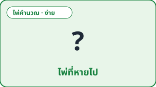</a> <b><a href="tricks/sw-easy-missing-card.md">ไพ่ที่หายไป</a></b> ผู้ชมซ่อนไพ่ 1 ใบ คุณบวกเลขที่เหลือก็รู้ว่าหายใบไหน ⏱ 15 นาที  🎴 🔢</td></tr>
<tr><td width="33%" valign="top"><a href="tricks/sw-easy-secret-number.md">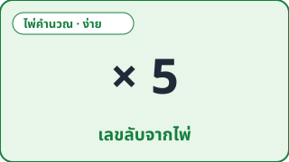</a> <b><a href="tricks/sw-easy-secret-number.md">เลขลับจากไพ่</a></b> ผู้ชมคำนวณเงียบ ๆ แล้วคุณบอกได้ว่าเป็นไพ่ใบไหน ⏱ 15 นาที  🔀 🔢</td><td width="33%" valign="top"><a href="tricks/sw-easy-alternating-deal.md">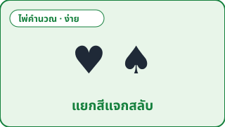</a> <b><a href="tricks/sw-easy-alternating-deal.md">แยกสีแจกสลับ</a></b> ตัดสำรับกี่ครั้งก็ได้ แจก 2 กอง ได้กองแดงล้วนกับดำล้วน ⏱ 15 นาที  🔧</td><td width="33%" valign="top"><a href="tricks/sw-easy-color-balance.md">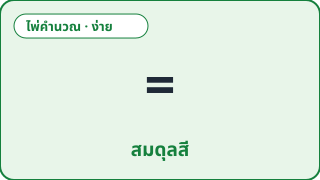</a> <b><a href="tricks/sw-easy-color-balance.md">สมดุลสี</a></b> แดงในกองของผู้ชม = ดำในกองของคุณ เสมอ แม้ผู้ชมสับเอง ⏱ 10 นาที  🔀 📝</td></tr>
<tr><td width="33%" valign="top"><a href="tricks/sw-easy-magic-square.md">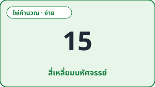</a> <b><a href="tricks/sw-easy-magic-square.md">สี่เหลี่ยมมหัศจรรย์</a></b> ไพ่ A–9 วาง 3×3 ทุกแถว สดมภ์ แนวทแยงรวม 15 ⏱ 20 นาที  🎴 🧠</td><td width="33%" valign="top"><a href="tricks/sw-easy-digit-sum.md">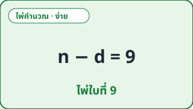</a> <b><a href="tricks/sw-easy-digit-sum.md">ไพ่ใบที่ 9</a></b> ผู้ชมนับไพ่เอง บวกเลขสองหลัก หยิบออก เหลือ 9 ใบ — คุณทายไพ่ใบบนสุดได้ ⏱ 15 นาที  📝</td><td width="33%" valign="top"><a href="tricks/sw-easy-equal-faces.md">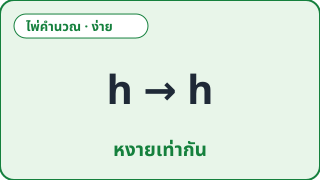</a> <b><a href="tricks/sw-easy-equal-faces.md">หงายเท่ากัน</a></b> แยกไพ่ 4 ใบแล้วพลิก ทั้งที่มองไม่เห็น — สองกองหงายเท่ากันพอดี ⏱ 10 นาที  🎴</td></tr>
<tr><td width="33%" valign="top"><a href="tricks/sw-easy-sixteen-cards.md">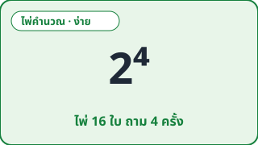</a> <b><a href="tricks/sw-easy-sixteen-cards.md">ไพ่ 16 ใบ ถาม 4 ครั้ง</a></b> ตอบซ้าย/ขวา 4 ครั้ง ไพ่ที่คิดไว้ไปอยู่ตำแหน่งที่ต้องการ ⏱ 20 นาที  🔀 🎴 🔢</td><td width="33%" valign="top"><a href="tricks/sw-easy-akqj-square.md">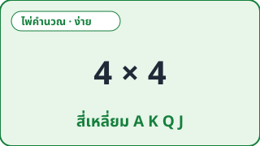</a> <b><a href="tricks/sw-easy-akqj-square.md">สี่เหลี่ยม A K Q J</a></b> ตาราง 16 ใบ ทุกกลุ่ม 4 ใบครบทั้ง 4 เลขและ 4 ดอก ⏱ 20 นาที  🎴 🧠</td><td width="33%" valign="top"><a href="tricks/sw-easy-multiply-11.md">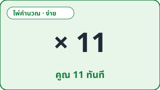</a> <b><a href="tricks/sw-easy-multiply-11.md">คูณ 11 ทันที</a></b> ผู้ชมเรียงไพ่เป็นเลข คุณบอกผลคูณ 11 ได้ทันที ⏱ 15 นาที  🎴 🔢</td></tr>
</table>

---

ดูระดับอื่น: [🟡 ระดับกลาง](Self-Working-Medium.md)  ·  [🔴 ระดับยาก](Self-Working-Hard.md)
