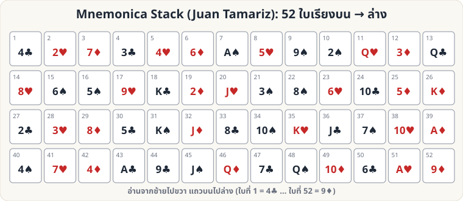

# ไพ่คำนวณ — 🔴 ระดับยาก

[← ระดับกลาง](Self-Working-Medium.md) · [หน้าหลัก](Home.md)

ระดับนี้ต้องใช้ **การคำนวณในใจ + ความจำ** และมักต้องมี **ผู้ช่วย (ผู้ร่วมแสดง)** หรือฝึกมือพื้นฐานเพิ่ม

---

<a id="fitch"></a>

## 1. Fitch–Cheney 5-Card Trick

**ผลที่ผู้ชมเห็น:** ผู้ชมเลือกไพ่ 5 ใบจากสำรับ ผู้ช่วยดูแล้วยื่นไพ่ 4 ใบให้นักมายากลทีละใบ (หงายหน้า) นักมายากลบอกไพ่ใบที่ 5 ที่ผู้ช่วยถืออยู่ได้ — โดย **ไม่มีสัญญาณอื่นนอกจากไพ่ 4 ใบ**

**อุปกรณ์:** สำรับ 52 ใบ, ผู้ช่วย 1 คน


### กฎ

**ลำดับขนาดไพ่:** เลข A<2<…<10<J<Q<K ถ้าเลขเท่ากันให้เทียบดอก **♣ < ♦ < ♥ < ♠** (ตามตัวอักษร C, D, H, S)

**สำหรับผู้ช่วย (เข้ารหัส)**

1. ใน 5 ใบ ต้องมี **ไพ่ดอกเดียวกัน 2 ใบ** เสมอ (หลักช่องนกพิราบ: 5 ใบ 4 ดอก)
2. นับระยะ "วนรอบ" ระหว่างทั้งสองใบ (A→2→…→K→A วนต่อ) เลือกให้ **ระยะ d ≤ 6** — เลือกใบหนึ่งเป็น **ใบแรก** แล้วนับ +d ไปถึงอีกใบ = **ใบที่ซ่อน**
   - ทำได้เสมอ เพราะสองทิศรวมกัน = 13 ดังนั้นอย่างน้อยหนึ่งทิศ ≤ 6
3. ยื่น **ใบแรก** ก่อน (บอกดอกของใบซ่อน และจุดเริ่มนับ)
4. ใบที่เหลือ 3 ใบ เรียงตามขนาดเป็น **S (เล็ก), M (กลาง), L (ใหญ่)** แล้ววางเรียงตามรหัส:

| d | ลำดับที่วาง |
|---|---|
| 1 | S M L |
| 2 | S L M |
| 3 | M S L |
| 4 | M L S |
| 5 | L S M |
| 6 | L M S |

**สำหรับนักมายากล (ถอดรหัส)**

1. ใบแรก → รู้ **ดอก** ของใบซ่อน
2. ดูใบที่เหลือ 3 ใบ เรียงว่าเล็ก/กลาง/ใหญ่ → อ่านรหัส d
3. ใบซ่อน = **เลขของใบแรก + d** (K+1 = A)

**ตัวอย่าง (ตามภาพ)**: ไพ่ 5 ใบ = K♥ 3♥ 9♠ 7♣ 2♦ → คู่ ♥: K→3 ระยะ 3 → ใบแรก = K♥ ซ่อน 3♥ → 2♦ 7♣ 9♠ = S M L → d=3 = M S L → วาง K♥, 7♣, 2♦, 9♠ → ผู้รับได้: ♥ + (M S L=3) → K+3 = 3♥ ✓

**เคล็ดลับ**

- จำตารางรหัสเป็นรูปแบบ: d=1 เรียงปกติ (เล็ก-กลาง-ใหญ่) แล้วไล่สลับตามตารางทีละแบบ ฝึกด้วยแฟลชการ์ด 6 ใบ
- เกม: ผู้ชมเลือก 5 ใบ → ขอให้ผู้ช่วย "ส่งพลังจิต" ผ่านไพ่ทีละใบ แล้วทายอย่างตื่นเต้น
- อย่าให้ผู้ชมมองเห็นผู้ช่วยกับนักมายากลคุยกัน — ไม่มีสัญญาณอื่นใด นอกจากไพ่

---

<a id="faro-math"></a>

## 2. Faro Shuffle: คณิตศาสตร์ตำแหน่งไพ่

Faro Shuffle คือการสับ **แบ่งครึ่ง 26/26 แล้วสอดสลับทีละใบพอดี** ทำให้ตำแหน่งของทุกใบ "ทำนายได้" ด้วยสูตร — ฝึกฝนเป็นกลคำนวณชั้นสูง (ฝีมือมือจริงดูที่ [Faro Shuffle ลงมือจริง](Sleight-Hard.md#faro))


| ชนิด | ผลลัพธ์ | สูตรตำแหน่ง (สำรับ 52, ตำแหน่ง p นับจากบน) |
|---|---|---|
| **Out-shuffle** | ใบบนสุด/ล่างสุดอยู่ที่เดิม | p → (2p − 1) mod 51 (ใบที่ 52 คงที่) |
| **In-shuffle** | ใบบนสุดลงมาเป็นใบที่ 2 | p → (2p) mod 53 |

**ข้อเท็จจริงที่ใช้โชว์ (ตรวจสอบด้วยโค้ดแล้ว)**

- Out-shuffle สมบูรณ์ **8 ครั้ง** → สำรับกลับเป็นลำดับเดิมทั้งหมด
- In-shuffle สมบูรณ์ **52 ครั้ง** → กลับเป็นลำดับเดิม
- In-shuffle **26 ครั้ง** → สำรับ **กลับด้าน** (ใบบนสุดไปอยู่ล่างสุด)

**ตัวอย่างการใช้:** ให้ผู้ชมเลือกไพ่ที่ตำแหน่ง p ใด ๆ ก็ได้ แล้วคำนวณจำนวน in-shuffle ที่พาไพ่ไปตำแหน่งที่ต้องการ (เช่น สูตร 2^k·p mod 53)

**ทดลองเอง:** รันสคริปต์ [`tools/generate_images.py`](tools/generate_images.py) — ตอนสร้างภาพจะตรวจสูตรข้างต้นด้วยการจำลองสำรับ

---

<a id="fitch-drill"></a>

## 3. Fitch–Cheney: ฝึกถอดรหัสเร็ว

เมื่อทำตามหน้า [Fitch–Cheney](#fitch) ได้แล้ว ขั้นต่อไปคือ **ถอดรหัสให้ทันที (ไม่ต้องคิดนาน)**


**ตรวจสอบกฎแล้วครบทุกมือ:** สคริปต์ [`tools/verify_tricks.py --fitch`](tools/verify_tricks.py) เข้ารหัส/ถอดรหัสไพ่ทุกมือที่เป็นไปได้ **2,598,960 มือ** — ถอดได้ถูกต้อง 100% (รวมกรณีมีไพ่ดอกเดียวกัน 3–4 ใบ, เลขซ้ำกัน, และ K→A วนรอบ)

**กรณีพิเศษที่ต้องจำ**

| สถานการณ์ | ทำอย่างไร |
|---|---|
| ดอกเดียวกัน 3 ใบขึ้นไป | เลือกคู่ใดก็ได้ที่ระยะ ≤ 6 (ทางใดทางหนึ่งเสมอ) |
| ไพ่เลขเท่ากัน (เช่น 7♣ 7♦) ในกลุ่ม S/M/L | เทียบดอก ♣ < ♦ < ♥ < ♠ |
| ใบแรกคือ K, ใบซ่อนคือ 3 | K→A→2→3 = ระยะ 3 (วนรอบ) |

**แบบฝึกหัด (ไพ่ 4 ใบที่ผู้ช่วยวาง → ใบที่ 5 คืออะไร?)** — เฉลยอยู่ขวามือ

| ข้อ | ไพ่ 4 ใบ (ตามลำดับที่วาง) | เฉลย (ใบซ่อน) |
|---|---|---|
| 1 | 6♣  2♠  2♥  J♦ | 9♣ |
| 2 | 4♥  10♠  9♠  7♥ | 10♥ |
| 3 | Q♥  9♠  10♣  K♦ | K♥ |
| 4 | 10♦  8♠  8♣  K♣ | K♦ |
| 5 | 4♠  2♠  2♦  A♣ | 10♠ |

อยากได้โจทย์ใหม่ไม่จำกัด: `python3 wiki/tools/fitch_drill.py 10 --answer`

**เกณฑ์ที่ควรไปถึงก่อนเล่นจริง:** ถอดถูก 10 ข้อติดภายใน 5 วินาที/ข้อ

---

<a id="mnemonica"></a>

## 4. Mnemonica Stack (สำรับท่องจำ)

**แนวคิด:** จัดสำรับตามลำดับที่ **ท่องจำได้ทั้ง 52 ใบ** (คิดโดย Juan Tamariz ในหนังสือ *Mnemonica*, 1986) แล้วเล่นกลตั้งแต่ "ผู้ชมบอกชื่อไพ่ → คุณหาใบนั้นได้ทันที" ไปจนถึง "ผู้ชมบอกเลข → คุณบอกไพ่ที่ตำแหน่งนั้น"



**ลำดับสำรับ (บน → ล่าง)**

```
4♣ 2♥ 7♦ 3♣ 4♥ 6♦ A♠ 5♥ 9♠ 2♠ Q♥ 3♦ Q♣
8♥ 6♠ 5♠ 9♥ K♣ 2♦ J♥ 3♠ 8♠ 6♥ 10♣ 5♦ K♦
2♣ 3♥ 8♦ 5♣ K♠ J♦ 8♣ 10♠ K♥ J♣ 7♠ 10♥ A♦
4♠ 7♥ 4♦ A♣ 9♣ J♠ Q♦ 7♣ Q♠ 10♦ 6♣ A♥ 9♦
```

(ตรวจแล้ว: ครบ 52 ใบไม่ซ้ำ)

**ท่องจำอย่างไร**

1. **แบ่งเป็นกลุ่มละ 13** และจำทีละกลุ่ม อย่าจำ 52 ใบรวดเดียว
2. **ผูกภาพ**: ทุกใบกับตำแหน่ง เช่น ใบที่ 1 = 4♣ ให้นึกเป็น "สี่เหลี่ยมสีเขียวที่ประตูทางเข้า" ฯลฯ — วิธีที่ได้ผลสูงสุดคือ "เรื่องเล่า/ลูกโซ่ภาพ" ที่ต่อกันทีละใบ
3. **ฝึกสองทิศ**: ตำแหน่ง → ไพ่ และ ไพ่ → ตำแหน่ง (ใช้ [`tools/mnemonica_drill.py`](tools/mnemonica_drill.py))
4. ทบทวน **ทุกวัน 10 นาที** เป็นเวลา 2–4 สัปดาห์

**ตัวช่วยฝึก:** `python3 wiki/tools/mnemonica_drill.py mnemonica 20` ถามตำแหน่ง/ไพ่สลับกัน (ใช้ `stebbins` แทนได้สำหรับ [Si Stebbins](Self-Working-Medium.md#stebbins))

**ใช้งานอย่างไร**

| กล | วิธีการ |
|---|---|
| ผู้ชมบอกชื่อไพ่ ให้คุณทายตำแหน่ง | รู้ตำแหน่งจากความจำ → นับ/ตัดสำรับไปถึงใบนั้น |
| ผู้ชมบอกเลข ให้คุณทายไพ่ | ท่องตำแหน่ง → ตอบทันที |
| ผู้ชมตัดสำรับ แล้วคุณคืนลำดับ | **หาไพ่ 9♦ (ใบล่างสุดเดิม)** แล้วตัดให้ 9♦ อยู่ล่างสุดอีกครั้ง → ลำดับเดิมกลับมาทั้งสำรับ (เพราะการตัดเพียงหมุนลำดับเป็นวงกลม) |
| ใช้ร่วมกับ Faro | In/Out-shuffle ตามสูตรใน [หน้าที่ 2](#faro-math) แล้วคำนวณตำแหน่งใหม่ |

**ข้อควรระวัง**

- **ห้ามสับ** สำรับระหว่างเล่น: ต้องใช้ "ตัดสำรับ" หรือ False Shuffle/False Cut ที่รักษาลำดับ (ต้องเรียนแยก)
- ใช้เวลาท่องจำมาก แต่เมื่อจำได้แล้ว **ทุกกลใช้สำรับเดียว**

---

<a id="monge"></a>

## 5. Monge's Shuffle

**แนวคิด:** วิธีสับที่ "ดูเหมือนสับธรรมดา" แต่คำนวณตำแหน่งไพ่ได้แน่นอนทุกใบ และเมื่อทำครบ **12 รอบ** สำรับ 52 ใบกลับเป็นลำดับเดิม (ผู้ชมคิดว่าสับจนมั่ว)


**วิธีสับ (Monge)**

1. ถือสำรับคว่ำในมือซ้าย ใช้มือขวาดึงไพ่ทีละใบมาวางบนโต๊ะ
2. ใบที่ 1 วางลงโต๊ะ → ใบที่ 2 **วางทับด้านบน** → ใบที่ 3 **วางใต้** → ใบที่ 4 วางทับ → ใบที่ 5 วางใต้ … สลับ ทับ/ใต้ จนหมดสำรับ
3. ผลลัพธ์: **ใบคู่เรียงกลับด้าน (บน)** ตามด้วย **ใบคี่เรียงปกติ (ล่าง)**

**สูตรตำแหน่ง (สำรับ 52 ใบ ตำแหน่ง i นับจากบน)**

- ใบคี่ i → ไปอยู่ตำแหน่ง **26 + (i+1)/2**
- ใบคู่ i → ไปอยู่ตำแหน่ง **27 − i/2**

**ข้อเท็จจริงที่ตรวจด้วยโค้ดแล้ว**

- สำรับ 52 ใบ ต้องทำ Monge **12 รอบ** จึงกลับลำดับเดิม
- ไพ่ในสำรับแบ่งเป็น **วงรอบ** ความยาว 12, 12, 12, 6, 4, 3, 2, 1 (รวม 52) — ไพ่ในวงรอบเดียวกับตำแหน่งที่ 1 (12 ตำแหน่ง) เท่านั้น ที่นำขึ้นมาบนสุดได้ด้วยการสับซ้ำ

**ตารางนำไพ่ขึ้นบนสุด** (ไพ่ที่อยู่ตำแหน่ง *p* ก่อนสับ → ต้อง Monge กี่รอบจึงขึ้นมาอยู่บนสุด)

| จำนวนรอบ | ตำแหน่ง p ก่อนสับ |
|---|---|
| 1 | 52 |
| 2 | 51 |
| 3 | 49 |
| 4 | 45 |
| 5 | 37 |
| 6 | 21 |
| 7 | 12 |
| 8 | 30 |
| 9 | 7 |
| 10 | 40 |
| 11 | 27 |

เช่น **ไพ่ล่างสุด (ตำแหน่ง 52) ขึ้นบนสุดใน 1 รอบ** · ไพ่ตำแหน่งที่ 51 ขึ้นใน 2 รอบ

**ใช้เล่นอย่างไร**

- **กลทายไพ่ล่างสุด**: ให้ผู้ชมเห็นและจำไพ่ใบล่าง (หรือ Glimpse) → Monge 1 รอบ → ใบนั้นอยู่บนสุดแน่นอน
- **กลสับครบ 12 รอบ**: "ฉันสับหนักมาก (12 ครั้ง)" แต่สำรับกลับมาเรียง Mnemonica/Stebbins เดิม
- ฝึกด้วยมือ 10 ใบก่อน (ตามภาพ) แล้วค่อยเป็น 52 ใบ


---

<a id="faro-binary"></a>

## 6. Faro Binary: ส่งไพ่ไปตำแหน่งใดก็ได้

ถ้าสอด [Faro Shuffle](Sleight-Hard.md#faro) สมบูรณ์ได้ (26/26) คุณสามารถ **นำไพ่บนสุดไปตำแหน่งใดก็ได้ใน 6 ครั้งหรือน้อยกว่า** ด้วยเลขฐานสอง


**หลักการ (ตำแหน่งนับจาก 0 = ใบบนสุด)**

- **In-shuffle:** ใบที่ตำแหน่ง i (< 26) → **2i + 1**
- **Out-shuffle:** ใบที่ตำแหน่ง i (< 26) → **2i**

เมื่อเขียนตำแหน่งปลายทาง t เป็นเลขฐานสอง แล้วสอดตามบิตจาก **ซ้ายไปขวา** (1 = In, 0 = Out) ไพ่บนสุดจะไต่ไป t พอดี เช่น ใบที่ 27 (t = 26 = 11010₂) → In, In, Out, In, Out : 1 → 2 → 4 → 7 → 14 → 27

**ไพ่ไม่ได้อยู่บนสุด?** ให้ผู้ชมเลือกและคืนไพ่ แล้ว **ตัดสำรับ** (ย้ายไพ่ด้านบนเหนือไพ่ที่เลือกไปไว้ล่าง) ให้ไพ่ที่เลือกอยู่บนสุดก่อน แล้วค่อย Faro ตามตาราง

**ตารางลำดับ In/Out สำหรับตำแหน่งปลายทาง (นับจากบนสุด = 1)**

```
 1: —                     27: In In Out In Out
 2: In                    28: In In Out In In
 3: In Out                29: In In In Out Out
 4: In In                 30: In In In Out In
 5: In Out Out            31: In In In In Out
 6: In Out In             32: In In In In In
 7: In In Out             33: In Out Out Out Out Out
 8: In In In              34: In Out Out Out Out In
 9: In Out Out Out        35: In Out Out Out In Out
10: In Out Out In         36: In Out Out Out In In
11: In Out In Out         37: In Out Out In Out Out
12: In Out In In          38: In Out Out In Out In
13: In In Out Out         39: In Out Out In In Out
14: In In Out In          40: In Out Out In In In
15: In In In Out          41: In Out In Out Out Out
16: In In In In           42: In Out In Out Out In
17: In Out Out Out Out    43: In Out In Out In Out
18: In Out Out Out In     44: In Out In Out In In
19: In Out Out In Out     45: In Out In In Out Out
20: In Out Out In In      46: In Out In In Out In
21: In Out In Out Out     47: In Out In In In Out
22: In Out In Out In      48: In Out In In In In
23: In Out In In Out      49: In In Out Out Out Out
24: In Out In In In       50: In In Out Out Out In
25: In In Out Out Out     51: In In Out Out In Out
26: In In Out Out In      52: In In Out Out In In
```

(ตรวจแล้วด้วยการจำลอง Faro จริงบนสำรับ 52 ใบ ครบทุกตำแหน่ง 1–52)

**ไอเดียการแสดง:** "ไพ่ที่คุณเลือกจะเดินทางไปอยู่ใบที่ 27 (กลางสำรับ) พอดี" → In, In, Out, In, Out แล้วเปิดนับ

---

<a id="mod9"></a>

## 7. เศษหาร 9: ทายเลขที่ปิดไว้

**ผลที่ผู้ชมเห็น:** ผู้ชมสร้างเลขใหญ่จากไพ่ สลับลำดับ ลบกัน แล้วปิดเลข 1 หลักของผลลัพธ์ บอกแค่หลักที่เหลือ — คุณบอกเลขที่ปิดไว้ได้

**อุปกรณ์:** ไพ่ตัวเลข A–9 (A=1) และ 10 = 0 / เครื่องคิดเลข


**ขั้นตอน**

1. ผู้ชมเลือกไพ่ 5 ใบ เรียงเป็นเลข 5 หลัก → 53821
2. **สลับลำดับไพ่** เป็นเลขใหม่ที่ต่างจากเดิม → 12358
3. **ลบ** (ใหญ่ − เล็ก) → 41463
4. ผู้ชมเลือกเลข **1 หลักที่ไม่ใช่ 0** ปิดไว้ (เช่น 6) แล้วอ่านที่เหลือ: 4, 1, 4, 3
5. คุณบวก 4+1+4+3 = 12 → **หาร 9 เหลือเศษ 3** → เลขที่ปิด = **9 − 3 = 6** (ถ้าเศษเป็น 0 เลขที่ปิดคือ 9)

**ทำไมถึงได้ผล:** เลขที่ใช้หลักเดียวกัน (เพียงสลับตำแหน่ง) มีผลรวมหลักเท่ากัน → หารด้วย 9 เหลือเศษเท่ากัน → ผลต่างหารด้วย 9 ลงตัวเสมอ → ผลรวมหลักของผลต่างเป็นพหุคูณของ 9 (ตรวจกับตัวอย่างสุ่ม 3,000 ชุดแล้ว)

**ข้อควรระวัง:** อย่าให้ผู้ชมปิดเลข 0 (ทายไม่ได้ ว่าเป็น 0 หรือ 9) · ต้องสลับลำดับให้ได้เลขต่างจากเดิม

---

<a id="josephus"></a>

## 8. Josephus Shuffle (ทิ้ง-ย้าย)

**ผลที่ผู้ชมเห็น:** ผู้ชม "คัดไพ่ทิ้ง" ด้วยกติกาง่าย ๆ ทีละใบจนเหลือใบเดียว — ใบสุดท้ายคือไพ่ที่ผู้ชมเลือกไว้ตั้งแต่ต้น

**กติกาการทิ้ง:** **ทิ้งใบบนสุด** (วางบนโต๊ะ) → **ย้ายใบถัดไปไปไว้ล่างสุด** → ทิ้งใบบนสุด → ย้าย → … จนเหลือ 1 ใบ


**สูตร:** สำรับ n ใบ (n > 1) ให้ m = 2 ยกกำลังสูงสุดที่ ≤ n − 1 → ใบที่รอดคือ **ตำแหน่ง 2 × (n − 1 − m) + 2** จากบนสุด

| จำนวนไพ่ n | ใบที่รอด (นับจากบน) |
|---|---|
| 2 | 2 |
| 3 | 2 |
| 4 | 4 |
| 5 | 2 |
| 8 | 8 |
| 10 | 4 |
| 13 | 10 |
| 16 | 16 |
| 20 | 8 |
| 26 | 20 |
| 32 | 32 |
| 33 | 2 |
| 40 | 16 |
| 52 | 40 |

**ข้อสังเกต (ตรวจ n = 1–52 แล้ว):** ถ้า n เป็นเลขยกกำลัง 2 (4, 8, 16, 32) → **ใบล่างสุดรอดเสมอ** · ถ้า n = 2ᵏ + 1 (3, 5, 9, 17, 33) → **ใบที่ 2 รอด**

**วิธีใช้แสดง**

1. ให้ผู้ชมเลือกไพ่แล้วคืนเข้าสำรับ → ควบคุมให้ไพ่ใบนั้น **อยู่บนสุด** → **เลื่อนนับไพ่ 13 ใบจากบนสุดเป็นก้อน (ไม่กลับลำดับ) ไปไว้ใต้สุด** → ไพ่ของผู้ชมจะอยู่ **ตำแหน่งที่ 40** พอดี (ใช้ [Overhand Shuffle](Sleight-Easy.md#overhand), [Pass](Sleight-Hard.md#pass) หรือ [Faro Binary](#faro-binary) เป็นตัวช่วยพาไพ่ขึ้นบน)
2. ให้ผู้ชมทิ้ง-ย้าย 51 รอบ → **ใบสุดท้ายคือไพ่ของผู้ชม**
3. หรือใช้ n เล็กลง เช่น 10 ใบ → ใบที่ 4

---

<a id="base-n"></a>

## 9. สูตรทั่วไป: n กอง k รอบ

หน้า [ไพ่ 9 ใบ](Self-Working-Easy.md#nine), [25 ใบ](Self-Working-Medium.md#fivepiles), [27 ใบ](Self-Working-Medium.md#ternary) ใช้หลักเดียวกัน: สำรับ **nᵏ ใบ** แจก **n กอง** ทำ **k รอบ** ตำแหน่งปลายทางคือเลขฐาน n


**ตำแหน่งปลายทาง** t (จาก 0) = ช่องรอบ 1 + n · ช่องรอบ 2 + n² · ช่องรอบ 3 + … (ช่อง 0 = บน, n−1 = ล่าง)

**ตัวอย่างเขียนด้วยโค้ด (ให้คำนวณช่องแต่ละรอบ)**

```python
def slots(target_position, n, k):
    t = target_position - 1
    return [(t // n**i) % n for i in range(k)]   # ตัวแรก = ช่องรอบ 1

print(slots(14, 3, 3))   # [1, 1, 1]  → กลาง กลาง กลาง
print(slots(25, 7, 2))   # [3, 3]     → ช่อง 3 ทั้งสองรอบ (กลางพอดีของ 7 กอง)
```

**ตารางขนาดสำรับที่ใช้ได้ (n² ≤ 52):** 9 (3×2), 16 (4×2), 25 (5×2), 36 (6×2), 49 (7×2), 27 (3×3) — ถ้ามีไพ่ไม่พอ ให้ใช้ไพ่ส่วนบนของสำรับตามจำนวนที่ต้องการ

**ตรวจแล้ว:** (3,2), (4,2), (5,2), (3,3) ทุกตำแหน่งเริ่ม × ทุกตำแหน่งปลายทาง

---

<a id="stebbins-crt"></a>

## 10. Stebbins ย้อนกลับ: ไพ่ → ตำแหน่ง

ตรงกันข้ามกับ [ตำแหน่ง → ไพ่](Self-Working-Medium.md#stebbins-formula): ผู้ชมหยิบ/บอกไพ่ใบหนึ่ง คุณบอกได้ว่าอยู่ **ตำแหน่งที่เท่าไร** ในสำรับ (ใช้ Chinese Remainder Theorem)


**ขั้นตอน**

1. **เลข → mod 13:** c = (9 × (ค่า + 2)) mod 13 (ถ้าได้ 0 ใช้ 13) — เพราะ 3 × 9 ≡ 1 (mod 13)
2. **ดอก → mod 4:** ให้ ♣=0, ♥=1, ♠=2, ♦=3 แล้ว r = (ดอก + 1) mod 4
3. ตำแหน่ง n = **c + 13 × ((r − c) mod 4)**

**ตัวอย่าง 8♦:** c = (9 × 10) mod 13 = 12 · r = (3 + 1) mod 4 = 0 · n = 12 + 13 × ((0 − 12) mod 4) = 12 + 13 × 0 = **12**

**ตัวอย่าง K♣:** c = (9 × 15) mod 13 = 135 mod 13 = 5 · r = (0 + 1) = 1 · n = 5 + 13 × ((1 − 5) mod 4) = 5 + 13 × 0 = **5** (ตรงกับลำดับ: ใบที่ 5 = K♣ ✓)

ตรวจครบทั้ง 52 ใบแล้ว ได้ตำแหน่งตรงทุกใบ

**ฝึก:** `python3 wiki/tools/mnemonica_drill.py stebbins 20`

---

กลับไป [หน้าหลัก](Home.md)
