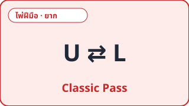
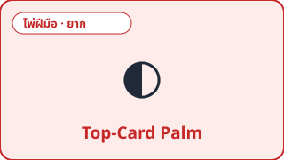
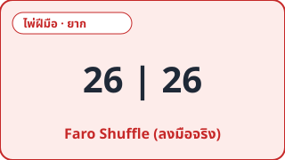

[🏠 หน้าแรก](Home.md) › ✋ ไพ่ฝีมือ › ระดับยาก

# ✋ ไพ่ฝีมือ — 🔴 ระดับยาก (3 กล)

คลิกที่การ์ดเพื่อเปิดอ่านทีละกล

<table>
<tr><td width="33%" valign="top"> <b><a href="tricks/sl-hard-classic-pass.md">Classic Pass</a></b> สลับครึ่งสำรับในพริบตา ไพ่ที่เลือกขึ้นมาอยู่บนสุด ⏱ หลายเดือน  ✋</td><td width="33%" valign="top"> <b><a href="tricks/sl-hard-palm.md">Top-Card Palm</a></b> ซ่อนไพ่ 1 ใบไว้ในอุ้งมือ ⏱ หลายเดือน  ✋</td><td width="33%" valign="top"> <b><a href="tricks/sl-hard-faro-shuffle.md">Faro Shuffle (ลงมือจริง)</a></b> สอดไพ่สองครึ่งสลับทีละใบสมบูรณ์ ⏱ หลายเดือน  ✋</td></tr>
</table>

---

ดูระดับอื่น: [🟢 ระดับง่าย](Sleight-Easy.md)  ·  [🟡 ระดับกลาง](Sleight-Medium.md)
