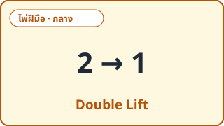
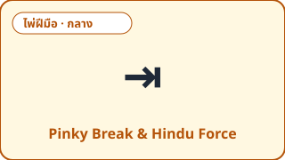
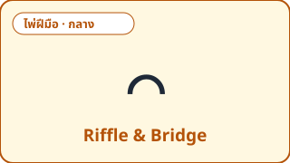

[🏠 หน้าแรก](Home.md) › ✋ ไพ่ฝีมือ › ระดับกลาง

# ✋ ไพ่ฝีมือ — 🟡 ระดับกลาง (3 กล)

คลิกที่การ์ดเพื่อเปิดอ่านทีละกล

<table>
<tr><td width="33%" valign="top"> <b><a href="tricks/sl-medium-double-lift.md">Double Lift</a></b> พลิกไพ่ 2 ใบให้เหมือนใบเดียว ⏱ 2–4 สัปดาห์  ✋</td><td width="33%" valign="top"> <b><a href="tricks/sl-medium-hindu-force.md">Pinky Break &amp; Hindu Force</a></b> ให้ผู้ชมสั่งหยุดเองตอนไหนก็ได้ แต่ได้ไพ่ที่คุณรู้ ⏱ 2–3 สัปดาห์  ✋</td><td width="33%" valign="top"> <b><a href="tricks/sl-medium-riffle-bridge.md">Riffle &amp; Bridge</a></b> สับริฟเฟิล ดัดสะพาน และคุมใบล่าง/บนสุดได้ ⏱ 2–4 สัปดาห์  ✋</td></tr>
</table>

---

ดูระดับอื่น: [🟢 ระดับง่าย](Sleight-Easy.md)  ·  [🔴 ระดับยาก](Sleight-Hard.md)
