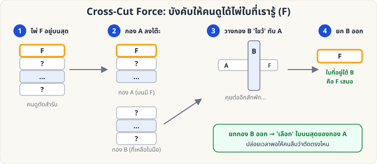

[🏠 หน้าแรก](../Home.md) › [✋ ไพ่ฝีมือ](../Sleight-Easy.md) › Cross-Cut Force

# Cross-Cut Force (บังคับไพ่ด้วยการตัดไขว้)

> 🟢 **ระดับง่าย** · ✋ ไพ่ฝีมือ · ⏱ 1 สัปดาห์ · ✋ ต้องฝึกมือ

<!-- title:Cross-Cut Force (บังคับไพ่ด้วยการตัดไขว้) -->
<!-- body:start -->
**ผลที่ผู้ชมเห็น:** ผู้ชมเลือกจุดตัดสำรับ "เองโดยอิสระ" แต่ได้ไพ่ F ใบที่คุณรู้อยู่แล้ว

**อุปกรณ์:** สำรับที่ไพ่ F อยู่บนสุด (ใช้ [Overhand](sl-easy-overhand.md) หรือ [Glimpse](sl-easy-glimpse.md) เพื่อรู้/ควบคุมใบบนสุด)

**วิธีทำ**

1. F อยู่บนสุดของสำรับคว่ำ ให้ผู้ชม **ตัดสำรับบางส่วนลงโต๊ะ** (กอง A — F อยู่บนสุดของ A)
2. คุณวางไพ่ส่วนที่เหลือ (กอง B) **ไขว้** ทับบนกอง A ขณะพูดอะไรบางอย่าง
3. คุยเรื่องอื่นสักพัก (ผู้ชมจะลืมว่าตัดตรงไหน)
4. "ตรงจุดที่คุณตัด" — ยกกอง B ออก แล้ว **หยิบไพ่ใบบนสุดของกอง A** → นั่นคือ F
5. ให้ผู้ชมดู จำ แล้วคืนเข้าสำรับ

**เคล็ดลับ**

- ต้องมีเวลาคั่นระหว่างขั้น 3–4 (อย่างน้อยก็สักประโยคหรือสองประโยค)
- อย่าเรียกว่า "บังคับ" ให้ผู้ชมรู้สึกว่าเป็นอิสระเต็มที่ ("ตัดตรงไหนก็ได้ ตามสบายเลย")
- เหมาะใช้เป็นขั้นตอนแรกของกลอ่านใจ/ทำนายต่าง ๆ
<!-- body:end -->

---

⬅️ [🟢 Glimpse](sl-easy-glimpse.md)  ·  [📋 ไพ่ฝีมือ · ระดับง่าย ทั้งหมด](../Sleight-Easy.md)  ·  [🟡 Double Lift](sl-medium-double-lift.md) ➡️

**กลที่เกี่ยวข้อง:** [🟢 Overhand Shuffle](sl-easy-overhand.md) · [🟢 Glimpse](sl-easy-glimpse.md)
