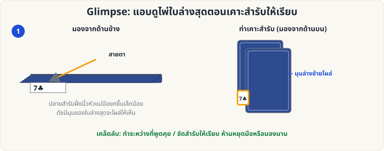

[🏠 หน้าแรก](../Home.md) › [✋ ไพ่ฝีมือ](../Sleight-Easy.md) › Glimpse

# Glimpse (แอบดูไพ่ล่างสุด)

> 🟢 **ระดับง่าย** · ✋ ไพ่ฝีมือ · ⏱ 1–3 วัน · ✋ ต้องฝึกมือ

<!-- title:Glimpse (แอบดูไพ่ล่างสุด) -->
<!-- body:start -->
**จุดประสงค์:** รู้ว่าไพ่ใบล่างสุด (หรือใบที่ต้องการ) คืออะไรโดยไม่มีใครรู้ — ใช้กับ [ไพ่คีย์](sw-easy-key-card.md) และ [Si Stebbins](sw-medium-stebbins.md)

**วิธีทำ**

1. ถือสำรับในท่า Dealing Grip หรือคว่ำบนฝ่ามือ
2. ขณะ **เคาะสำรับให้เรียบ** (หรือจัดสำรับ) ยกปลายด้านนิ้วโป้งขึ้นเล็กน้อย
3. มุมดัชนีของใบล่างสุดจะโผล่ให้เห็น ชำเลืองสั้น ๆ ไม่เกิน 1 วินาที
4. กลับสู่ท่าปกติ แล้วพูดต่อ

**เคล็ดลับ**

- ทำตอน "ชวนคุย" หรือคิดว่าจะแจกไพ่ ไม่ต้องหยุดการเคลื่อนไหว
- ฝึกแล้วจำให้ได้ ไม่ต้องเพ่ง: มองแว่บเดียว บอกชื่อไพ่ได้
- ซ้อมกับสำรับที่ดัชนีใหญ่ → แล้วค่อยเปลี่ยนเป็นสำรับธรรมดา
<!-- body:end -->

---

⬅️ [🟢 Overhand Shuffle](sl-easy-overhand.md)  ·  [📋 ไพ่ฝีมือ · ระดับง่าย ทั้งหมด](../Sleight-Easy.md)  ·  [🟢 Cross-Cut Force](sl-easy-cross-cut-force.md) ➡️

**กลที่เกี่ยวข้อง:** [🟢 ไพ่คีย์](sw-easy-key-card.md) · [🟡 Si Stebbins Stack](sw-medium-stebbins.md)
