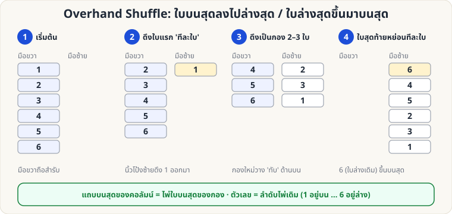

[🏠 หน้าแรก](../Home.md) › [✋ ไพ่ฝีมือ](../Sleight-Easy.md) › Overhand Shuffle

# Overhand Shuffle (สับแบบสับมือ)

> 🟢 **ระดับง่าย** · ✋ ไพ่ฝีมือ · ⏱ 3–7 วัน · ✋ ต้องฝึกมือ

<!-- title:Overhand Shuffle (สับแบบสับมือ) -->
<!-- body:start -->
**จุดประสงค์:** สับไพ่ให้ดูจริง และเรียนรู้การ **คุมตำแหน่งไพ่** (นี่คือรากฐานของการควบคุมไพ่เกือบทั้งหมด)

**ท่าพื้นฐาน**

1. มือขวาถือสำรับจากด้านบน (นิ้วโป้งที่ขอบด้านหนึ่ง นิ้วที่เหลืออีกด้านหนึ่ง) สำรับคว่ำ
2. นิ้วโป้งซ้ายแตะ **ด้านบนสุด** ของสำรับในมือขวา แล้วดึงไพ่ออกเป็นกองเล็ก ๆ ลงบนฝ่ามือซ้าย
3. กองถัดไป **วางทับ** กองก่อนหน้า ทำจนสำรับหมดมือขวา

**หลักที่ต้องจำ (ใช้ควบคุมไพ่)**

| ต้องการ | ทำอย่างไร |
|---|---|
| ส่ง **ใบบนสุด → ล่างสุด** | ดึงใบบนสุด **ทีละใบเดี่ยว ๆ** เป็นการดึงครั้งแรก แล้วที่เหลือสับต่อ |
| ส่ง **ใบล่างสุด → บนสุด** | สับตามปกติ แต่ปล่อยใบสุดท้ายในมือขวา **ทีละใบเดี่ยว ๆ** ลงบนสุด |

ในภาพ: ใบ 1 (บนสุด) ถูกดึงก่อนจึงอยู่ล่างสุด ส่วนใบ 6 (ล่างสุด) ถูกปล่อยท้ายสุดจึงขึ้นบนสุด

**ข้อผิดพลาดที่พบบ่อย**

- ดึงกองใหญ่/เล็กสลับสม่ำเสมอเกินไป → ดูเหมือนฝึกมา ให้ขนาดกองไม่เท่ากัน
- จ้องมือ → มองหน้าผู้ชมแล้วพูดคุยไปด้วย
<!-- body:end -->

---

[📋 ไพ่ฝีมือ · ระดับง่าย ทั้งหมด](../Sleight-Easy.md)  ·  [🟢 Glimpse](sl-easy-glimpse.md) ➡️

**กลที่เกี่ยวข้อง:** [🟢 Glimpse](sl-easy-glimpse.md) · [🟢 เอซ 4 กอง](sw-easy-four-aces.md)
