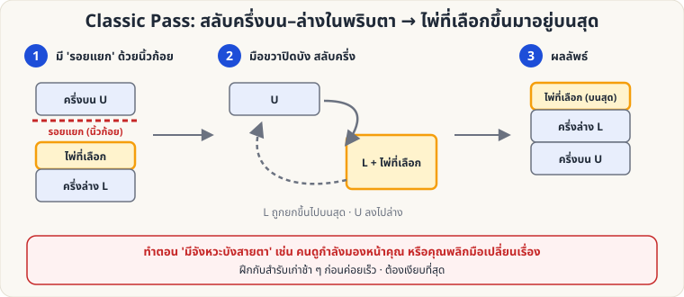

[🏠 หน้าแรก](../Home.md) › [✋ ไพ่ฝีมือ](../Sleight-Hard.md) › Classic Pass

# Classic Pass (สลับครึ่งสำรับ)

> 🔴 **ระดับยาก** · ✋ ไพ่ฝีมือ · ⏱ หลายเดือน · ✋ ต้องฝึกมือ

<!-- title:Classic Pass (สลับครึ่งสำรับ) -->
<!-- body:start -->
**จุดประสงค์:** พาไพ่ที่ผู้ชมเลือกขึ้นมาอยู่ **บนสุด** ของสำรับในพริบตา โดยไม่ให้ผู้ชมรู้ว่ามีการเคลื่อนไหว

**ขั้นตอนหลัก**

1. ผู้ชมเลือกไพ่ แล้วคุณให้คืน **ใบบนสุดของครึ่งล่าง (L)** ขณะที่คุณถือ **รอยแยก (Break)** ด้วยนิ้วก้อยซ้าย — รอยแยกอยู่ **ระหว่างครึ่งบน U และไพ่ที่เลือก**
2. จัดสำรับในมือซ้าย มือขวาครอบด้านบน/ด้านนอกของสำรับเพื่อบังสายตา
3. **มือซ้ายปล่อยครึ่งล่าง L** (พร้อมไพ่ที่เลือก) ให้หมุนขึ้นไปบนสุด ขณะที่ **ครึ่งบน U** ถูกดึงลงล่าง — สลับกันในพริบตา (ต้องบังด้วยมือขวา)
4. เมื่อจบ ไพ่ที่เลือกอยู่ **บนสุด** ของสำรับ พร้อมต่อกับท่าอื่น เช่น Double Lift หรือ Ambitious Card

**ฝึกอย่างไร**

- ฝึกช้า ๆ กับสำรับเก่าก่อน ให้ "ปิดสนิท" แล้วค่อยเร่งความเร็ว
- ให้เพื่อนดูมุมด้านข้าง หรือถ่ายวิดีโอสโลว์โมชั่นดูสิ่งที่ผู้ชมเห็น
- อย่า "รีบ" ให้ท่าเดียวเสร็จในจังหวะที่ **คนดูกำลังมองหน้าคุณ**

**ข้อควรระวัง:** ถ้าเสียงดังหรือไพ่เอียง ผู้ชมจะรู้ทันที — ท่านี้ต้อง "เงียบ" ที่สุด
<!-- body:end -->

---

⬅️ [🟡 Riffle & Bridge](sl-medium-riffle-bridge.md)  ·  [📋 ไพ่ฝีมือ · ระดับยาก ทั้งหมด](../Sleight-Hard.md)  ·  [🔴 Top-Card Palm](sl-hard-palm.md) ➡️

**กลที่เกี่ยวข้อง:** [🟡 Double Lift](sl-medium-double-lift.md) · [🔴 Top-Card Palm](sl-hard-palm.md)
