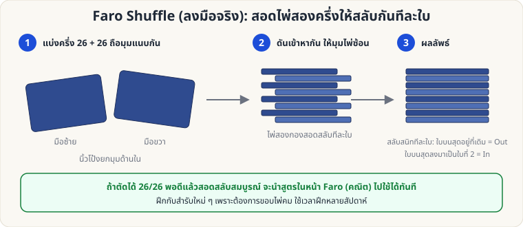

[🏠 หน้าแรก](../Home.md) › [✋ ไพ่ฝีมือ](../Sleight-Hard.md) › Faro Shuffle (ลงมือจริง)

# Faro Shuffle (ลงมือจริง)

> 🔴 **ระดับยาก** · ✋ ไพ่ฝีมือ · ⏱ หลายเดือน · ✋ ต้องฝึกมือ

<!-- title:Faro Shuffle (ลงมือจริง) -->
<!-- body:start -->
**จุดประสงค์:** สอดไพ่สองครึ่งให้สลับกันทีละใบ **สมบูรณ์** เพื่อควบคุมตำแหน่งไพ่ทั้งสำรับ (ใช้ร่วมกับ [สูตรคณิตศาสตร์ Faro](sw-hard-faro-math.md))

**ขั้นตอนหลัก**

1. **แบ่งสำรับ 26/26 พอดี** — นับ หรือคุ้นเคยกับความหนา (ฝึกจนตัดได้แม่น)
2. ถือแต่ละครึ่งในมือคนละข้าง ให้ **มุมด้านในชิดกัน** นิ้วโป้งยกมุมขึ้นเล็กน้อย
3. **ดันสองครึ่งเข้าหากัน** ให้มุมไพ่ซ้อนสอดสลับทีละใบ (ใช้แรงนิ้วชี้กดมุมบนไว้ไม่ให้ไพ่เด้ง)
4. **ดันให้สุด** แล้วเรียบสำรับ — ได้สำรับที่สอดสลับสมบูรณ์

**Out vs In**

- **Out-shuffle:** ใบบนสุดอยู่ที่เดิม
- **In-shuffle:** ใบบนสุดลงมาเป็นใบที่ 2

**ข้อควรระวัง**

- ต้องใช้ **สำรับใหม่/ขอบคม** ไพ่เก่าหรือโค้งงอทำไม่ได้
- ผิดพลาดบ่อยจนกว่าจะฝึกหลายสัปดาห์ — อดทน
- ตรวจผลด้วยการทำ Out-shuffle 8 ครั้งติด: ถ้าสำรับกลับเป็นลำดับเดิม แสดงว่าสอดสมบูรณ์ทุกครั้ง
<!-- body:end -->

---

⬅️ [🔴 Top-Card Palm](sl-hard-palm.md)  ·  [📋 ไพ่ฝีมือ · ระดับยาก ทั้งหมด](../Sleight-Hard.md)

**กลที่เกี่ยวข้อง:** [🔴 Faro: คณิตศาสตร์ตำแหน่ง](sw-hard-faro-math.md) · [🔴 Faro Binary](sw-hard-faro-binary.md) · [🟡 Riffle & Bridge](sl-medium-riffle-bridge.md)
