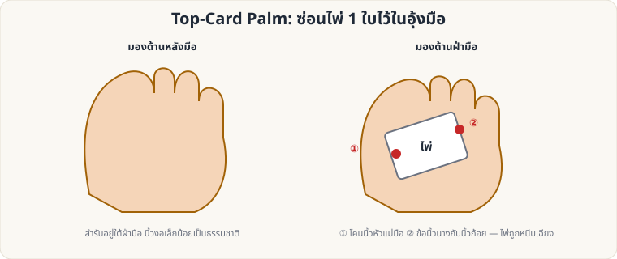

[🏠 หน้าแรก](../Home.md) › [✋ ไพ่ฝีมือ](../Sleight-Hard.md) › Top-Card Palm

# Top-Card Palm (ซ่อนไพ่ใบบนสุดในอุ้งมือ)

> 🔴 **ระดับยาก** · ✋ ไพ่ฝีมือ · ⏱ หลายเดือน · ✋ ต้องฝึกมือ

<!-- title:Top-Card Palm (ซ่อนไพ่ใบบนสุดในอุ้งมือ) -->
<!-- body:start -->
**ผลที่ผู้ชมเห็น:** ไพ่ใบหนึ่ง "หายไป" จากสำรับ แล้วไปโผล่ที่อื่น (กระเป๋า, กล่อง, เสื้อ ฯลฯ)

**ขั้นตอนหลัก**

1. สำรับในมือซ้าย (Dealing Grip) ผู้ชมยังเห็นไพ่ใบบนสุด
2. มือขวาวางครอบสำรับ แล้ว **ดึงไพ่ใบบนสุด** ไปด้านหลังเล็กน้อยด้วยนิ้วโป้งซ้าย (ใช้ Pinky Break ช่วยหาใบ)
3. ใช้ **โคนนิ้วโป้งขวา (①)** และ **ข้อนิ้วนางกับนิ้วก้อย (②)** หนีบไพ่ไว้ตามแนวเฉียงในฝ่ามือ
4. นิ้วมือต้อง **ผ่อนคลายและงอตามธรรมชาติ** — ห้ามกำแน่น หรือกางนิ้วผิดสังเกต
5. ใช้มือที่ถือไพ่ไปทำอย่างอื่น เช่น หยิบกระเป๋า วางไพ่ลง (ปล่อยไพ่ตอนมือเข้าไปในกระเป๋า)

**ข้อควรระวัง**

- หลีกเลี่ยงท่าทางผิดธรรมชาติ (มือแข็ง นิ้วแน่นผิดปกติ)
- ใช้ **Misdirection**: ให้ผู้ชมมองมืออีกข้างหนึ่งหรือหน้าคุณ
- ฝึกให้ผ่อนคลายจนทำได้ระหว่างพูดคุยโดยไม่ต้องคิด
<!-- body:end -->

---

⬅️ [🔴 Classic Pass](sl-hard-classic-pass.md)  ·  [📋 ไพ่ฝีมือ · ระดับยาก ทั้งหมด](../Sleight-Hard.md)  ·  [🔴 Faro Shuffle (ลงมือจริง)](sl-hard-faro-shuffle.md) ➡️

**กลที่เกี่ยวข้อง:** [🔴 Classic Pass](sl-hard-classic-pass.md)
