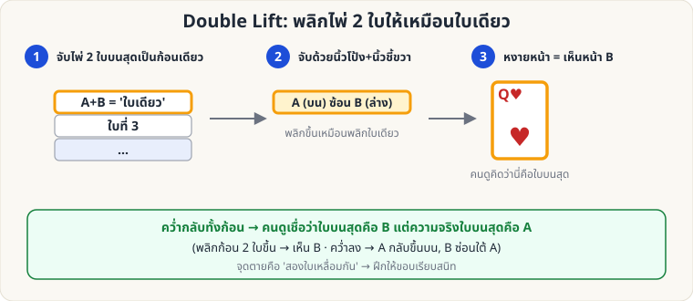

[🏠 หน้าแรก](../Home.md) › [✋ ไพ่ฝีมือ](../Sleight-Medium.md) › Double Lift

# Double Lift (พลิกไพ่ 2 ใบให้เป็นใบเดียว)

> 🟡 **ระดับกลาง** · ✋ ไพ่ฝีมือ · ⏱ 2–4 สัปดาห์ · ✋ ต้องฝึกมือ

<!-- title:Double Lift (พลิกไพ่ 2 ใบให้เป็นใบเดียว) -->
<!-- body:start -->
**ผลที่ผู้ชมเห็น:** คุณพลิกไพ่ "ใบบนสุด" ให้ดู แล้วคว่ำกลับ — ผู้ชมเชื่อว่าใบนั้นอยู่บนสุดของสำรับจริง ๆ

**หลักการ:** ไพ่ 2 ใบเรียงซ้อนตรงกัน ถูกพลิกเป็น "ใบเดียว" หน้าที่เห็นคือใบที่ **2 จากบน (B)** แต่ใบบนสุดจริงคือ **A**

**วิธีทำ (ท่าพื้นฐาน)**

1. สำรับคว่ำในท่า Dealing Grip
2. ใช้นิ้วโป้งซ้ายดันไพ่ **2 ใบบนสุด** ไปทางขวาเล็กน้อย ให้ขอบเรียงตรงกันเป็นก้อนเดียว (ใช้ [Pinky Break](sl-medium-hindu-force.md) ช่วยแบ่งตำแหน่ง 2 ใบ)
3. มือขวาจับมุมด้านที่ไกลจากตัวคุณ (นิ้วโป้งด้านใน นิ้วอื่นด้านนอก) แล้ว **พลิกก้อน 2 ใบหงายขึ้น** เหมือนพลิกไพ่ใบเดียว ผู้ชมเห็นหน้าไพ่ B
4. **คว่ำก้อนกลับ** วางบนสำรับ — A กลับขึ้นบนสุดตามเดิม (B ซ่อนอยู่ใต้ A)
5. หยิบ **ใบบนสุดจริง (A)** ออกไปวางแยก โดยเรียกมันว่า "B" — ผู้ชมเชื่อว่าเป็นใบที่เพิ่งเห็น แล้วทำให้มัน "เปลี่ยน/หาย/โผล่ที่อื่น" ด้วยกลต่อไป (เช่น Ambitious Card)

**เคล็ดลับ**

- ความตึงของไพ่ 2 ใบต้อง **เท่ากับไพ่ใบเดียว** (อย่าถือหลวม/แน่นเกิน)
- เมื่อพลิก ให้ท่ามือ **เหมือนพลิกใบเดียว** ทุกจังหวะ
- ฝึกด้วยไพ่ที่ต่างสีกัน 2 ใบ เพื่อสังเกตว่า "เห็นเท่าไร"
<!-- body:end -->

---

⬅️ [🟢 Cross-Cut Force](sl-easy-cross-cut-force.md)  ·  [📋 ไพ่ฝีมือ · ระดับกลาง ทั้งหมด](../Sleight-Medium.md)  ·  [🟡 Pinky Break & Hindu Force](sl-medium-hindu-force.md) ➡️

**กลที่เกี่ยวข้อง:** [🔴 Classic Pass](sl-hard-classic-pass.md)
