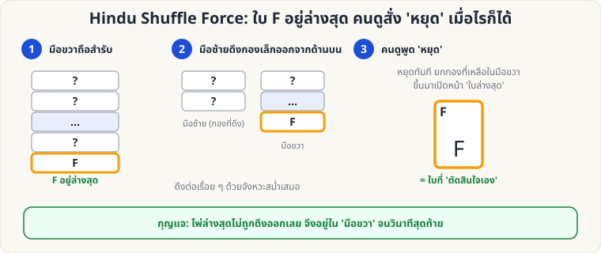

[🏠 หน้าแรก](../Home.md) › [✋ ไพ่ฝีมือ](../Sleight-Medium.md) › Pinky Break & Hindu Force

# Pinky Break และ Hindu Shuffle Force

> 🟡 **ระดับกลาง** · ✋ ไพ่ฝีมือ · ⏱ 2–3 สัปดาห์ · ✋ ต้องฝึกมือ

<!-- title:Pinky Break และ Hindu Shuffle Force -->
<!-- body:start -->
### 2.1 Pinky Break (ช่องว่างนิ้วก้อย)

ใช้ปลายนิ้วก้อยซ้ายแง้มไพ่ที่ **ด้านหลังขอบสำรับ** ให้เกิดช่องเล็ก ๆ เพื่อ "จำตำแหน่ง" โดยไม่ต้องมอง — ใช้กับ Double Lift, Pass, Palm และท่าอื่น ๆ ฝึกให้ช่องกว้าง **1–2 มม.** และไม่เห็นจากด้านหน้า

### 2.2 Hindu Shuffle Force

**ผลที่ผู้ชมเห็น:** คุณสับสำรับด้วยท่า Hindu Shuffle ผู้ชมสั่ง "หยุด" ตอนไหนก็ได้ แล้วหยิบไพ่ใบนั้น ซึ่งก็คือ F ที่คุณรู้อยู่แล้ว

**อุปกรณ์:** สำรับที่ F อยู่ **ล่างสุด** (ใช้ [Overhand](sl-easy-overhand.md) ส่ง F ลงล่าง หรือ [Glimpse](sl-easy-glimpse.md) หาไพ่ล่างสุด)

**วิธีทำ**

1. มือขวาถือสำรับจากด้านบน (ท่าเดียวกับ Overhand) มือซ้ายอยู่ข้างล่าง
2. มือซ้าย **ดึงกองเล็ก ๆ จากด้านบนสุด** ของสำรับในมือขวา ลงในมือซ้าย กองถัดไปวางทับ
3. บอกผู้ชมว่า "สั่งหยุดเมื่อไรก็ได้ตามใจ"
4. เมื่อผู้ชมสั่งหยุด **ปล่อยกองที่เหลือในมือขวา** ยกขึ้นด้านหน้าแล้ว **เปิดไพ่ใบล่างสุดของกองนั้น** = F
5. ผู้ชมเชื่อว่าเขาเป็นผู้หยุดให้ตรงใบนั้น

**เคล็ดลับ**

- จังหวะดึงต้องสม่ำเสมอ ผู้ชมต้องไม่รู้ว่าใบล่างสุดไม่เคยถูกดึง
- ถ้าผู้ชมไม่หยุดเลย ให้เล่นต่อจน "เหลือแต่ F" แล้วบอกว่า "ผู้ชมตัดสินใจช้าจัง!"
<!-- body:end -->

---

⬅️ [🟡 Double Lift](sl-medium-double-lift.md)  ·  [📋 ไพ่ฝีมือ · ระดับกลาง ทั้งหมด](../Sleight-Medium.md)  ·  [🟡 Riffle & Bridge](sl-medium-riffle-bridge.md) ➡️

**กลที่เกี่ยวข้อง:** [🟢 Overhand Shuffle](sl-easy-overhand.md) · [🟢 Glimpse](sl-easy-glimpse.md)
