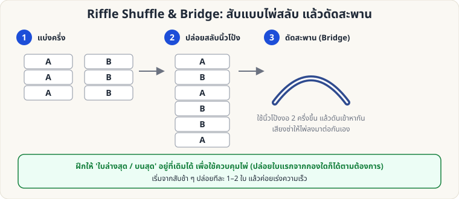

[🏠 หน้าแรก](../Home.md) › [✋ ไพ่ฝีมือ](../Sleight-Medium.md) › Riffle & Bridge

# Riffle Shuffle และ Bridge

> 🟡 **ระดับกลาง** · ✋ ไพ่ฝีมือ · ⏱ 2–4 สัปดาห์ · ✋ ต้องฝึกมือ

<!-- title:Riffle Shuffle และ Bridge -->
<!-- body:start -->
**จุดประสงค์:** สับให้ดูแบบมืออาชีพ และเป็นพื้นฐานของ Faro Shuffle

**วิธีทำ**

1. แบ่งสำรับเป็น 2 ครึ่ง วางบนโต๊ะ (หรือถือในมือทั้งสอง) ให้มุมด้านในชิดกัน
2. ใช้นิ้วโป้งทั้งสองดัดมุมไพ่ ปล่อยให้ไพ่ **ลื่นไหลตกลงมาสลับกัน** (ปล่อยทีละใบ หรือ 2–3 ใบ)
3. **Bridge:** ดันสองครึ่งเข้าหากัน ให้ไพ่โค้ง "สะพาน" ขึ้นด้านบน แล้วปล่อยให้ไพ่ตกลงมาเรียบร้อยด้วยแรงนิ้วโป้ง

**การควบคุม**

- ถ้าต้องการให้ **ใบล่างสุดยังอยู่ล่างสุด** ให้ปล่อยไพ่จากครึ่งล่างก่อน
- ถ้าต้องการให้ **ใบบนสุดอยู่บนสุด** ให้ปล่อยไพ่ใบสุดท้ายจากครึ่งบนทีหลัง

**ข้อควรระวัง:** ถ้าฝึกไม่พอ ไพ่จะ "กระเด็น" — ฝึกบนโต๊ะผ้าก่อน
<!-- body:end -->

---

⬅️ [🟡 Pinky Break & Hindu Force](sl-medium-hindu-force.md)  ·  [📋 ไพ่ฝีมือ · ระดับกลาง ทั้งหมด](../Sleight-Medium.md)  ·  [🔴 Classic Pass](sl-hard-classic-pass.md) ➡️

**กลที่เกี่ยวข้อง:** [🔴 Faro Shuffle (ลงมือจริง)](sl-hard-faro-shuffle.md) · [🟡 Gilbreath (สีไพ่)](sw-medium-gilbreath.md)
