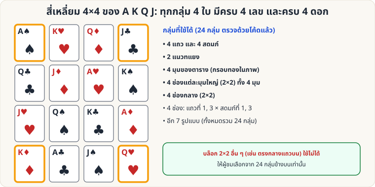

[🏠 หน้าแรก](../Home.md) › [🧮 ไพ่คำนวณ](../Self-Working-Easy.md) › สี่เหลี่ยม A K Q J

# สี่เหลี่ยม 4×4 ของ A K Q J

> 🟢 **ระดับง่าย** · 🧮 ไพ่คำนวณ · ⏱ 20 นาที · 🎴 ใช้ไพ่ไม่กี่ใบ · 🧠 ต้องท่องจำ

<!-- title:สี่เหลี่ยม 4×4 ของ A K Q J -->
<!-- body:start -->
**ผลที่ผู้ชมเห็น:** ไพ่ A, K, Q, J ทั้ง 4 ดอก (16 ใบ) วางเป็นตาราง 4×4 ผู้ชมเลือกกลุ่ม 4 ใบแบบใดก็ได้จากรูปแบบที่กำหนด → **ทุกกลุ่มมีครบ A K Q J และครบทั้ง 4 ดอก**

**อุปกรณ์:** ไพ่ A K Q J ทั้ง 4 ดอก (16 ใบ)



**การวาง (แถวละ 4 ใบ, หงายหน้า)**

```
A♠ K♥ Q♦ J♣
Q♣ J♦ A♥ K♠
J♥ Q♠ K♣ A♦
K♦ A♣ J♠ Q♥
```

**กลุ่ม 4 ใบที่ใช้ได้** (ตรวจครบทั้ง 1,820 แบบ พบ **24 กลุ่ม**)

- 4 แถว, 4 สดมภ์, 2 แนวทแยง
- 4 มุมของตาราง
- มุมใหญ่ 2×2 ทั้ง 4 มุม และ 2×2 ตรงกลาง (**รวม 5 บล็อก**)
- อีก 8 กลุ่ม (แถว, สดมภ์ เลขที่ 1–4):

| กลุ่ม | ตำแหน่ง (แถว, สดมภ์) | ไพ่ |
|---|---|---|
| 1 | (1,1) (1,3) (3,1) (3,3) | A♠ Q♦ J♥ K♣ |
| 2 | (1,2) (1,3) (4,2) (4,3) | K♥ Q♦ A♣ J♠ |
| 3 | (1,2) (1,4) (3,2) (3,4) | K♥ J♣ Q♠ A♦ |
| 4 | (1,2) (2,1) (3,4) (4,3) | K♥ Q♣ A♦ J♠ |
| 5 | (1,3) (2,4) (3,1) (4,2) | Q♦ K♠ J♥ A♣ |
| 6 | (2,1) (2,3) (4,1) (4,3) | Q♣ A♥ K♦ J♠ |
| 7 | (2,1) (2,4) (3,1) (3,4) | Q♣ K♠ J♥ A♦ |
| 8 | (2,2) (2,4) (4,2) (4,4) | J♦ K♠ A♣ Q♥ |

**ข้อควรระวัง:** บล็อก 2×2 **อื่น ๆ** (เช่น แถว 1–2 สดมภ์ 2–3) **ใช้ไม่ได้** (มีดอกซ้ำ) ให้ผู้ชมเลือกเฉพาะรูปแบบข้างบน (เช่น "แถว, สดมภ์, ทแยง, มุม, สี่เหลี่ยมใหญ่")

**ลูกเล่น:** ปิดไพ่ (คว่ำ) แล้วให้ผู้ชม "เรียก" กลุ่มที่ต้องการ → เปิดดู
<!-- body:end -->

---

⬅️ [🟢 ไพ่ 16 ใบ ถาม 4 ครั้ง](sw-easy-sixteen-cards.md)  ·  [📋 ไพ่คำนวณ · ระดับง่าย ทั้งหมด](../Self-Working-Easy.md)  ·  [🟢 คูณ 11 ทันที](sw-easy-multiply-11.md) ➡️

**กลที่เกี่ยวข้อง:** [🟢 สี่เหลี่ยมมหัศจรรย์](sw-easy-magic-square.md)
