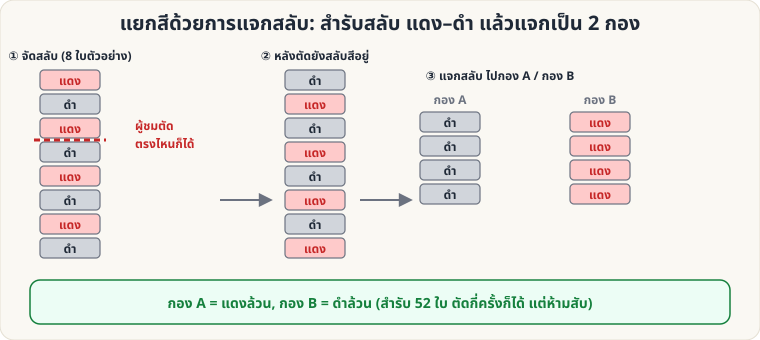

[🏠 หน้าแรก](../Home.md) › [🧮 ไพ่คำนวณ](../Self-Working-Easy.md) › แยกสีแจกสลับ

# แยกสีด้วยการแจกสลับ

> 🟢 **ระดับง่าย** · 🧮 ไพ่คำนวณ · ⏱ 15 นาที · 🔧 ต้องจัดสำรับล่วงหน้า

<!-- title:แยกสีด้วยการแจกสลับ -->
<!-- body:start -->
**ผลที่ผู้ชมเห็น:** ผู้ชมตัดสำรับกี่ครั้งก็ได้ แล้วแจกไพ่ลง 2 กองสลับกัน เปิดดู — **กองหนึ่งแดงล้วน อีกกองดำล้วน**

**อุปกรณ์:** สำรับ 52 ใบ จัดให้ **สลับ แดง–ดำ** ตลอดทั้งสำรับ (บนสุดสีหนึ่ง ล่างสุดอีกสีหนึ่ง)

**วิธีทำ**

1. จัดสำรับให้สีสลับกันทุกใบ (ใบที่ 1 แดง, 2 ดำ, 3 แดง … 52 ดำ)
2. ให้ผู้ชม **ตัดสำรับ** กี่ครั้งก็ได้ (ห้ามสับ)
3. ให้ผู้ชมแจกไพ่ **คว่ำหน้า** ทีละใบ **สลับกอง A / กอง B** จนหมดสำรับ
4. ก่อนเปิด ให้ผู้ชมทาย: "กองไหนแดง กองไหนดำ?" แล้วเปิดดู → **แยกสีสมบูรณ์**

**ทำไมถึงได้ผล:** ใบบนสุดและล่างสุดสีต่างกัน สำรับจึง "สลับสีแบบวนรอบ" ตัดตรงไหนก็ยังสลับสีต่อเนื่อง การแจกสลับจึงได้ใบเว้นใบ = สีเดียวกัน (ตรวจครบทุกจุดตัด 52 แบบแล้ว)

**ต่อยอด:** ใช้กับ "คุณสมบัติ" อื่นได้ เช่น เลขคู่/คี่, ไพ่ต่ำ (A–6)/สูง (8–K), หรือดอกดำ/แดง — ขอแค่สลับกันทั้งสำรับ
<!-- body:end -->

---

⬅️ [🟢 เลขลับจากไพ่](sw-easy-secret-number.md)  ·  [📋 ไพ่คำนวณ · ระดับง่าย ทั้งหมด](../Self-Working-Easy.md)  ·  [🟢 สมดุลสี](sw-easy-color-balance.md) ➡️

**กลที่เกี่ยวข้อง:** [🟡 Gilbreath (สีไพ่)](sw-medium-gilbreath.md)
