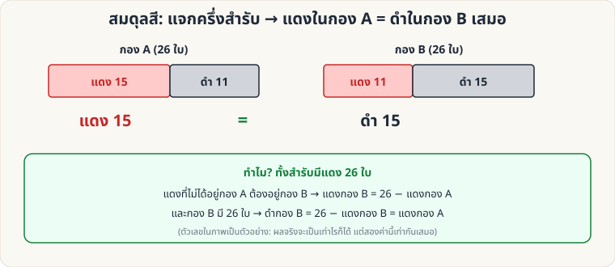

[🏠 หน้าแรก](../Home.md) › [🧮 ไพ่คำนวณ](../Self-Working-Easy.md) › สมดุลสี

# สมดุลสี (Red–Black Balance)

> 🟢 **ระดับง่าย** · 🧮 ไพ่คำนวณ · ⏱ 10 นาที · 🔀 ผู้ชมสับสำรับได้ · 📝 เล่นแบบทำนายได้

<!-- title:สมดุลสี (Red–Black Balance) -->
<!-- body:start -->
**ผลที่ผู้ชมเห็น:** คุณเขียนคำทำนายไว้ ผู้ชมสับสำรับเอง แล้วแบ่งครึ่งสำรับ (26/26) เปิดดู: **จำนวนไพ่แดงในกอง A เท่ากับจำนวนไพ่ดำในกอง B พอดี**

**อุปกรณ์:** สำรับ 52 ใบ (แดง 26, ดำ 26) ผู้ชมสับเองได้เต็มที่

**วิธีทำ**

1. เขียนคำทำนาย: "จำนวนไพ่แดงในกองของคุณ จะเท่ากับจำนวนไพ่ดำในกองของฉัน"
2. ผู้ชม **สับสำรับ** ตามใจ
3. แจก/แบ่งสำรับเป็น **2 กอง กองละ 26 ใบพอดี** (A ให้ผู้ชม, B ให้คุณ)
4. ให้ผู้ชมนับแดงในกอง A และคุณนับดำในกอง B → **เท่ากันเสมอ**

**ทำไมถึงได้ผล:** แดงทั้งหมด 26 ใบ → แดงกอง B = 26 − แดงกอง A และกอง B มี 26 ใบ → ดำกอง B = 26 − แดงกอง B = แดงกอง A

**ข้อควรระวัง:** กองต้อง **26/26 พอดี** (ตรวจแล้ว: ถ้าแบ่งไม่เท่ากันสมการไม่เท่ากัน) · ผลจริงของแต่ละรอบจะต่างกัน แต่สองจำนวนเท่ากันเสมอ
<!-- body:end -->

---

⬅️ [🟢 แยกสีแจกสลับ](sw-easy-alternating-deal.md)  ·  [📋 ไพ่คำนวณ · ระดับง่าย ทั้งหมด](../Self-Working-Easy.md)  ·  [🟢 สี่เหลี่ยมมหัศจรรย์](sw-easy-magic-square.md) ➡️

**กลที่เกี่ยวข้อง:** [🟡 Gilbreath (สีไพ่)](sw-medium-gilbreath.md)
