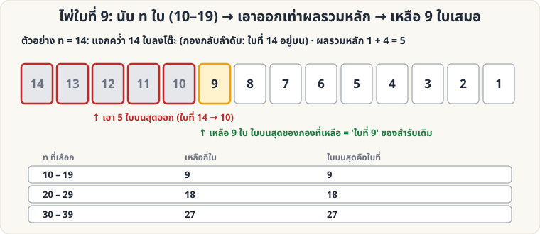

[🏠 หน้าแรก](../Home.md) › [🧮 ไพ่คำนวณ](../Self-Working-Easy.md) › ไพ่ใบที่ 9

# ไพ่ใบที่ 9 (บวกเลขสองหลัก)

> 🟢 **ระดับง่าย** · 🧮 ไพ่คำนวณ · ⏱ 15 นาที · 📝 เล่นแบบทำนายได้

<!-- title:ไพ่ใบที่ 9 (บวกเลขสองหลัก) -->
<!-- body:start -->
**ผลที่ผู้ชมเห็น:** ผู้ชมเลือกเลขเอง (10–19) นับไพ่ลงโต๊ะ แล้วบวกเลขสองหลักของจำนวนนั้น หยิบไพ่ออกตามผลบวก — คุณทายล่วงหน้าได้ว่าไพ่ที่เหลือ **มี 9 ใบเสมอ** และ **ใบบนสุดของกองที่เหลือคือไพ่ที่คุณเขียนไว้**

**อุปกรณ์:** สำรับไพ่ (ไม่ต้องจัดทั้งสำรับ — รู้แค่ไพ่ **ใบที่ 9 จากบนสุด**)

**การเตรียม:** รู้ว่าไพ่ใบที่ 9 จากบนสุดคืออะไร (แอบดูด้วย [Glimpse](sl-easy-glimpse.md) ตอนจัดสำรับ หรือจัดให้ไพ่ที่ผู้ชมเลือกไปอยู่ตำแหน่งที่ 9) แล้วเขียนคำทำนายใส่กระดาษ

**วิธีเล่น**

1. ถือสำรับคว่ำ ให้ผู้ชม **เลือกเลข 10–19** (เช่น 14) โดยไม่บอกคุณ
2. ผู้ชม **แจกไพ่คว่ำลงโต๊ะทีละใบ** เป็นกองเดียวตามจำนวนนั้น (กองจะกลับลำดับ: ใบที่ n อยู่บนสุด)
3. ให้ **บวกเลขสองหลักของจำนวนนั้น** (14 → 1 + 4 = 5) แล้ว **หยิบไพ่จากบนสุดของกองนั้นออก** ตามผลบวก
4. ไพ่ที่เหลือ **มี 9 ใบเสมอ** → เปิดคำทำนาย แล้วเปิดไพ่ใบบนสุดของกองที่เหลือ = **ไพ่ใบที่ 9 เดิม**

**ทำไมถึงได้ผล:** ถ้า n อยู่ในช่วง 10–19 ผลบวกหลัก = n − 9 พอดี → n − (n − 9) = **9 ใบ** ที่เหลืออยู่ล่างสุดของกอง (คือใบที่ 9, 8, …, 1 เดิม) ใบบนสุดจึงเป็นใบที่ 9

| ผู้ชมเลือก n | ไพ่ที่เหลือ | ใบบนสุดของกองที่เหลือ |
|---|---|---|
| 10 – 19 | 9 ใบ | ใบที่ **9** เดิม |
| 20 – 29 | 18 ใบ | ใบที่ **18** เดิม |
| 30 – 39 | 27 ใบ | ใบที่ **27** เดิม |

**ทำนายได้อีกอย่าง:** ใบ **ล่างสุด** ของกองที่เหลือ = ใบ **บนสุดเดิม** ของสำรับ (ใบที่ 1) เสมอ — ทำนายสองใบพร้อมกันได้ (ตรวจแล้วทุก n ตั้งแต่ 10–39)

**ข้อควรระวัง:** กำหนดช่วงเลขให้ชัด (10–19) และให้ผู้ชมแจก **ทีละใบคว่ำลงโต๊ะ** ห้ามตัดหรือสลับสำรับก่อน
<!-- body:end -->

---

⬅️ [🟢 สี่เหลี่ยมมหัศจรรย์](sw-easy-magic-square.md)  ·  [📋 ไพ่คำนวณ · ระดับง่าย ทั้งหมด](../Self-Working-Easy.md)  ·  [🟢 หงายเท่ากัน](sw-easy-equal-faces.md) ➡️

**กลที่เกี่ยวข้อง:** [🟢 ไพ่คีย์](sw-easy-key-card.md) · [🟢 Glimpse](sl-easy-glimpse.md)
