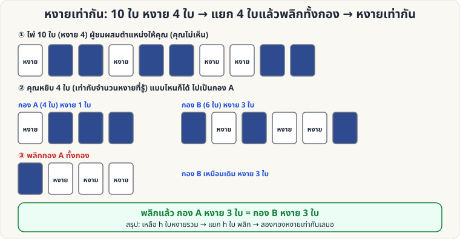

[🏠 หน้าแรก](../Home.md) › [🧮 ไพ่คำนวณ](../Self-Working-Easy.md) › หงายเท่ากัน

# หงายเท่ากัน (แยกกอง แล้วพลิก)

> 🟢 **ระดับง่าย** · 🧮 ไพ่คำนวณ · ⏱ 10 นาที · 🎴 ใช้ไพ่ไม่กี่ใบ

<!-- title:หงายเท่ากัน (แยกกอง แล้วพลิก) -->
<!-- body:start -->
**ผลที่ผู้ชมเห็น:** ไพ่ 10 ใบ หงายอยู่ 4 ใบ ถูกผสมตำแหน่งขณะที่คุณมองไม่เห็น คุณแยกไพ่ 4 ใบ พลิกทั้งกอง — **จำนวนไพ่หงายในสองกองเท่ากันพอดี**

**อุปกรณ์:** ไพ่ 10 ใบ (ใบอะไรก็ได้)

**วิธีเล่น**

1. เรียงไพ่ 10 ใบ **หงาย 4 ใบ คว่ำ 6 ใบ** (ให้ผู้ชมเห็นและจำจำนวนหงาย = 4)
2. คุณ **ปิดตา / หันหลัง / มือซ่อนใต้โต๊ะ** ผู้ชม **ผสมตำแหน่งไพ่** ได้อิสระ (ห้ามพลิกไพ่สักใบ)
3. คุณ **หยิบไพ่ 4 ใบใดก็ได้** (เท่ากับจำนวนหงาย) ไปเป็น **กอง A** ที่เหลือ 6 ใบเป็น **กอง B**
4. **พลิกกอง A ทั้งกอง** (พลิกทุกใบ)
5. เปิดดูทั้งสองกอง → **จำนวนไพ่หงายเท่ากัน**

**ทำไมถึงได้ผล:** ให้กอง A มีหงาย u ใบ (คว่ำ 4 − u) → กอง B ต้องมีหงาย 4 − u ใบ (เพราะหงายรวม 4) หลังพลิกกอง A จะมีหงาย 4 − u ใบ = กอง B เท่ากัน (ตรวจด้วยการสุ่ม 3,000 ชุด จำนวนไพ่ 6–20 ใบ)

**กฎทั่วไป:** มีไพ่หงายรวม **h ใบ** → แยกไพ่ **h ใบ** พลิกทั้งกอง → สองกองหงายเท่ากันเสมอ ไม่ว่าไพ่รวมกี่ใบ

**ลูกเล่น:** ใช้เหรียญหรือไพ่ที่มีสองหน้าต่างกันมาก (แดง/ดำ) ให้ผู้ชมเห็นชัดแต่ยังตื่นเต้น
<!-- body:end -->

---

⬅️ [🟢 ไพ่ใบที่ 9](sw-easy-digit-sum.md)  ·  [📋 ไพ่คำนวณ · ระดับง่าย ทั้งหมด](../Self-Working-Easy.md)  ·  [🟢 ไพ่ 16 ใบ ถาม 4 ครั้ง](sw-easy-sixteen-cards.md) ➡️

**กลที่เกี่ยวข้อง:** [🟢 คว่ำ–หงาย (คู่–คี่)](sw-easy-parity.md)
