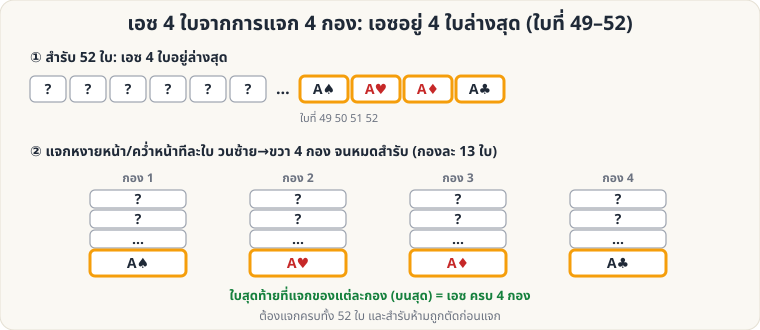

[🏠 หน้าแรก](../Home.md) › [🧮 ไพ่คำนวณ](../Self-Working-Easy.md) › เอซ 4 กอง

# เอซ 4 ใบจากการแจก 4 กอง

> 🟢 **ระดับง่าย** · 🧮 ไพ่คำนวณ · ⏱ 10 นาที · 🔧 ต้องจัดสำรับล่วงหน้า

<!-- title:เอซ 4 ใบจากการแจก 4 กอง -->
<!-- body:start -->
**ผลที่ผู้ชมเห็น:** ผู้ชมแจกไพ่ลงโต๊ะเป็น 4 กอง จนหมดสำรับ แล้วเปิดใบบนสุดของแต่ละกอง ก็ได้ **เอซครบ 4 ใบ** ราวกับถูกเรียกมา

**อุปกรณ์:** สำรับ 52 ใบ จัดให้ **เอซ 4 ใบอยู่ล่างสุด** (ใบที่ 49–52, เรียงดอกไหนก็ได้)

**วิธีเล่น**

1. ถือสำรับที่จัดเอซไว้ล่างสุด พูดบทเปิดเรื่องเอซ (เช่น "เอซคือผู้นำของไพ่")
2. ยื่นสำรับให้ผู้ชม แล้วบอกให้ **แจกไพ่ทีละใบ** ลงโต๊ะเป็น **4 กอง** วนซ้าย → ขวา จนหมดสำรับ
3. ใบสุดท้ายที่แจก (ใบที่ 49–52) ตกเป็นใบ **บนสุด** ของ 4 กองพอดี
4. ให้ผู้ชมหยิบ "ใบบนสุด" ของแต่ละกองขึ้นมาเปิด → **เอซครบ 4 ใบ**

**ข้อควรระวัง**

- สำรับ **ห้ามตัดและห้ามสับ** ก่อนแจก (ตัดผิดจุดเอซจะไม่ตกที่ใบบนสุด)
- ต้องแจกให้ครบ **ทั้ง 52 ใบ** (จำนวนต้องหาร 4 ลงตัว)
- เพราะแจกแล้วเห็นเอซง่ายมาก ให้ **เบี่ยงเบนความสนใจ** ด้วยการพูด/ให้ผู้ชมเลือก "กองโปรด" ก่อนเปิด

**ต่อยอด:** ถ้าเอซอยู่ **บนสุด** 4 ใบ ให้ใช้ [Overhand Shuffle](sl-easy-overhand.md) ดึงเอซออกมา **ทีละใบ 4 ครั้งแรก** แล้วสับส่วนที่เหลือต่อ เอซจะลงไปอยู่ล่างสุดให้เล่นกลนี้ได้
<!-- body:end -->

---

⬅️ [🟢 ไพ่สะกดชื่อ](sw-easy-spelling.md)  ·  [📋 ไพ่คำนวณ · ระดับง่าย ทั้งหมด](../Self-Working-Easy.md)  ·  [🟢 คว่ำ–หงาย (คู่–คี่)](sw-easy-parity.md) ➡️

**กลที่เกี่ยวข้อง:** [🟡 โป๊กเกอร์ดีล](sw-medium-poker-deal.md) · [🟢 Overhand Shuffle](sl-easy-overhand.md)
