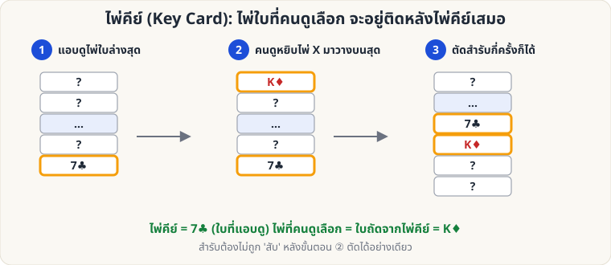

[🏠 หน้าแรก](../Home.md) › [🧮 ไพ่คำนวณ](../Self-Working-Easy.md) › ไพ่คีย์

# ไพ่คีย์ (Key Card)

> 🟢 **ระดับง่าย** · 🧮 ไพ่คำนวณ · ⏱ 10 นาที

<!-- title:ไพ่คีย์ (Key Card) -->
<!-- body:start -->
**ผลที่ผู้ชมเห็น:** ผู้ชมเลือกไพ่หนึ่งใบ เสียบกลับในสำรับ ตัดสำรับ แล้วคุณทายไพ่ได้

**อุปกรณ์:** สำรับไพ่ 1 สำรับ

**วิธีทำ**

1. **แอบดูไพ่ใบล่างสุด** ของสำรับ (เช่น 7♣) นี่คือ *ไพ่คีย์* ดูได้ตอนเคาะสำรับให้เรียบ (ดู [Glimpse](sl-easy-glimpse.md))
2. ให้ผู้ชมดึงไพ่ 1 ใบจากสำรับ (X) ดูแล้วจำ
3. ให้ผู้ชมวาง **X ลงบนสุดของสำรับ**
4. ให้ผู้ชม **ตัดสำรับ** กี่ครั้งก็ได้ (ห้ามสับ)
5. ถึงตอนนี้ไพ่คีย์อยู่ **ติดข้างบน X เสมอ** (ลำดับ ...7♣, X...) เพราะการตัดสำรับเพียงย้ายจุดตัด แต่ลำดับวนต่อกัน
6. หงายไพ่เรียงทีละใบ เมื่อเจอ 7♣ ใบถัดไปคือไพ่ของผู้ชม

**ทำให้ดีขึ้น**

- อย่าเปิดเผยทันที: เปิดไพ่ขึ้นมาทีละใบ "อ่านใจ" แล้วหยุดที่ใบที่ต้องการ
- เปลี่ยนแนวการเปิดเผย เช่น วางไพ่คีย์ติดโต๊ะ แล้วให้ผู้ชมบอกชื่อไพ่เอง
- ผู้ชมต้อง **ตัดอย่างเดียว ห้ามสับ** ถ้าอยากให้สับได้จริง ให้ดู [Gilbreath](sw-medium-gilbreath.md) หรือ [Si Stebbins](sw-medium-stebbins.md)
<!-- body:end -->

---

[📋 ไพ่คำนวณ · ระดับง่าย ทั้งหมด](../Self-Working-Easy.md)  ·  [🟢 ไพ่ 9 ใบ](sw-easy-nine-cards.md) ➡️

**กลที่เกี่ยวข้อง:** [🟢 Glimpse](sl-easy-glimpse.md) · [🟡 Si Stebbins Stack](sw-medium-stebbins.md) · [🟢 ไพ่ 9 ใบ](sw-easy-nine-cards.md)
