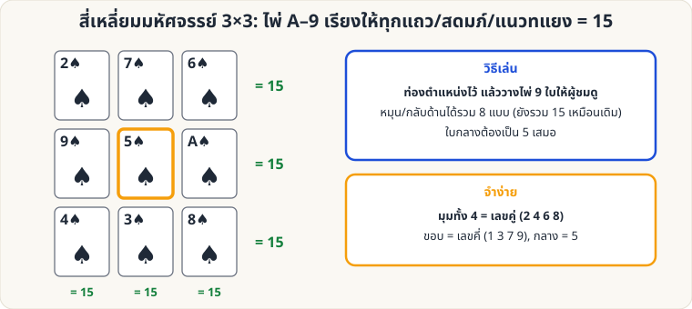

[🏠 หน้าแรก](../Home.md) › [🧮 ไพ่คำนวณ](../Self-Working-Easy.md) › สี่เหลี่ยมมหัศจรรย์

# สี่เหลี่ยมมหัศจรรย์ (ผลรวม 15)

> 🟢 **ระดับง่าย** · 🧮 ไพ่คำนวณ · ⏱ 20 นาที · 🎴 ใช้ไพ่ไม่กี่ใบ · 🧠 ต้องท่องจำ

<!-- title:สี่เหลี่ยมมหัศจรรย์ (ผลรวม 15) -->
<!-- body:start -->
**ผลที่ผู้ชมเห็น:** ไพ่ A–9 วางเป็นตาราง 3×3 ผู้ชมเลือกแถว สดมภ์ หรือแนวทแยงใดก็ได้ เปิดไพ่ แล้ว **ผลรวม 15 ทุกครั้ง**

**อุปกรณ์:** ไพ่ดอกเดียว A–9 (9 ใบ)



**การวาง (บนซ้าย → ล่างขวา)**

```
2  7  6
9  5  1
4  3  8
```

**วิธีเล่น**

1. วางไพ่ **คว่ำหน้า** ตามตารางข้างบน (ท่องตำแหน่งไว้ล่วงหน้า)
2. ผู้ชมเลือกเส้นใดก็ได้ใน 8 เส้น (3 แถว, 3 สดมภ์, 2 แนวทแยง) → เปิดไพ่ 3 ใบ บวกกัน = **15**
3. ผลรวมอีกแบบ: ไพ่ 3 ใบที่ผ่านใบกลาง (5) ทุกเส้น รวม 15 เสมอ

**ท่องจำ:** มุมทั้ง 4 เป็นเลขคู่ (2, 6, 4, 8), กลาง = 5, ขอบเป็นเลขคี่ (7, 9, 3, 1) — หมุนหรือกลับด้านตารางได้อีก 7 แบบ ยังรวม 15 เหมือนเดิม
<!-- body:end -->

---

⬅️ [🟢 สมดุลสี](sw-easy-color-balance.md)  ·  [📋 ไพ่คำนวณ · ระดับง่าย ทั้งหมด](../Self-Working-Easy.md)  ·  [🟢 ไพ่ใบที่ 9](sw-easy-digit-sum.md) ➡️

**กลที่เกี่ยวข้อง:** [🟡 Binary Cards](sw-medium-binary-cards.md)
