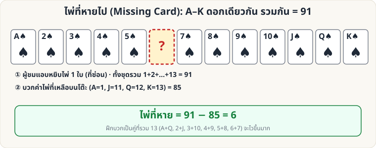

[🏠 หน้าแรก](../Home.md) › [🧮 ไพ่คำนวณ](../Self-Working-Easy.md) › ไพ่ที่หายไป

# ไพ่ที่หายไป (Missing Card)

> 🟢 **ระดับง่าย** · 🧮 ไพ่คำนวณ · ⏱ 15 นาที · 🎴 ใช้ไพ่ไม่กี่ใบ · 🔢 มีการคำนวณ

<!-- title:ไพ่ที่หายไป (Missing Card) -->
<!-- body:start -->
**ผลที่ผู้ชมเห็น:** ผู้ชมแอบหยิบไพ่ 1 ใบออกจากชุดไพ่ที่เรียงอยู่ คุณแค่กวาดตาดูไพ่ที่เหลือ ก็บอกได้ทันทีว่าใบที่หายคืออะไร

**อุปกรณ์:** ไพ่ดอกเดียวกัน A ถึง K (13 ใบ)

**วิธีทำ**

1. วางไพ่ 13 ใบให้ผู้ชมดู ให้หลับตา/หันหลัง แล้วผู้ชม **หยิบไพ่ 1 ใบ** ซ่อนไว้ (หรือคุณเก็บใส่กระเป๋าผู้ชม)
2. คุณกวาดดูไพ่ที่เหลือ **บวกค่า** (A=1, J=11, Q=12, K=13)
3. **ไพ่ที่หายไป = 91 − ผลรวมที่ได้** (เพราะ 1+2+…+13 = 91)

**บวกให้เร็ว:** จับคู่ที่รวม 13 — A+Q, 2+J, 3+10, 4+9, 5+8, 6+7 (เหลือ K ใบเดียว) ให้ **ลบทีละคู่ที่ครบ** ใบที่ไม่มีคู่ = ใบที่หาย

**ต่อยอด:** ใช้ทั้งสำรับ: แยก 4 ดอกเป็น 4 แถว ให้ผู้ชมหยิบไพ่ 1 ใบ — ดอกที่แถวขาดไปคือดอกของใบที่หาย แล้วใช้สูตรเดิมหาเลข
<!-- body:end -->

---

⬅️ [🟢 คว่ำ–หงาย (คู่–คี่)](sw-easy-parity.md)  ·  [📋 ไพ่คำนวณ · ระดับง่าย ทั้งหมด](../Self-Working-Easy.md)  ·  [🟢 เลขลับจากไพ่](sw-easy-secret-number.md) ➡️

**กลที่เกี่ยวข้อง:** [🟢 เลขลับจากไพ่](sw-easy-secret-number.md) · [🔴 เศษหาร 9](sw-hard-mod9.md)
