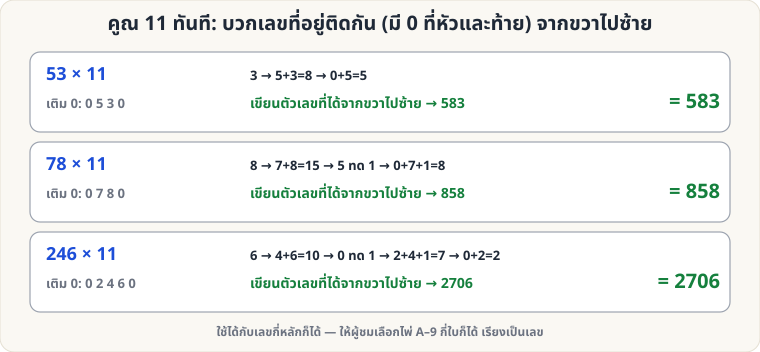

[🏠 หน้าแรก](../Home.md) › [🧮 ไพ่คำนวณ](../Self-Working-Easy.md) › คูณ 11 ทันที

# คูณ 11 ทันที

> 🟢 **ระดับง่าย** · 🧮 ไพ่คำนวณ · ⏱ 15 นาที · 🎴 ใช้ไพ่ไม่กี่ใบ · 🔢 มีการคำนวณ

<!-- title:คูณ 11 ทันที -->
<!-- body:start -->
**ผลที่ผู้ชมเห็น:** ผู้ชมเรียงไพ่ A–9 เป็นเลขกี่หลักก็ได้ คุณบอกผลคูณกับ 11 **ทันที** ไม่ต้องใช้เครื่องคิดเลข

**อุปกรณ์:** ไพ่ A–9 (A = 1) กี่ใบก็ได้

**วิธีคำนวณ**

1. เติม **0 ไว้หน้าและหลัง** เลขของผู้ชม เช่น 53 → `0 5 3 0`
2. เริ่มจาก **ขวา** บวก **เลขที่อยู่ติดกัน** ทีละคู่ เขียนผลหลักหน่วยของแต่ละคู่ (ถ้าเกิน 9 ให้ **ทด 1** ไปคู่ถัดไป)
   - 53 × 11: 3 → 5+3 = 8 → 0+5 = 5 → **583**
   - 78 × 11: 8 → 7+8 = 15 (เขียน 5 ทด 1) → 0+7+1 = 8 → **858**
   - 246 × 11: 6 → 4+6 = 10 (เขียน 0 ทด 1) → 2+4+1 = 7 → 0+2 = 2 → **2706**
3. ถ้าคู่ซ้ายสุดยังมีส่วนทด ให้เขียนหน้าสุดอีกหนึ่งหลัก (เช่น 99 × 11 = 1089)

**ทำไมถึงได้ผล:** เลข × 11 = เลข × 10 + เลข → เลื่อนหนึ่งหลักแล้วบวกกับตัวเอง ได้เป็นผลบวกของหลักที่ติดกันพอดี (ตรวจกับเลขสุ่มยาว 1–6 หลัก 2,000 ตัวแล้ว)

**ลูกเล่น:** ให้ผู้ชมใช้เครื่องคิดเลข แล้วคุณบอกผลก่อนกด "=" · หรือเชื่อมกับ [เลข 1089](sw-medium-1089.md) (99 × 11 = 1089)
<!-- body:end -->

---

⬅️ [🟢 สี่เหลี่ยม A K Q J](sw-easy-akqj-square.md)  ·  [📋 ไพ่คำนวณ · ระดับง่าย ทั้งหมด](../Self-Working-Easy.md)  ·  [🟡 ไพ่ 21 ใบ](sw-medium-21-cards.md) ➡️

**กลที่เกี่ยวข้อง:** [🟡 เลข 1089](sw-medium-1089.md)
