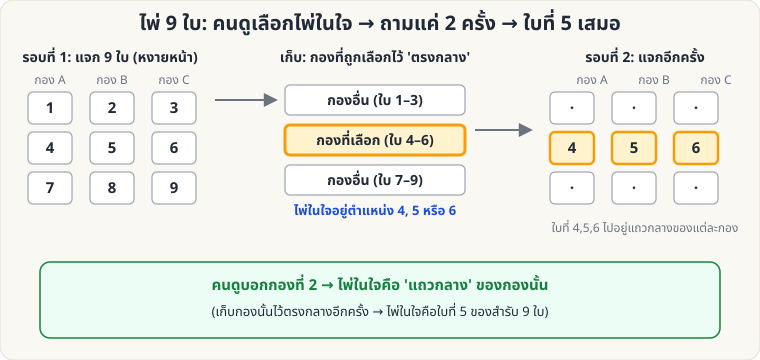

[🏠 หน้าแรก](../Home.md) › [🧮 ไพ่คำนวณ](../Self-Working-Easy.md) › ไพ่ 9 ใบ

# ไพ่ 9 ใบ (Nine-Card Mind Reading)

> 🟢 **ระดับง่าย** · 🧮 ไพ่คำนวณ · ⏱ 10 นาที · 🔀 ผู้ชมสับสำรับได้ · 🎴 ใช้ไพ่ไม่กี่ใบ

<!-- title:ไพ่ 9 ใบ (Nine-Card Mind Reading) -->
<!-- body:start -->
**ผลที่ผู้ชมเห็น:** ผู้ชมคิดไพ่ในใจจาก 9 ใบ คุณถามแค่ว่า "อยู่กองไหน" 2 ครั้ง ก็หาไพ่เจอ

**อุปกรณ์:** ไพ่ 9 ใบ (ใบอะไรก็ได้ ไม่ซ้ำ)

**วิธีทำ**

1. แจกไพ่หงายหน้า 9 ใบ เป็น 3 กอง (A, B, C) แจกทีละใบวนไป จะได้กองละ 3 ใบ
2. ให้ผู้ชมคิดไพ่ 1 ใบในใจ และบอกว่าอยู่กองไหน
3. **เก็บไพ่:** วางกองที่ผู้ชมบอก **ไว้ตรงกลาง** ระหว่างอีก 2 กอง (อีก 2 กองอยู่บนและล่าง) เก็บแต่ละกองโดยไม่สลับลำดับไพ่ภายในกอง
4. แจกไพ่หงายหน้าอีกรอบเป็น 3 กอง ให้ผู้ชมบอกกองอีกครั้ง
5. ไพ่ในใจคือ **ใบแถวกลาง** (ใบที่ 2 จาก 3 ใบ) ของกองที่ผู้ชมบอก
   - (ถ้าเก็บกองนั้นไว้ตรงกลางอีกครั้ง ไพ่ในใจจะเป็น **ใบที่ 5** ของสำรับ 9 ใบ — ใช้เปิดเผยทีละใบได้)

**ทำไมถึงได้ผล**

รอบแรก ไพ่ในใจต้องอยู่ที่ตำแหน่ง 4–6 (กองกลาง) แจกรอบ 2 ใบที่ 4, 5, 6 จะตกไปอยู่ **แถวกลาง** ของ 3 กองพอดี (กองละใบ) ดังนั้นพอรู้กอง ก็รู้ไพ่

**ต่อยอด:** เมื่อเข้าใจหลักแล้ว ไปเล่น [ไพ่ 21 ใบ](sw-medium-21-cards.md) ซึ่งใช้หลักเดียวกันกับสำรับที่ใหญ่ขึ้น
<!-- body:end -->

---

⬅️ [🟢 ไพ่คีย์](sw-easy-key-card.md)  ·  [📋 ไพ่คำนวณ · ระดับง่าย ทั้งหมด](../Self-Working-Easy.md)  ·  [🟢 ไพ่สะกดชื่อ](sw-easy-spelling.md) ➡️

**กลที่เกี่ยวข้อง:** [🟡 ไพ่ 21 ใบ](sw-medium-21-cards.md) · [🟡 ไพ่ 27 ใบ](sw-medium-27-cards.md)
