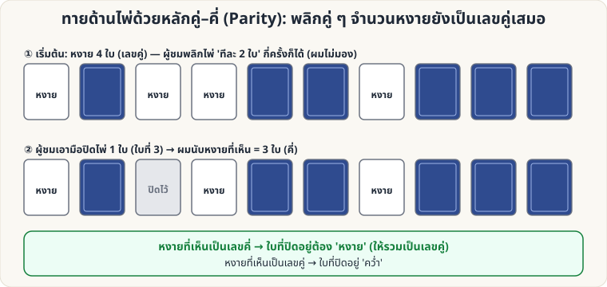

[🏠 หน้าแรก](../Home.md) › [🧮 ไพ่คำนวณ](../Self-Working-Easy.md) › คว่ำ–หงาย (คู่–คี่)

# ทายด้านไพ่ด้วยหลักคู่–คี่ (Parity)

> 🟢 **ระดับง่าย** · 🧮 ไพ่คำนวณ · ⏱ 15 นาที · 🎴 ใช้ไพ่ไม่กี่ใบ · 🔢 มีการคำนวณ

<!-- title:ทายด้านไพ่ด้วยหลักคู่–คี่ (Parity) -->
<!-- body:start -->
**ผลที่ผู้ชมเห็น:** ไพ่ 10 ใบคว่ำ/หงายปะปน ผู้ชมพลิกไพ่ "ทีละ 2 ใบ" หลายครั้ง ขณะที่คุณ **ไม่มอง** จากนั้นผู้ชมเอามือปิดไพ่ 1 ใบ แต่คุณบอกได้ว่าใบที่ปิด **คว่ำหรือหงาย**

**อุปกรณ์:** ไพ่ 10 ใบ (ใบอะไรก็ได้)

**วิธีเล่น**

1. วางไพ่ 10 ใบเป็นแถวบนโต๊ะ ให้ **หงาย 4 ใบ** (หรือจำนวนคู่ใดก็ได้ เช่น 0, 2, 4, …) ที่เหลือคว่ำ
2. บอกผู้ชมว่า "ฉันจะหันหลัง ให้คุณ **พลิกไพ่ครั้งละ 2 ใบ** เมื่อไรก็ได้ กี่รอบก็ได้ เสร็จแล้วบอกฉัน"
3. หันกลับมา ผู้ชม **เอามือปิดไพ่ 1 ใบ** (ใบไหนก็ได้)
4. คุณนับ **ไพ่หงายที่เห็น**:
   - เป็น **เลขคี่** → ใบที่ปิดอยู่ **หงาย**
   - เป็น **เลขคู่** → ใบที่ปิดอยู่ **คว่ำ**

**ทำไมถึงได้ผล:** การพลิก 2 ใบ ทำให้จำนวนไพ่หงายเปลี่ยนทีละ −2, 0 หรือ +2 → **ความเป็นคู่/คี่ของจำนวนไพ่หงายไม่เปลี่ยน** จึงเป็นเลขคู่ตลอด ถ้าจำนวนที่เห็นเป็นคี่ ใบที่ปิดต้องหงายเพื่อให้รวมเป็นคู่

**ต่อยอด**

- ปิดไพ่ได้ **หลายใบ** (เห็นเฉพาะที่เหลือ) ก็ทายได้ แค่รู้ว่า "ใบที่ปิดรวมกัน" มีหงายจำนวนคู่หรือคี่
- ใช้ไพ่ 13 ใบ หรือ 12 ใบได้ — ต้องให้จำนวนหงายตอนเริ่มเป็นเลขคู่
- ใช้สีไพ่แทน: คว่ำ = "สีดำ", หงาย = "สีแดง" ในบทพูด ฯลฯ
<!-- body:end -->

---

⬅️ [🟢 เอซ 4 กอง](sw-easy-four-aces.md)  ·  [📋 ไพ่คำนวณ · ระดับง่าย ทั้งหมด](../Self-Working-Easy.md)  ·  [🟢 ไพ่ที่หายไป](sw-easy-missing-card.md) ➡️

**กลที่เกี่ยวข้อง:** [🟢 ไพ่ที่หายไป](sw-easy-missing-card.md)
