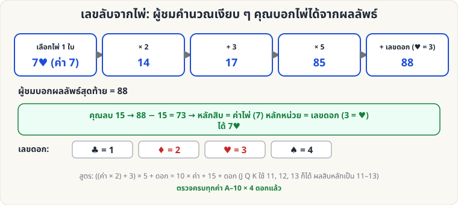

[🏠 หน้าแรก](../Home.md) › [🧮 ไพ่คำนวณ](../Self-Working-Easy.md) › เลขลับจากไพ่

# เลขลับจากไพ่ (คูณ 2 บวก 3 คูณ 5)

> 🟢 **ระดับง่าย** · 🧮 ไพ่คำนวณ · ⏱ 15 นาที · 🔀 ผู้ชมสับสำรับได้ · 🔢 มีการคำนวณ

<!-- title:เลขลับจากไพ่ (คูณ 2 บวก 3 คูณ 5) -->
<!-- body:start -->
**ผลที่ผู้ชมเห็น:** ผู้ชมเลือกไพ่ 1 ใบ คำนวณตามขั้นตอนในใจ แล้วบอกเลขสุดท้าย — คุณบอกได้ว่าเป็นไพ่ใบไหน

**ขั้นตอนที่ให้ผู้ชมทำ (ในใจ หรือกดเครื่องคิดเลข)**

1. เลือกไพ่ 1 ใบ จำ **ค่าไพ่** (A=1, 2–10 ตามเลข, J=11, Q=12, K=13)
2. **คูณ 2** → **บวก 3** → **คูณ 5**
3. **บวก "เลขดอก"** (♣ = 1, ♦ = 2, ♥ = 3, ♠ = 4)
4. บอกผลลัพธ์

**คุณถอดรหัส:** **ลบ 15** → ส่วนหน้า = **ค่าไพ่**, หลักหน่วย = **ดอก** เช่น 88 → 73 → ค่า 7, ดอก 3 → **7♥**

**ทำไมถึงได้ผล:** ((ค่า × 2) + 3) × 5 + ดอก = 10 × ค่า + 15 + ดอก (ตรวจครบทุกค่า A–10 และทั้ง 4 ดอกแล้ว)
<!-- body:end -->

---

⬅️ [🟢 ไพ่ที่หายไป](sw-easy-missing-card.md)  ·  [📋 ไพ่คำนวณ · ระดับง่าย ทั้งหมด](../Self-Working-Easy.md)  ·  [🟢 แยกสีแจกสลับ](sw-easy-alternating-deal.md) ➡️

**กลที่เกี่ยวข้อง:** [🟡 เลข 1089](sw-medium-1089.md) · [🔴 เศษหาร 9](sw-hard-mod9.md)
