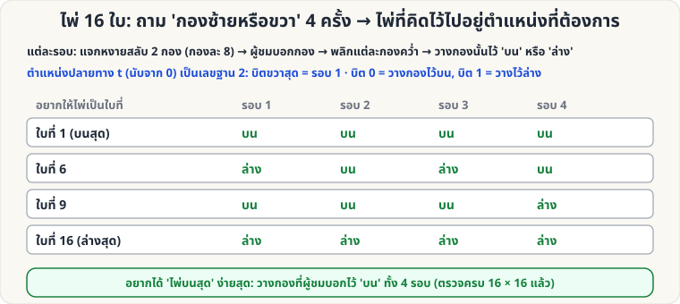

[🏠 หน้าแรก](../Home.md) › [🧮 ไพ่คำนวณ](../Self-Working-Easy.md) › ไพ่ 16 ใบ ถาม 4 ครั้ง

# ไพ่ 16 ใบ: ถามใช่/ไม่ใช่ 4 ครั้ง

> 🟢 **ระดับง่าย** · 🧮 ไพ่คำนวณ · ⏱ 20 นาที · 🔀 ผู้ชมสับสำรับได้ · 🎴 ใช้ไพ่ไม่กี่ใบ · 🔢 มีการคำนวณ

<!-- title:ไพ่ 16 ใบ: ถามใช่/ไม่ใช่ 4 ครั้ง -->
<!-- body:start -->
**ผลที่ผู้ชมเห็น:** ผู้ชมคิดไพ่ในใจจาก 16 ใบ ตอบเพียงว่า "อยู่กองซ้ายหรือขวา" 4 ครั้ง — ไพ่ที่คิดไว้ไปอยู่ **บนสุด** (หรือตำแหน่งที่คุณต้องการ)

**อุปกรณ์:** ไพ่ 16 ใบ (สุ่มจากสำรับ)

**ขั้นตอนต่อรอบ (ทำ 4 รอบ)**

1. ถือไพ่ 16 ใบ **คว่ำหน้า** แจก **หงายหน้าทีละใบ** สลับลง 2 กอง (กองซ้าย/ขวา กองละ 8 ใบ)
2. ผู้ชมบอกว่าไพ่ในใจอยู่ **กองไหน**
3. **พลิกแต่ละกองคว่ำทั้งก้อน** (ไพ่ที่แจกก่อนอยู่บน) แล้วซ้อนกองสองกอง โดยวางกองที่ผู้ชมบอก **ไว้ "บน" หรือ "ล่าง"** ตามที่ต้องการ

**อยากได้ไพ่บนสุด:** วางกองที่ผู้ชมบอกไว้ **บน** ทั้ง 4 รอบ → ไพ่อยู่ใบแรกพอดี

**อยากให้ไพ่เป็นใบที่ N:** ให้ t = N − 1 เขียนเป็นเลขฐาน 2 (4 หลัก) → **บิตขวาสุดคือรอบ 1** บิต 0 = วางกองไว้บน, บิต 1 = วางไว้ล่าง เช่น ใบที่ 6 (t = 5 = 0101₂) → ล่าง, บน, ล่าง, บน

**ตรวจแล้ว:** จำลองทุกตำแหน่งเริ่มต้น (16) × ทุกตำแหน่งปลายทาง (16) ไพ่ไปถึงตำแหน่งที่ต้องการเสมอ

**ต่อยอด:** เป็นกรณีพิเศษ n = 2 ของ [สูตร n กอง k รอบ](sw-hard-base-n.md) — เปรียบเทียบกับ [ไพ่ 9 ใบ](sw-easy-nine-cards.md) และ [ไพ่ 27 ใบ](sw-medium-27-cards.md)
<!-- body:end -->

---

⬅️ [🟢 หงายเท่ากัน](sw-easy-equal-faces.md)  ·  [📋 ไพ่คำนวณ · ระดับง่าย ทั้งหมด](../Self-Working-Easy.md)  ·  [🟢 สี่เหลี่ยม A K Q J](sw-easy-akqj-square.md) ➡️

**กลที่เกี่ยวข้อง:** [🟢 ไพ่ 9 ใบ](sw-easy-nine-cards.md) · [🟡 ไพ่ 27 ใบ](sw-medium-27-cards.md) · [🔴 สูตร n กอง k รอบ](sw-hard-base-n.md)
