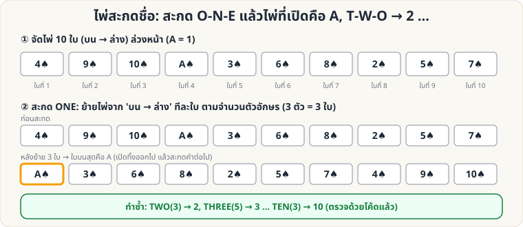

[🏠 หน้าแรก](../Home.md) › [🧮 ไพ่คำนวณ](../Self-Working-Easy.md) › ไพ่สะกดชื่อ

# ไพ่สะกดชื่อ (Spelling Trick)

> 🟢 **ระดับง่าย** · 🧮 ไพ่คำนวณ · ⏱ 15 นาที · 🔧 ต้องจัดสำรับล่วงหน้า · 🎴 ใช้ไพ่ไม่กี่ใบ

<!-- title:ไพ่สะกดชื่อ (Spelling Trick) -->
<!-- body:start -->
**ผลที่ผู้ชมเห็น:** คุณสะกด "O-N-E" แล้วเปิดไพ่ได้ **A** สะกด "T-W-O" เปิดได้ **2** … ไล่ไปถึง **10** โดยไม่พลาดสักครั้ง

**อุปกรณ์:** ไพ่ 10 ใบ (A ถึง 10 ดอกเดียวกันก็ได้ ให้ดูสวย) จัดเรียงล่วงหน้า



**การจัดสำรับ (บน → ล่าง, คว่ำหน้า)**

```
4  9  10  A  3  6  8  2  5  7
```

**วิธีเล่น**

1. ถือไพ่ 10 ใบคว่ำหน้า สะกดคำว่า **O-N-E** โดย **ย้ายไพ่จากบนสุดไปไว้ล่างสุดทีละใบ ตามตัวอักษร** (3 ตัว = 3 ใบ)
2. **หงายไพ่ใบบนสุดของกองที่เหลือ** → เป็น **A** วางทิ้งไว้บนโต๊ะ (หงายหน้า)
3. สะกด **T-W-O** (3 ใบ) แล้วหงายใบบนสุด → **2**
4. ทำต่อ: THREE (5) → 3, FOUR (4) → 4, FIVE (4) → 5, SIX (3) → 6, SEVEN (5) → 7, EIGHT (5) → 8, NINE (4) → 9, TEN (3) → 10

**ทำไมถึงได้ผล:** ลำดับข้างต้นคำนวณย้อนกลับจากขั้นตอนการสะกดโดยตรง สคริปต์ [`tools/verify_tricks.py`](../tools/verify_tricks.py) จำลองให้ครบทุกคำแล้ว

**ต่อยอด**

- เปลี่ยนจำนวนใบ/คำสะกด (เช่น สะกดชื่อไพ่เต็ม "ACE OF SPADES") ได้ โดยแก้ `WORDS` ในสคริปต์เพื่อคำนวณลำดับใหม่
- เล่นแบบ "เสี่ยงทาย": ให้ผู้ชมเลือกคำที่จะสะกด ด้วยการหยุดที่ชุด A–10 ที่คุณจัดไว้หลายสำรับ
- ท่าทางต้องไม่เร็วเกินไปจนดูเหมือนจำ ใส่ "เสียงสะกดแบบดราม่า" ทุกตัวอักษร
<!-- body:end -->

---

⬅️ [🟢 ไพ่ 9 ใบ](sw-easy-nine-cards.md)  ·  [📋 ไพ่คำนวณ · ระดับง่าย ทั้งหมด](../Self-Working-Easy.md)  ·  [🟢 เอซ 4 กอง](sw-easy-four-aces.md) ➡️

**กลที่เกี่ยวข้อง:** [🟢 เอซ 4 กอง](sw-easy-four-aces.md)
