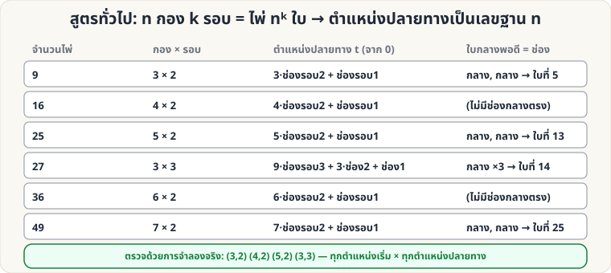

[🏠 หน้าแรก](../Home.md) › [🧮 ไพ่คำนวณ](../Self-Working-Hard.md) › สูตร n กอง k รอบ

# สูตรทั่วไป: n กอง k รอบ

> 🔴 **ระดับยาก** · 🧮 ไพ่คำนวณ · ⏱ 1 ชั่วโมง · 🔀 ผู้ชมสับสำรับได้ · 🔢 มีการคำนวณ

<!-- title:สูตรทั่วไป: n กอง k รอบ -->
<!-- body:start -->
หน้า [ไพ่ 9 ใบ](sw-easy-nine-cards.md), [25 ใบ](sw-medium-25-cards.md), [27 ใบ](sw-medium-27-cards.md) ใช้หลักเดียวกัน: สำรับ **nᵏ ใบ** แจก **n กอง** ทำ **k รอบ** ตำแหน่งปลายทางคือเลขฐาน n



**ตำแหน่งปลายทาง** t (จาก 0) = ช่องรอบ 1 + n · ช่องรอบ 2 + n² · ช่องรอบ 3 + … (ช่อง 0 = บน, n−1 = ล่าง)

**ตัวอย่างเขียนด้วยโค้ด (ให้คำนวณช่องแต่ละรอบ)**

```python
def slots(target_position, n, k):
    t = target_position - 1
    return [(t // n**i) % n for i in range(k)]   # ตัวแรก = ช่องรอบ 1

print(slots(14, 3, 3))   # [1, 1, 1]  → กลาง กลาง กลาง
print(slots(25, 7, 2))   # [3, 3]     → ช่อง 3 ทั้งสองรอบ (กลางพอดีของ 7 กอง)
```

**ตารางขนาดสำรับที่ใช้ได้ (n² ≤ 52):** 9 (3×2), 16 (4×2), 25 (5×2), 36 (6×2), 49 (7×2), 27 (3×3) — ถ้ามีไพ่ไม่พอ ให้ใช้ไพ่ส่วนบนของสำรับตามจำนวนที่ต้องการ

**ตรวจแล้ว:** (3,2), (4,2), (5,2), (3,3) ทุกตำแหน่งเริ่ม × ทุกตำแหน่งปลายทาง
<!-- body:end -->

---

⬅️ [🔴 Josephus Shuffle](sw-hard-josephus.md)  ·  [📋 ไพ่คำนวณ · ระดับยาก ทั้งหมด](../Self-Working-Hard.md)  ·  [🔴 Stebbins ย้อนกลับ](sw-hard-stebbins-crt.md) ➡️

**กลที่เกี่ยวข้อง:** [🟡 ไพ่ 27 ใบ](sw-medium-27-cards.md) · [🟡 ไพ่ 25 ใบ](sw-medium-25-cards.md)
