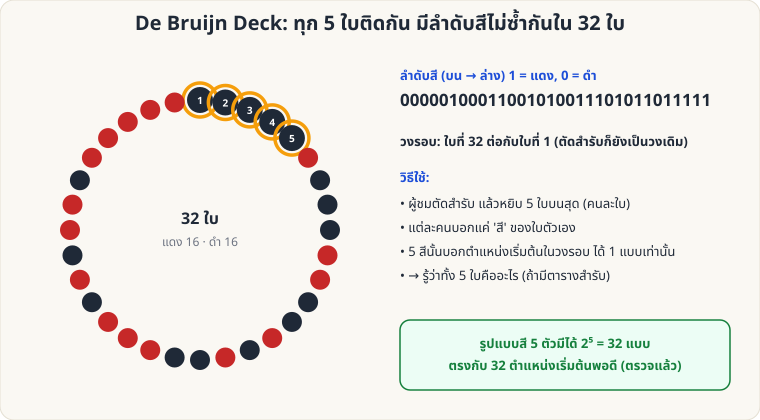

[🏠 หน้าแรก](../Home.md) › [🧮 ไพ่คำนวณ](../Self-Working-Hard.md) › De Bruijn Deck

# De Bruijn Deck (ไพ่ 32 ใบ สีเป็นรหัส)

> 🔴 **ระดับยาก** · 🧮 ไพ่คำนวณ · ⏱ 1–2 สัปดาห์ · 🔧 ต้องจัดสำรับล่วงหน้า · 🧠 ต้องท่องจำ

<!-- title:De Bruijn Deck (ไพ่ 32 ใบ สีเป็นรหัส) -->
<!-- body:start -->
**ผลที่ผู้ชมเห็น:** ผู้ชมตัดสำรับ แล้วให้ 5 คนหยิบไพ่ใบบนสุดคนละใบ ทุกคนบอกแค่ **สี (แดง/ดำ)** ของไพ่ตัวเอง — คุณบอกได้ว่า **ไพ่ของทุกคนคือใบไหน**

**อุปกรณ์:** สำรับ 32 ใบ (7, 8, 9, 10, J, Q, K, A ทั้ง 4 ดอก) จัดเรียงตามลำดับ De Bruijn



**หลักการ:** เรียงไพ่แดง/ดำเป็นวงรอบ 32 ใบ โดยที่ **ทุกชุด 5 ใบที่อยู่ติดกัน มีลำดับสีไม่ซ้ำกันเลย** (มี 2⁵ = 32 แบบพอดี) เมื่อผู้ชมตัดสำรับ (วงรอบไม่เปลี่ยน) และบอกสี 5 ใบแรก คุณจะรู้ตำแหน่งเริ่มต้น และรู้ทุกใบ

**ลำดับสี (บน → ล่าง; 1 = แดง, 0 = ดำ)**

```
00000100011001010011101011011111
```

**ลำดับไพ่ที่ใช้ (บน → ล่าง)**

```
 1:7♠  2:7♣  3:8♠  4:8♣  5:9♠  6:7♥  7:9♣  8:10♠
 9:10♣ 10:7♦ 11:8♥ 12:J♠ 13:J♣ 14:8♦ 15:Q♠ 16:9♥
17:Q♣ 18:K♠ 19:9♦ 20:10♥ 21:10♦ 22:K♣ 23:J♥ 24:A♠
25:J♦ 26:Q♥ 27:A♣ 28:Q♦ 29:K♥ 30:K♦ 31:A♥ 32:A♦
```

**วิธีเล่น**

1. จัดสำรับตามลำดับด้านบน (ท่องหรือมีบัตรสรุปซ่อนไว้)
2. ให้ผู้ชมตัดสำรับกี่ครั้งก็ได้ (**ห้ามสับ**) แล้วหยิบไพ่ **5 ใบบนสุด** แจก 5 คน (คนละใบ ตามลำดับ)
3. แต่ละคนบอกเพียงสีของไพ่ตนเอง → คุณได้ชุดสี 5 ตัวตามลำดับ
4. ดูตาราง → รู้ตำแหน่งเริ่ม → บอกไพ่ทั้ง 5 ใบ

**ตารางถอดรหัส (ชุดสี 5 ตัว → ตำแหน่งเริ่ม → ไพ่ใบแรก)**

| ชุดสี | ตำแหน่งเริ่ม | ไพ่ใบแรก |
|---|---|---|
| 00000 | 1 | 7♠ |
| 00001 | 2 | 7♣ |
| 00010 | 3 | 8♠ |
| 00100 | 4 | 8♣ |
| 01000 | 5 | 9♠ |
| 10001 | 6 | 7♥ |
| 00011 | 7 | 9♣ |
| 00110 | 8 | 10♠ |
| 01100 | 9 | 10♣ |
| 11001 | 10 | 7♦ |
| 10010 | 11 | 8♥ |
| 00101 | 12 | J♠ |
| 01010 | 13 | J♣ |
| 10100 | 14 | 8♦ |
| 01001 | 15 | Q♠ |
| 10011 | 16 | 9♥ |
| 00111 | 17 | Q♣ |
| 01110 | 18 | K♠ |
| 11101 | 19 | 9♦ |
| 11010 | 20 | 10♥ |
| 10101 | 21 | 10♦ |
| 01011 | 22 | K♣ |
| 10110 | 23 | J♥ |
| 01101 | 24 | A♠ |
| 11011 | 25 | J♦ |
| 10111 | 26 | Q♥ |
| 01111 | 27 | A♣ |
| 11111 | 28 | Q♦ |
| 11110 | 29 | K♥ |
| 11100 | 30 | K♦ |
| 11000 | 31 | A♥ |
| 10000 | 32 | A♦ |

(ตรวจแล้ว: ทั้ง 32 ชุดไม่ซ้ำกัน และไพ่แดง/ดำอย่างละ 16 ใบ)

**ข้อควรระวัง:** ต้องหยิบ **5 ใบติดกันจากบนสุด** ตามลำดับ · วงรอบปิดท้าย ใบที่ 32 ต่อกับใบที่ 1 ดังนั้นตัดสำรับได้ทุกจุด
<!-- body:end -->

---

⬅️ [🔴 Stebbins ย้อนกลับ](sw-hard-stebbins-crt.md)  ·  [📋 ไพ่คำนวณ · ระดับยาก ทั้งหมด](../Self-Working-Hard.md)  ·  [🔴 Hamming 7 ใบ](sw-hard-hamming-7.md) ➡️

**กลที่เกี่ยวข้อง:** [🔴 Mnemonica Stack](sw-hard-mnemonica.md)
