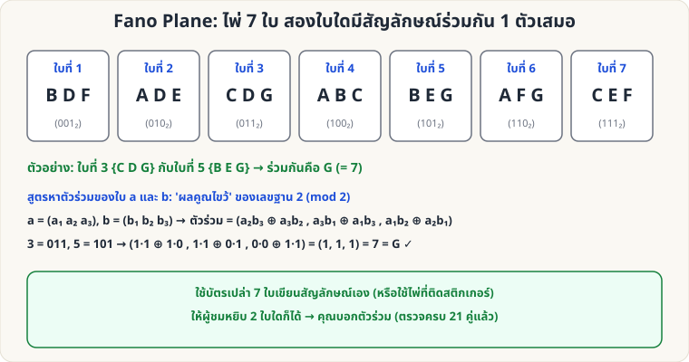

[🏠 หน้าแรก](../Home.md) › [🧮 ไพ่คำนวณ](../Self-Working-Hard.md) › Fano Plane

# Fano Plane (ไพ่ 7 ใบ สัญลักษณ์ร่วม 1 ตัว)

> 🔴 **ระดับยาก** · 🧮 ไพ่คำนวณ · ⏱ 2–3 วัน · 🎴 ใช้ไพ่ไม่กี่ใบ · 🔢 มีการคำนวณ · 🧠 ต้องท่องจำ

<!-- title:Fano Plane (ไพ่ 7 ใบ สัญลักษณ์ร่วม 1 ตัว) -->
<!-- body:start -->
**ผลที่ผู้ชมเห็น:** ไพ่ 7 ใบ แต่ละใบมีสัญลักษณ์ 3 ตัวจาก 7 แบบ ผู้ชมหยิบ 2 ใบใดก็ได้ — **สองใบนั้นมีสัญลักษณ์ร่วมกัน 1 ตัวพอดีเสมอ** และคุณบอกได้ก่อนเปิดว่าตัวไหน

**อุปกรณ์:** บัตรเปล่า/ไพ่ 7 ใบ เขียนสัญลักษณ์ (A–G) ตามตาราง

**ไพ่แต่ละใบ**

| ใบที่ | เลขฐาน 2 | สัญลักษณ์บนใบ |
|---|---|---|
| 1 | 001 | B D F |
| 2 | 010 | A D E |
| 3 | 011 | C D G |
| 4 | 100 | A B C |
| 5 | 101 | B E G |
| 6 | 110 | A F G |
| 7 | 111 | C E F |

**สัญลักษณ์ร่วมของแต่ละคู่** (แถว = ใบที่หนึ่ง, สดมภ์ = ใบที่สอง)

| ใบ | 1 | 2 | 3 | 4 | 5 | 6 | 7 |
|---|---|---|---|---|---|---|---|
| 1  | — | D | D | B | B | F | F |
| 2  | D | — | D | A | E | A | E |
| 3  | D | D | — | C | G | G | C |
| 4  | B | A | C | — | B | A | C |
| 5  | B | E | G | B | — | G | E |
| 6  | F | A | G | A | G | — | F |
| 7  | F | E | C | C | E | F | — |

**วิธีคำนวณแทนการท่องตาราง:** เขียนเลขของไพ่สองใบเป็นเลขฐาน 2 สามหลัก (a₁a₂a₃, b₁b₂b₃) → สัญลักษณ์ร่วม = **(a₂b₃ ⊕ a₃b₂, a₃b₁ ⊕ a₁b₃, a₁b₂ ⊕ a₂b₁)** (⊕ = บวกแล้วเอาเศษหาร 2 เหมือน "ผลคูณไขว้") ตัวอย่าง: 3 = 011, 5 = 101 → (1, 1, 1) = 7 = **G** ✓

**วิธีเล่น**

1. ผู้ชมหยิบไพ่ 2 ใบ (คุณดูเลขใบที่ด้านหลังบัตร หรือจำจากชุดสัญลักษณ์)
2. คุณคำนวณ/มองตารางได้สัญลักษณ์ร่วม → ประกาศก่อนเปิด
3. ผู้ชมเปิดไพ่ ตรวจว่ามีสัญลักษณ์นั้นร่วมกันเพียงตัวเดียว

**ทำไมถึงได้ผล:** นี่คือ Fano plane (เรขาคณิตที่เล็กที่สุด: 7 จุด 7 เส้น เส้นสองเส้นใดก็ตัดกันที่จุดเดียว) เลขใบที่ ↔ เวกเตอร์ฐาน 2 และสัญลักษณ์ s อยู่บนใบ k ก็ต่อเมื่อ s·k เป็นเลขคู่ (ตรวจครบ 21 คู่แล้ว ได้สัญลักษณ์ร่วม 1 ตัวเสมอ และตรงกับสูตรผลคูณไขว้)

**ต่อยอด:** เกมการ์ด Dobble / Spot it ใช้หลักการเดียวกัน (projective plane) แต่ใช้ขนาดที่ใหญ่กว่านี้
<!-- body:end -->

---

⬅️ [🔴 Nim สามกอง](sw-hard-nim-sum.md)  ·  [📋 ไพ่คำนวณ · ระดับยาก ทั้งหมด](../Self-Working-Hard.md)

**กลที่เกี่ยวข้อง:** [🔴 Hamming 7 ใบ](sw-hard-hamming-7.md)
