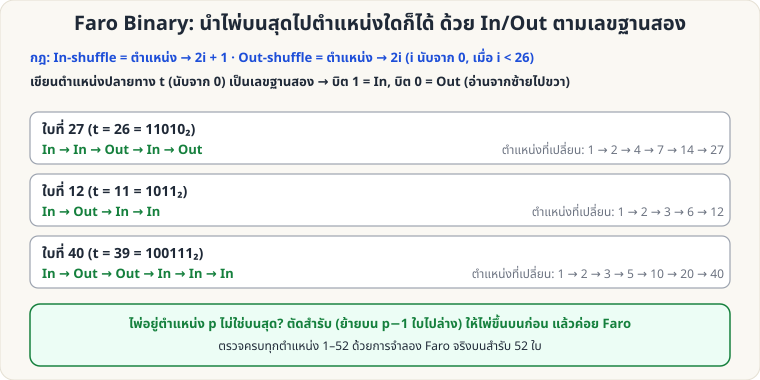

[🏠 หน้าแรก](../Home.md) › [🧮 ไพ่คำนวณ](../Self-Working-Hard.md) › Faro Binary

# Faro Binary: ส่งไพ่ไปตำแหน่งใดก็ได้

> 🔴 **ระดับยาก** · 🧮 ไพ่คำนวณ · ⏱ หลายสัปดาห์ · ✋ ต้องฝึกมือ · 🔢 มีการคำนวณ · 🧠 ต้องท่องจำ

<!-- title:Faro Binary: ส่งไพ่ไปตำแหน่งใดก็ได้ -->
<!-- body:start -->
ถ้าสอด [Faro Shuffle](sl-hard-faro-shuffle.md) สมบูรณ์ได้ (26/26) คุณสามารถ **นำไพ่บนสุดไปตำแหน่งใดก็ได้ใน 6 ครั้งหรือน้อยกว่า** ด้วยเลขฐานสอง



**หลักการ (ตำแหน่งนับจาก 0 = ใบบนสุด)**

- **In-shuffle:** ใบที่ตำแหน่ง i (< 26) → **2i + 1**
- **Out-shuffle:** ใบที่ตำแหน่ง i (< 26) → **2i**

เมื่อเขียนตำแหน่งปลายทาง t เป็นเลขฐานสอง แล้วสอดตามบิตจาก **ซ้ายไปขวา** (1 = In, 0 = Out) ไพ่บนสุดจะไต่ไป t พอดี เช่น ใบที่ 27 (t = 26 = 11010₂) → In, In, Out, In, Out : 1 → 2 → 4 → 7 → 14 → 27

**ไพ่ไม่ได้อยู่บนสุด?** ให้ผู้ชมเลือกและคืนไพ่ แล้ว **ตัดสำรับ** (ย้ายไพ่ด้านบนเหนือไพ่ที่เลือกไปไว้ล่าง) ให้ไพ่ที่เลือกอยู่บนสุดก่อน แล้วค่อย Faro ตามตาราง

**ตารางลำดับ In/Out สำหรับตำแหน่งปลายทาง (นับจากบนสุด = 1)**

```
 1: —                     27: In In Out In Out
 2: In                    28: In In Out In In
 3: In Out                29: In In In Out Out
 4: In In                 30: In In In Out In
 5: In Out Out            31: In In In In Out
 6: In Out In             32: In In In In In
 7: In In Out             33: In Out Out Out Out Out
 8: In In In              34: In Out Out Out Out In
 9: In Out Out Out        35: In Out Out Out In Out
10: In Out Out In         36: In Out Out Out In In
11: In Out In Out         37: In Out Out In Out Out
12: In Out In In          38: In Out Out In Out In
13: In In Out Out         39: In Out Out In In Out
14: In In Out In          40: In Out Out In In In
15: In In In Out          41: In Out In Out Out Out
16: In In In In           42: In Out In Out Out In
17: In Out Out Out Out    43: In Out In Out In Out
18: In Out Out Out In     44: In Out In Out In In
19: In Out Out In Out     45: In Out In In Out Out
20: In Out Out In In      46: In Out In In Out In
21: In Out In Out Out     47: In Out In In In Out
22: In Out In Out In      48: In Out In In In In
23: In Out In In Out      49: In In Out Out Out Out
24: In Out In In In       50: In In Out Out Out In
25: In In Out Out Out     51: In In Out Out In Out
26: In In Out Out In      52: In In Out Out In In
```

(ตรวจแล้วด้วยการจำลอง Faro จริงบนสำรับ 52 ใบ ครบทุกตำแหน่ง 1–52)

**ไอเดียการแสดง:** "ไพ่ที่คุณเลือกจะเดินทางไปอยู่ใบที่ 27 (กลางสำรับ) พอดี" → In, In, Out, In, Out แล้วเปิดนับ
<!-- body:end -->

---

⬅️ [🔴 Monge's Shuffle](sw-hard-monge.md)  ·  [📋 ไพ่คำนวณ · ระดับยาก ทั้งหมด](../Self-Working-Hard.md)  ·  [🔴 เศษหาร 9](sw-hard-mod9.md) ➡️

**กลที่เกี่ยวข้อง:** [🔴 Faro Shuffle (ลงมือจริง)](sl-hard-faro-shuffle.md) · [🔴 Faro: คณิตศาสตร์ตำแหน่ง](sw-hard-faro-math.md)
