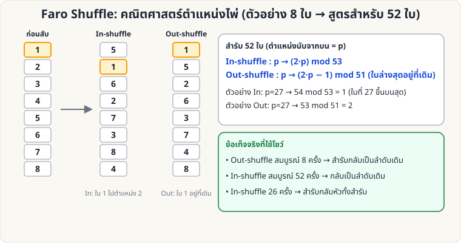

[🏠 หน้าแรก](../Home.md) › [🧮 ไพ่คำนวณ](../Self-Working-Hard.md) › Faro: คณิตศาสตร์ตำแหน่ง

# Faro Shuffle: คณิตศาสตร์ตำแหน่งไพ่

> 🔴 **ระดับยาก** · 🧮 ไพ่คำนวณ · ⏱ 1 ชั่วโมง · 🔢 มีการคำนวณ

<!-- title:Faro Shuffle: คณิตศาสตร์ตำแหน่งไพ่ -->
<!-- body:start -->
Faro Shuffle คือการสับ **แบ่งครึ่ง 26/26 แล้วสอดสลับทีละใบพอดี** ทำให้ตำแหน่งของทุกใบ "ทำนายได้" ด้วยสูตร — ฝึกฝนเป็นกลคำนวณชั้นสูง (ฝีมือมือจริงดูที่ [Faro Shuffle ลงมือจริง](sl-hard-faro-shuffle.md))

| ชนิด | ผลลัพธ์ | สูตรตำแหน่ง (สำรับ 52, ตำแหน่ง p นับจากบน) |
|---|---|---|
| **Out-shuffle** | ใบบนสุด/ล่างสุดอยู่ที่เดิม | p → (2p − 1) mod 51 (ใบที่ 52 คงที่) |
| **In-shuffle** | ใบบนสุดลงมาเป็นใบที่ 2 | p → (2p) mod 53 |

**ข้อเท็จจริงที่ใช้โชว์ (ตรวจสอบด้วยโค้ดแล้ว)**

- Out-shuffle สมบูรณ์ **8 ครั้ง** → สำรับกลับเป็นลำดับเดิมทั้งหมด
- In-shuffle สมบูรณ์ **52 ครั้ง** → กลับเป็นลำดับเดิม
- In-shuffle **26 ครั้ง** → สำรับ **กลับด้าน** (ใบบนสุดไปอยู่ล่างสุด)

**ตัวอย่างการใช้:** ให้ผู้ชมเลือกไพ่ที่ตำแหน่ง p ใด ๆ ก็ได้ แล้วคำนวณจำนวน in-shuffle ที่พาไพ่ไปตำแหน่งที่ต้องการ (เช่น สูตร 2^k·p mod 53)

**ทดลองเอง:** รันสคริปต์ [`tools/generate_images.py`](../tools/generate_images.py) — ตอนสร้างภาพจะตรวจสูตรข้างต้นด้วยการจำลองสำรับ
<!-- body:end -->

---

⬅️ [🔴 Fitch–Cheney 5 ใบ](sw-hard-fitch-cheney.md)  ·  [📋 ไพ่คำนวณ · ระดับยาก ทั้งหมด](../Self-Working-Hard.md)  ·  [🔴 Fitch–Cheney: ฝึกถอดรหัส](sw-hard-fitch-drill.md) ➡️

**กลที่เกี่ยวข้อง:** [🔴 Faro Shuffle (ลงมือจริง)](sl-hard-faro-shuffle.md) · [🔴 Faro Binary](sw-hard-faro-binary.md)
