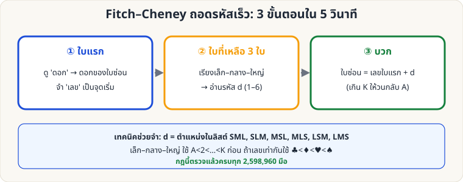

[🏠 หน้าแรก](../Home.md) › [🧮 ไพ่คำนวณ](../Self-Working-Hard.md) › Fitch–Cheney: ฝึกถอดรหัส

# Fitch–Cheney: ฝึกถอดรหัสเร็ว

> 🔴 **ระดับยาก** · 🧮 ไพ่คำนวณ · ⏱ 1 สัปดาห์ · 👥 ต้องมีผู้ช่วย · 🧠 ต้องท่องจำ · 🔢 มีการคำนวณ

<!-- title:Fitch–Cheney: ฝึกถอดรหัสเร็ว -->
<!-- body:start -->
เมื่อทำตามหน้า [Fitch–Cheney](sw-hard-fitch-cheney.md) ได้แล้ว ขั้นต่อไปคือ **ถอดรหัสให้ทันที (ไม่ต้องคิดนาน)**

**ตรวจสอบกฎแล้วครบทุกมือ:** สคริปต์ [`tools/verify_tricks.py --fitch`](../tools/verify_tricks.py) เข้ารหัส/ถอดรหัสไพ่ทุกมือที่เป็นไปได้ **2,598,960 มือ** — ถอดได้ถูกต้อง 100% (รวมกรณีมีไพ่ดอกเดียวกัน 3–4 ใบ, เลขซ้ำกัน, และ K→A วนรอบ)

**กรณีพิเศษที่ต้องจำ**

| สถานการณ์ | ทำอย่างไร |
|---|---|
| ดอกเดียวกัน 3 ใบขึ้นไป | เลือกคู่ใดก็ได้ที่ระยะ ≤ 6 (ทางใดทางหนึ่งเสมอ) |
| ไพ่เลขเท่ากัน (เช่น 7♣ 7♦) ในกลุ่ม S/M/L | เทียบดอก ♣ < ♦ < ♥ < ♠ |
| ใบแรกคือ K, ใบซ่อนคือ 3 | K→A→2→3 = ระยะ 3 (วนรอบ) |

**แบบฝึกหัด (ไพ่ 4 ใบที่ผู้ช่วยวาง → ใบที่ 5 คืออะไร?)** — เฉลยอยู่ขวามือ

| ข้อ | ไพ่ 4 ใบ (ตามลำดับที่วาง) | เฉลย (ใบซ่อน) |
|---|---|---|
| 1 | 6♣  2♠  2♥  J♦ | 9♣ |
| 2 | 4♥  10♠  9♠  7♥ | 10♥ |
| 3 | Q♥  9♠  10♣  K♦ | K♥ |
| 4 | 10♦  8♠  8♣  K♣ | K♦ |
| 5 | 4♠  2♠  2♦  A♣ | 10♠ |

อยากได้โจทย์ใหม่ไม่จำกัด: `python3 wiki/tools/fitch_drill.py 10 --answer`

**เกณฑ์ที่ควรไปถึงก่อนเล่นจริง:** ถอดถูก 10 ข้อติดภายใน 5 วินาที/ข้อ
<!-- body:end -->

---

⬅️ [🔴 Faro: คณิตศาสตร์ตำแหน่ง](sw-hard-faro-math.md)  ·  [📋 ไพ่คำนวณ · ระดับยาก ทั้งหมด](../Self-Working-Hard.md)  ·  [🔴 Mnemonica Stack](sw-hard-mnemonica.md) ➡️

**กลที่เกี่ยวข้อง:** [🔴 Fitch–Cheney 5 ใบ](sw-hard-fitch-cheney.md)
