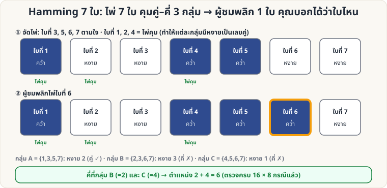

[🏠 หน้าแรก](../Home.md) › [🧮 ไพ่คำนวณ](../Self-Working-Hard.md) › Hamming 7 ใบ

# Hamming 7 ใบ (หาไพ่ที่ถูกพลิก)

> 🔴 **ระดับยาก** · 🧮 ไพ่คำนวณ · ⏱ 1 วัน · 🎴 ใช้ไพ่ไม่กี่ใบ · 🔢 มีการคำนวณ

<!-- title:Hamming 7 ใบ (หาไพ่ที่ถูกพลิก) -->
<!-- body:start -->
**ผลที่ผู้ชมเห็น:** ไพ่ 7 ใบวางแถวเดียว คุณหันหลัง ผู้ชมพลิกไพ่ 1 ใบ (หรือไม่พลิกเลย) — คุณหันกลับมา **บอกได้ทันทีว่าพลิกใบที่เท่าไร**

**อุปกรณ์:** ไพ่ 7 ใบ (มีด้านหงาย/คว่ำชัดเจน)

**หลักการ:** ไพ่ใบที่ 1, 2, 4 เป็น "ไพ่คุม" (เลขยกกำลังสอง) แต่ละใบคุมหนึ่งกลุ่ม:

| กลุ่ม | ไพ่ในกลุ่ม | ค่ารหัส |
|---|---|---|
| A | 1, 3, 5, 7 | 1 |
| B | 2, 3, 6, 7 | 2 |
| C | 4, 5, 6, 7 | 4 |

**การเตรียม:** ให้ผู้ชมวางไพ่ใบที่ **3, 5, 6, 7** ตามใจ (หงาย/คว่ำ) แล้วคุณตั้งไพ่คุมใบที่ **1, 2, 4** ให้ **ทุกกลุ่มมีไพ่หงายเป็นเลขคู่**

**วิธีเล่น**

1. คุณหันหลัง ผู้ชมพลิกไพ่ 1 ใบ
2. ตรวจทีละกลุ่ม ว่า **หงายเป็นเลขคี่หรือไม่**
3. รวม **ค่ารหัสของกลุ่มที่เป็นคี่** = ตำแหน่งที่ถูกพลิก (ไม่มีกลุ่มคี่เลย = ไม่ได้พลิก)

ตัวอย่างในภาพ: กลุ่ม B (2) และ C (4) เป็นคี่ → 2 + 4 = ใบที่ **6**

**อีกมุมมอง (สั้นกว่า):** เขียนตำแหน่งของไพ่ **ที่หงายอยู่** เป็นเลขฐาน 2 แล้ว **XOR รวมกัน** → ถ้าไม่เคยพลิกจะได้ 0 ถ้าพลิกแล้วจะได้ **ตำแหน่งที่ถูกพลิกพอดี** (ตรวจครบทุกแบบ: 16 ชุดข้อมูล × 8 กรณีพลิก แล้ว)

**ต่อยอด:** ไพ่ 15 ใบ (ไพ่คุมที่ตำแหน่ง 1, 2, 4, 8) ก็ใช้หลักเดียวกัน · เปรียบเทียบกับ [ตารางคู่–คี่ 5×5](sw-medium-parity-grid.md)

**ข้อควรระวัง:** ผู้ชมพลิกได้ **แค่ 1 ใบเท่านั้น** (พลิก 2 ใบขึ้นไปตรวจจับตำแหน่งไม่ได้)
<!-- body:end -->

---

⬅️ [🔴 De Bruijn Deck](sw-hard-de-bruijn.md)  ·  [📋 ไพ่คำนวณ · ระดับยาก ทั้งหมด](../Self-Working-Hard.md)  ·  [🔴 เดาสีไพ่บนหน้าผาก](sw-hard-parity-hats.md) ➡️

**กลที่เกี่ยวข้อง:** [🟡 ตารางคู่–คี่ 5×5](sw-medium-parity-grid.md)
