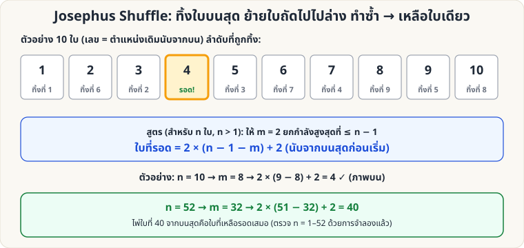

[🏠 หน้าแรก](../Home.md) › [🧮 ไพ่คำนวณ](../Self-Working-Hard.md) › Josephus Shuffle

# Josephus Shuffle (ทิ้ง-ย้าย)

> 🔴 **ระดับยาก** · 🧮 ไพ่คำนวณ · ⏱ 1 ชั่วโมง · 🔧 ต้องจัดสำรับล่วงหน้า · 🔢 มีการคำนวณ

<!-- title:Josephus Shuffle (ทิ้ง-ย้าย) -->
<!-- body:start -->
**ผลที่ผู้ชมเห็น:** ผู้ชม "คัดไพ่ทิ้ง" ด้วยกติกาง่าย ๆ ทีละใบจนเหลือใบเดียว — ใบสุดท้ายคือไพ่ที่ผู้ชมเลือกไว้ตั้งแต่ต้น

**กติกาการทิ้ง:** **ทิ้งใบบนสุด** (วางบนโต๊ะ) → **ย้ายใบถัดไปไปไว้ล่างสุด** → ทิ้งใบบนสุด → ย้าย → … จนเหลือ 1 ใบ

**สูตร:** สำรับ n ใบ (n > 1) ให้ m = 2 ยกกำลังสูงสุดที่ ≤ n − 1 → ใบที่รอดคือ **ตำแหน่ง 2 × (n − 1 − m) + 2** จากบนสุด

| จำนวนไพ่ n | ใบที่รอด (นับจากบน) |
|---|---|
| 2 | 2 |
| 3 | 2 |
| 4 | 4 |
| 5 | 2 |
| 8 | 8 |
| 10 | 4 |
| 13 | 10 |
| 16 | 16 |
| 20 | 8 |
| 26 | 20 |
| 32 | 32 |
| 33 | 2 |
| 40 | 16 |
| 52 | 40 |

**ข้อสังเกต (ตรวจ n = 1–52 แล้ว):** ถ้า n เป็นเลขยกกำลัง 2 (4, 8, 16, 32) → **ใบล่างสุดรอดเสมอ** · ถ้า n = 2ᵏ + 1 (3, 5, 9, 17, 33) → **ใบที่ 2 รอด**

**วิธีใช้แสดง**

1. ให้ผู้ชมเลือกไพ่แล้วคืนเข้าสำรับ → ควบคุมให้ไพ่ใบนั้น **อยู่บนสุด** → **เลื่อนนับไพ่ 13 ใบจากบนสุดเป็นก้อน (ไม่กลับลำดับ) ไปไว้ใต้สุด** → ไพ่ของผู้ชมจะอยู่ **ตำแหน่งที่ 40** พอดี (ใช้ [Overhand Shuffle](sl-easy-overhand.md), [Pass](sl-hard-classic-pass.md) หรือ [Faro Binary](sw-hard-faro-binary.md) เป็นตัวช่วยพาไพ่ขึ้นบน)
2. ให้ผู้ชมทิ้ง-ย้าย 51 รอบ → **ใบสุดท้ายคือไพ่ของผู้ชม**
3. หรือใช้ n เล็กลง เช่น 10 ใบ → ใบที่ 4
<!-- body:end -->

---

⬅️ [🔴 เศษหาร 9](sw-hard-mod9.md)  ·  [📋 ไพ่คำนวณ · ระดับยาก ทั้งหมด](../Self-Working-Hard.md)  ·  [🔴 สูตร n กอง k รอบ](sw-hard-base-n.md) ➡️

**กลที่เกี่ยวข้อง:** [🔴 Faro Binary](sw-hard-faro-binary.md)
