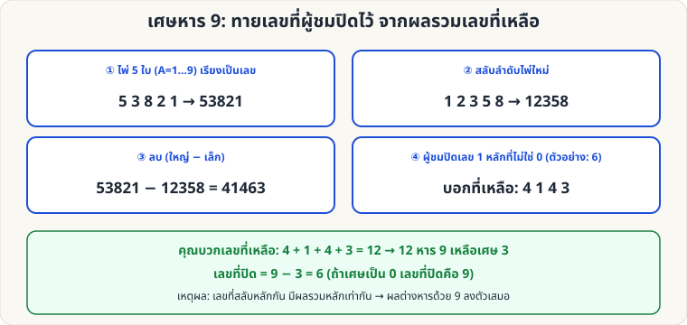

[🏠 หน้าแรก](../Home.md) › [🧮 ไพ่คำนวณ](../Self-Working-Hard.md) › เศษหาร 9

# เศษหาร 9: ทายเลขที่ปิดไว้

> 🔴 **ระดับยาก** · 🧮 ไพ่คำนวณ · ⏱ 30 นาที · 🎴 ใช้ไพ่ไม่กี่ใบ · 🔢 มีการคำนวณ

<!-- title:เศษหาร 9: ทายเลขที่ปิดไว้ -->
<!-- body:start -->
**ผลที่ผู้ชมเห็น:** ผู้ชมสร้างเลขใหญ่จากไพ่ สลับลำดับ ลบกัน แล้วปิดเลข 1 หลักของผลลัพธ์ บอกแค่หลักที่เหลือ — คุณบอกเลขที่ปิดไว้ได้

**อุปกรณ์:** ไพ่ตัวเลข A–9 (A=1) และ 10 = 0 / เครื่องคิดเลข

**ขั้นตอน**

1. ผู้ชมเลือกไพ่ 5 ใบ เรียงเป็นเลข 5 หลัก → 53821
2. **สลับลำดับไพ่** เป็นเลขใหม่ที่ต่างจากเดิม → 12358
3. **ลบ** (ใหญ่ − เล็ก) → 41463
4. ผู้ชมเลือกเลข **1 หลักที่ไม่ใช่ 0** ปิดไว้ (เช่น 6) แล้วอ่านที่เหลือ: 4, 1, 4, 3
5. คุณบวก 4+1+4+3 = 12 → **หาร 9 เหลือเศษ 3** → เลขที่ปิด = **9 − 3 = 6** (ถ้าเศษเป็น 0 เลขที่ปิดคือ 9)

**ทำไมถึงได้ผล:** เลขที่ใช้หลักเดียวกัน (เพียงสลับตำแหน่ง) มีผลรวมหลักเท่ากัน → หารด้วย 9 เหลือเศษเท่ากัน → ผลต่างหารด้วย 9 ลงตัวเสมอ → ผลรวมหลักของผลต่างเป็นพหุคูณของ 9 (ตรวจกับตัวอย่างสุ่ม 3,000 ชุดแล้ว)

**ข้อควรระวัง:** อย่าให้ผู้ชมปิดเลข 0 (ทายไม่ได้ ว่าเป็น 0 หรือ 9) · ต้องสลับลำดับให้ได้เลขต่างจากเดิม
<!-- body:end -->

---

⬅️ [🔴 Faro Binary](sw-hard-faro-binary.md)  ·  [📋 ไพ่คำนวณ · ระดับยาก ทั้งหมด](../Self-Working-Hard.md)  ·  [🔴 Josephus Shuffle](sw-hard-josephus.md) ➡️

**กลที่เกี่ยวข้อง:** [🟢 ไพ่ที่หายไป](sw-easy-missing-card.md) · [🟡 เลข 1089](sw-medium-1089.md)
