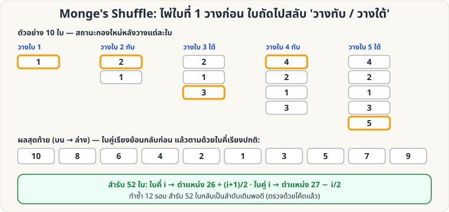

[🏠 หน้าแรก](../Home.md) › [🧮 ไพ่คำนวณ](../Self-Working-Hard.md) › Monge's Shuffle

# Monge's Shuffle

> 🔴 **ระดับยาก** · 🧮 ไพ่คำนวณ · ⏱ 1–3 วัน · 🔢 มีการคำนวณ

<!-- title:Monge's Shuffle -->
<!-- body:start -->
**แนวคิด:** วิธีสับที่ "ดูเหมือนสับธรรมดา" แต่คำนวณตำแหน่งไพ่ได้แน่นอนทุกใบ และเมื่อทำครบ **12 รอบ** สำรับ 52 ใบกลับเป็นลำดับเดิม (ผู้ชมคิดว่าสับจนมั่ว)

**วิธีสับ (Monge)**

1. ถือสำรับคว่ำในมือซ้าย ใช้มือขวาดึงไพ่ทีละใบมาวางบนโต๊ะ
2. ใบที่ 1 วางลงโต๊ะ → ใบที่ 2 **วางทับด้านบน** → ใบที่ 3 **วางใต้** → ใบที่ 4 วางทับ → ใบที่ 5 วางใต้ … สลับ ทับ/ใต้ จนหมดสำรับ
3. ผลลัพธ์: **ใบคู่เรียงกลับด้าน (บน)** ตามด้วย **ใบคี่เรียงปกติ (ล่าง)**

**สูตรตำแหน่ง (สำรับ 52 ใบ ตำแหน่ง i นับจากบน)**

- ใบคี่ i → ไปอยู่ตำแหน่ง **26 + (i+1)/2**
- ใบคู่ i → ไปอยู่ตำแหน่ง **27 − i/2**

**ข้อเท็จจริงที่ตรวจด้วยโค้ดแล้ว**

- สำรับ 52 ใบ ต้องทำ Monge **12 รอบ** จึงกลับลำดับเดิม
- ไพ่ในสำรับแบ่งเป็น **วงรอบ** ความยาว 12, 12, 12, 6, 4, 3, 2, 1 (รวม 52) — ไพ่ในวงรอบเดียวกับตำแหน่งที่ 1 (12 ตำแหน่ง) เท่านั้น ที่นำขึ้นมาบนสุดได้ด้วยการสับซ้ำ

**ตารางนำไพ่ขึ้นบนสุด** (ไพ่ที่อยู่ตำแหน่ง *p* ก่อนสับ → ต้อง Monge กี่รอบจึงขึ้นมาอยู่บนสุด)

| จำนวนรอบ | ตำแหน่ง p ก่อนสับ |
|---|---|
| 1 | 52 |
| 2 | 51 |
| 3 | 49 |
| 4 | 45 |
| 5 | 37 |
| 6 | 21 |
| 7 | 12 |
| 8 | 30 |
| 9 | 7 |
| 10 | 40 |
| 11 | 27 |

เช่น **ไพ่ล่างสุด (ตำแหน่ง 52) ขึ้นบนสุดใน 1 รอบ** · ไพ่ตำแหน่งที่ 51 ขึ้นใน 2 รอบ

**ใช้เล่นอย่างไร**

- **กลทายไพ่ล่างสุด**: ให้ผู้ชมเห็นและจำไพ่ใบล่าง (หรือ Glimpse) → Monge 1 รอบ → ใบนั้นอยู่บนสุดแน่นอน
- **กลสับครบ 12 รอบ**: "ฉันสับหนักมาก (12 ครั้ง)" แต่สำรับกลับมาเรียง Mnemonica/Stebbins เดิม
- ฝึกด้วยมือ 10 ใบก่อน (ตามภาพ) แล้วค่อยเป็น 52 ใบ
<!-- body:end -->

---

⬅️ [🔴 Mnemonica Stack](sw-hard-mnemonica.md)  ·  [📋 ไพ่คำนวณ · ระดับยาก ทั้งหมด](../Self-Working-Hard.md)  ·  [🔴 Faro Binary](sw-hard-faro-binary.md) ➡️

**กลที่เกี่ยวข้อง:** [🔴 Faro: คณิตศาสตร์ตำแหน่ง](sw-hard-faro-math.md)
