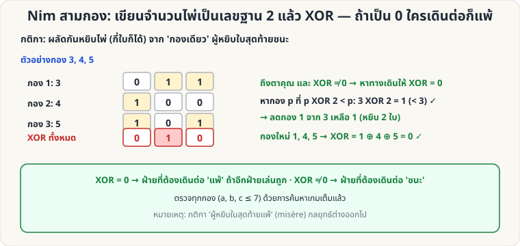

[🏠 หน้าแรก](../Home.md) › [🧮 ไพ่คำนวณ](../Self-Working-Hard.md) › Nim สามกอง

# Nim สามกอง (XOR ฐานสอง)

> 🔴 **ระดับยาก** · 🧮 ไพ่คำนวณ · ⏱ 1–2 วัน · 🔢 มีการคำนวณ

<!-- title:Nim สามกอง (XOR ฐานสอง) -->
<!-- body:start -->
**ผลที่ผู้ชมเห็น:** ไพ่ 3 กอง (เช่น 3, 4, 5 ใบ) ผู้เล่นสองฝ่ายผลัดกันหยิบไพ่ **กี่ใบก็ได้** จาก **กองเดียว** ใครหยิบใบสุดท้ายชนะ — คุณชนะได้เสมอ (ถ้าเริ่มที่จังหวะได้เปรียบ)

**อุปกรณ์:** ไพ่ 12 ใบขึ้นไป แบ่งเป็น 3 กอง

**กลยุทธ์**

1. เขียนจำนวนไพ่แต่ละกองเป็นเลขฐาน 2 แล้ว **XOR** ทุกกอง (Nim-sum) — ในแต่ละหลัก ถ้าจำนวน 1 เป็นเลขคี่ ผลคือ 1
2. **XOR = 0** → ผู้ที่ถึงตาเดิน **แพ้** (ถ้าอีกฝ่ายเล่นถูก)
3. **XOR ≠ 0** → ผู้ที่ถึงตาเดิน **ชนะ** โดย:
   - หากองที่ **p XOR (ค่า XOR รวม) < p**
   - ลดกองนั้นให้เหลือ **p XOR (ค่า XOR รวม)** ใบ → ได้ XOR = 0

**ตัวอย่าง:** กอง 3, 4, 5 → XOR = 3 ⊕ 4 ⊕ 5 = **2** ≠ 0 · หากอง p ที่ p ⊕ 2 < p: 3 ⊕ 2 = 1 (< 3) → ลดกอง 3 เหลือ 1 ใบ (หยิบ 2 ใบ) → กอง 1, 4, 5 มี XOR = 0 ✓

**วิธีให้ได้เปรียบ**

- ถ้ากองเริ่มต้นมี XOR = 0 (เช่น 1, 2, 3) → ให้ **ผู้ชมเดินก่อน** แล้วคุณตอบด้วยท่าทำให้ XOR = 0 ทุกครั้ง
- ถ้า XOR ≠ 0 → **คุณเดินก่อน** ด้วยท่าข้างบน

**ตรวจแล้ว:** ค้นหาเกมเต็มทุกชุดกอง (a, b, c ≤ 7) — "XOR = 0 ⇔ ผู้ที่ถึงตาเดินแพ้" ถูกต้องทุกชุด

**หมายเหตุ:** หน้านี้ครอบคลุมกติกา "ผู้หยิบใบสุดท้าย **ชนะ**" เท่านั้น กติกาแบบ "ใบสุดท้ายแพ้" (misère) กลยุทธ์ต่างออกไปและยังไม่ได้ตรวจในที่นี้ · เทียบกับ [Nim 1–3 ใบ](sw-medium-nim-21.md) ที่ง่ายกว่า
<!-- body:end -->

---

⬅️ [🔴 เดาสีไพ่บนหน้าผาก](sw-hard-parity-hats.md)  ·  [📋 ไพ่คำนวณ · ระดับยาก ทั้งหมด](../Self-Working-Hard.md)  ·  [🔴 Fano Plane](sw-hard-fano-plane.md) ➡️

**กลที่เกี่ยวข้อง:** [🟡 เกมจับไพ่ชนะเสมอ](sw-medium-nim-21.md)
