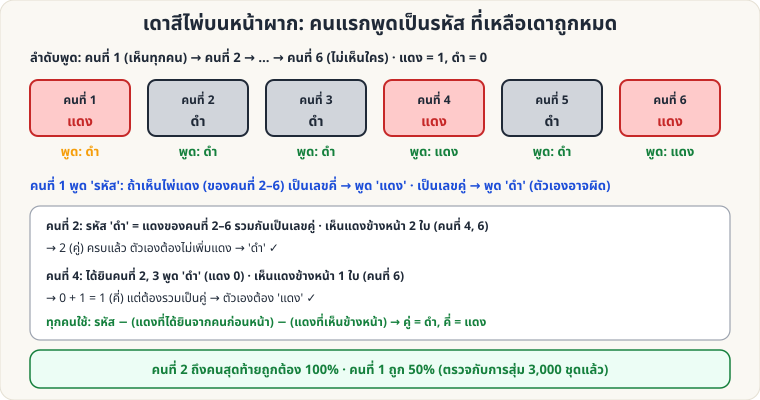

[🏠 หน้าแรก](../Home.md) › [🧮 ไพ่คำนวณ](../Self-Working-Hard.md) › เดาสีไพ่บนหน้าผาก

# เดาสีไพ่บนหน้าผาก (Parity Hats)

> 🔴 **ระดับยาก** · 🧮 ไพ่คำนวณ · ⏱ 1 วัน · 👥 ต้องมีผู้ช่วย · 🔢 มีการคำนวณ

<!-- title:เดาสีไพ่บนหน้าผาก (Parity Hats) -->
<!-- body:start -->
**ผลที่ผู้ชมเห็น:** ผู้เข้าร่วม n คนเรียงแถว แต่ละคนถือไพ่ (แดงหรือดำ) แนบหน้าผาก เห็นเฉพาะไพ่ของคนข้างหน้า พูดทีละคนว่าไพ่ตัวเองสีอะไร — **ทุกคนยกเว้นคนแรกตอบถูก 100%** (คนแรกถูก 50%)

**อุปกรณ์:** ไพ่แดง/ดำ (ใบละคน) คนละใบ 6–26 คน

**ลำดับ:** ทุกคนยืนเรียงแถวหันไปทางเดียวกัน คนที่ 1 อยู่หลังสุด (เห็นไพ่ของทุกคนข้างหน้า) คนที่ n อยู่หน้าสุด (ไม่เห็นใคร) พูดทีละคนจากคนที่ 1 ไปคนที่ n ทุกคน **ได้ยินคำตอบของคนที่พูดก่อนหน้า** และตกลงกลยุทธ์ด้านล่างกันไว้ล่วงหน้า (คุยกันได้ก่อนแจกไพ่ แต่ห้ามส่งสัญญาณระหว่างพูด)

**กลยุทธ์ที่ตกลงกันล่วงหน้า**

1. **คนที่ 1** นับ **ไพ่แดง** ที่เห็นข้างหน้า (คนที่ 2–n):
   - เป็น **เลขคี่** → พูด "**แดง**"
   - เป็น **เลขคู่** → พูด "**ดำ**"
   (คำพูดนี้เป็น **รหัส** ไม่ใช่การเดาสีตัวเอง)
2. **คนที่ k (k ≥ 2)** คำนวณ: *รหัสของคนที่ 1* − *จำนวนแดงที่ได้ยินจากคนที่ 2 ถึง k−1* − *จำนวนแดงที่เห็นข้างหน้า* → ถ้าได้เลข **คี่** ไพ่ตัวเองคือ **แดง** ถ้า **คู่** คือ **ดำ**

**ตัวอย่าง (ในภาพ 6 คน):** คนที่ 4: รหัสคนที่ 1 = ดำ (คู่) · ได้ยินคนที่ 2, 3 = ดำ, ดำ (แดง 0) · เห็นข้างหน้าแดง 1 ใบ (คนที่ 6) → 0 + 1 = คี่ ต้องรวมให้คู่ → ตัวเองคือ **แดง** ✓

**ทำไมถึงได้ผล:** รหัสของคนที่ 1 บอก "ความเป็นคู่/คี่ของจำนวนไพ่แดงของคนที่ 2–n ทั้งหมด" ทุกคนถัดมานำข้อมูลที่ได้ยินและเห็นมาหักออก จึงเหลือสีของตัวเองพอดี (ตรวจกับการสุ่ม 3,000 ชุด n = 2–26 คน ผ่านทุกชุด)

**ลูกเล่น:** ใช้ผู้ชมอาสาสมัคร 6–10 คน แล้วให้ผู้ชมตรวจสอบเองว่า "ไม่มีใครส่งสัญญาณลับ" · เป็นกลที่ทั้งห้องร่วมแสดงได้
<!-- body:end -->

---

⬅️ [🔴 Hamming 7 ใบ](sw-hard-hamming-7.md)  ·  [📋 ไพ่คำนวณ · ระดับยาก ทั้งหมด](../Self-Working-Hard.md)  ·  [🔴 Nim สามกอง](sw-hard-nim-sum.md) ➡️

**กลที่เกี่ยวข้อง:** [🟢 คว่ำ–หงาย (คู่–คี่)](sw-easy-parity.md)
