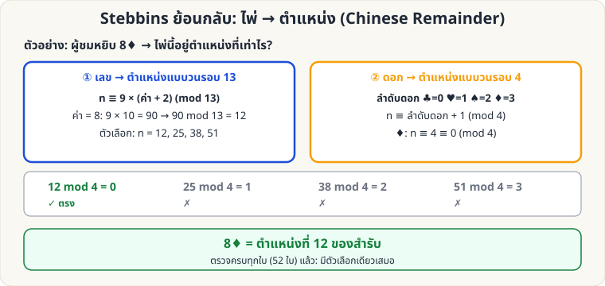

[🏠 หน้าแรก](../Home.md) › [🧮 ไพ่คำนวณ](../Self-Working-Hard.md) › Stebbins ย้อนกลับ

# Stebbins ย้อนกลับ: ไพ่ → ตำแหน่ง

> 🔴 **ระดับยาก** · 🧮 ไพ่คำนวณ · ⏱ 1–2 วัน · 🔧 ต้องจัดสำรับล่วงหน้า · 🧠 ต้องท่องจำ · 🔢 มีการคำนวณ

<!-- title:Stebbins ย้อนกลับ: ไพ่ → ตำแหน่ง -->
<!-- body:start -->
ตรงกันข้ามกับ [ตำแหน่ง → ไพ่](sw-medium-stebbins-formula.md): ผู้ชมหยิบ/บอกไพ่ใบหนึ่ง คุณบอกได้ว่าอยู่ **ตำแหน่งที่เท่าไร** ในสำรับ (ใช้ Chinese Remainder Theorem)

**ขั้นตอน**

1. **เลข → mod 13:** c = (9 × (ค่า + 2)) mod 13 (ถ้าได้ 0 ใช้ 13) — เพราะ 3 × 9 ≡ 1 (mod 13)
2. **ดอก → mod 4:** ให้ ♣=0, ♥=1, ♠=2, ♦=3 แล้ว r = (ดอก + 1) mod 4
3. ตำแหน่ง n = **c + 13 × ((r − c) mod 4)**

**ตัวอย่าง 8♦:** c = (9 × 10) mod 13 = 12 · r = (3 + 1) mod 4 = 0 · n = 12 + 13 × ((0 − 12) mod 4) = 12 + 13 × 0 = **12**

**ตัวอย่าง K♣:** c = (9 × 15) mod 13 = 135 mod 13 = 5 · r = (0 + 1) = 1 · n = 5 + 13 × ((1 − 5) mod 4) = 5 + 13 × 0 = **5** (ตรงกับลำดับ: ใบที่ 5 = K♣ ✓)

ตรวจครบทั้ง 52 ใบแล้ว ได้ตำแหน่งตรงทุกใบ

**ฝึก:** `python3 wiki/tools/mnemonica_drill.py stebbins 20`
<!-- body:end -->

---

⬅️ [🔴 สูตร n กอง k รอบ](sw-hard-base-n.md)  ·  [📋 ไพ่คำนวณ · ระดับยาก ทั้งหมด](../Self-Working-Hard.md)

**กลที่เกี่ยวข้อง:** [🟡 Stebbins: ตำแหน่ง → ไพ่](sw-medium-stebbins-formula.md) · [🟡 Si Stebbins Stack](sw-medium-stebbins.md)
