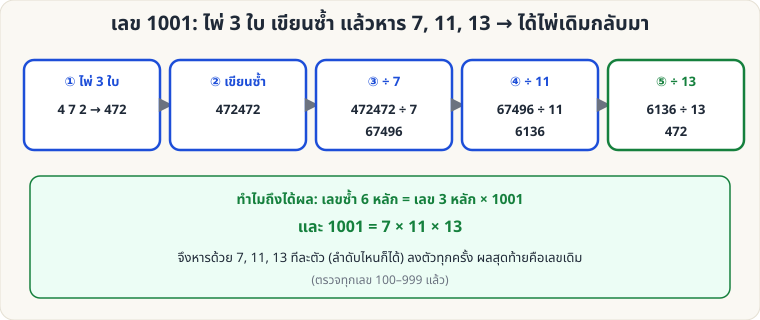

[🏠 หน้าแรก](../Home.md) › [🧮 ไพ่คำนวณ](../Self-Working-Medium.md) › เลข 1001

# เลข 1001 (ไพ่ 3 ใบ หาร 7, 11, 13)

> 🟡 **ระดับกลาง** · 🧮 ไพ่คำนวณ · ⏱ 15 นาที · 🎴 ใช้ไพ่ไม่กี่ใบ · 🔢 มีการคำนวณ · 📝 เล่นแบบทำนายได้

<!-- title:เลข 1001 (ไพ่ 3 ใบ หาร 7, 11, 13) -->
<!-- body:start -->
**ผลที่ผู้ชมเห็น:** ผู้ชมเลือกไพ่ 3 ใบเป็นเลข 3 หลัก เขียนซ้ำเป็น 6 หลัก แล้วหารด้วย 7, 11, 13 ตามลำดับ — **ผลสุดท้ายคือเลข 3 หลักเดิม** ตรงกับคำทำนายของคุณ

**อุปกรณ์:** ไพ่ A–9 (A = 1) เครื่องคิดเลข กระดาษ

**วิธีเล่น**

1. ผู้ชมเลือกไพ่ 3 ใบ เรียงเป็นเลข 3 หลัก เช่น 4, 7, 2 → **472**
2. **เขียนซ้ำอีกครั้ง** ต่อท้ายเป็นเลข 6 หลัก: **472472**
3. ให้ผู้ชม **หารด้วย 7** → 67496 (ลงตัว!)
4. **หารด้วย 11** → 6136 (ลงตัว!)
5. **หารด้วย 13** → **472** = ไพ่ 3 ใบที่เลือกไว้เดิม

**ทำไมถึงได้ผล:** เลขซ้ำ 6 หลัก = เลข 3 หลัก × 1001 และ 1001 = 7 × 11 × 13 ดังนั้นหารด้วย 7, 11, 13 ลงตัวทุกครั้ง (ลำดับไหนก็ได้) และได้เลข 3 หลักเดิมกลับมา — ตรวจครบทุกเลข 100–999 แล้ว

**ลูกเล่น**

- เขียนคำทำนาย "เลขที่คุณจะได้สุดท้ายคือไพ่ 3 ใบที่เลือก" ไว้ในซอง
- ให้ผู้ชมเปิดไพ่ 3 ใบทีละใบหลังหารเสร็จ — ผลหารตรงกับไพ่ที่เลือกเมื่อกี้
- ต่อยอดจาก [เลข 1089](sw-medium-1089.md) เป็นชุดกลเลขจากไพ่
<!-- body:end -->

---

⬅️ [🟡 เกมจับไพ่ชนะเสมอ](sw-medium-nim-21.md)  ·  [📋 ไพ่คำนวณ · ระดับกลาง ทั้งหมด](../Self-Working-Medium.md)  ·  [🟡 ผลรวม 10 ตัวเลข](sw-medium-fibonacci-sum.md) ➡️

**กลที่เกี่ยวข้อง:** [🟡 เลข 1089](sw-medium-1089.md) · [🟢 คูณ 11 ทันที](sw-easy-multiply-11.md)
