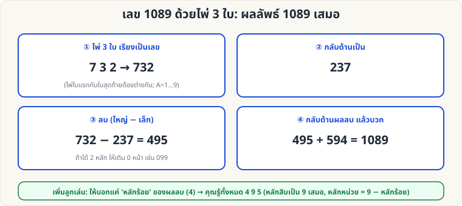

[🏠 หน้าแรก](../Home.md) › [🧮 ไพ่คำนวณ](../Self-Working-Medium.md) › เลข 1089

# เลข 1089 ด้วยไพ่ 3 ใบ

> 🟡 **ระดับกลาง** · 🧮 ไพ่คำนวณ · ⏱ 15 นาที · 🎴 ใช้ไพ่ไม่กี่ใบ · 🔢 มีการคำนวณ · 📝 เล่นแบบทำนายได้

<!-- title:เลข 1089 ด้วยไพ่ 3 ใบ -->
<!-- body:start -->
**ผลที่ผู้ชมเห็น:** ผู้ชมเลือกไพ่ 3 ใบ ทำเลขกลับด้านลบ-บวก ตามขั้นตอน จบที่ **1089** ทุกครั้ง ตรงกับคำทำนายที่คุณเขียนไว้

**อุปกรณ์:** ไพ่ A–9 (A=1) ปากกาและกระดาษ หรือเครื่องคิดเลข

**ขั้นตอน**

1. ผู้ชมเลือกไพ่ 3 ใบ (**ใบแรกกับใบสุดท้ายต้องไม่เท่ากัน**) เรียงเป็นเลข 3 หลัก เช่น 7, 3, 2 → **732**
2. **กลับด้าน** เป็น 237
3. **ลบ** เลขมาก − เลขน้อย → 732 − 237 = **495** (ถ้าได้เลข 2 หลัก ให้เติม 0 ข้างหน้า เช่น 099)
4. **กลับด้านผลลบ** แล้ว **บวก**: 495 + 594 = **1089**

**ลูกเล่นเสริม (ทายผลลบ):** ขอให้ผู้ชมบอกแค่ **หลักร้อย** ของผลลบ → หลักสิบคือ **9** เสมอ หลักหน่วย = 9 − หลักร้อย เช่น บอก 4 → ผลลบคือ 4**9**5

**ทำไมถึงได้ผล:** ผลลบ = 99 × (ตัวหน้า − ตัวท้าย) จึงเป็นรูป (x−1) 9 (10−x) ผลรวมกับตัวกลับด้านเป็น 1089 เสมอ ตรวจครบทุกชุดไพ่ A–9 แล้ว
<!-- body:end -->

---

⬅️ [🟡 Gilbreath (ดอกไพ่)](sw-medium-gilbreath-suit.md)  ·  [📋 ไพ่คำนวณ · ระดับกลาง ทั้งหมด](../Self-Working-Medium.md)  ·  [🟡 ไพ่ 27 ใบ](sw-medium-27-cards.md) ➡️

**กลที่เกี่ยวข้อง:** [🟢 เลขลับจากไพ่](sw-easy-secret-number.md)
