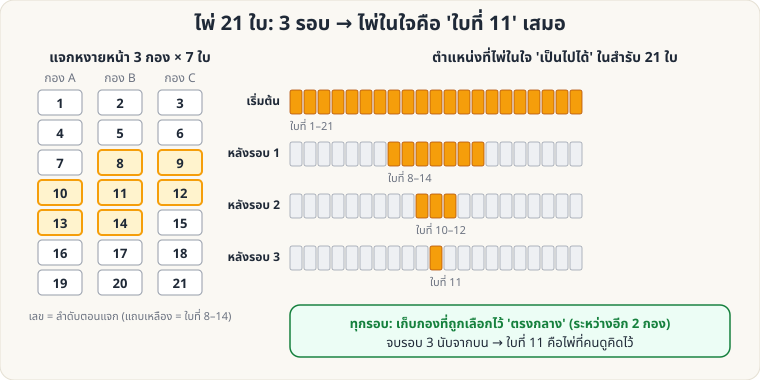

[🏠 หน้าแรก](../Home.md) › [🧮 ไพ่คำนวณ](../Self-Working-Medium.md) › ไพ่ 21 ใบ

# ไพ่ 21 ใบ (21-Card Trick)

> 🟡 **ระดับกลาง** · 🧮 ไพ่คำนวณ · ⏱ 20 นาที · 🔀 ผู้ชมสับสำรับได้

<!-- title:ไพ่ 21 ใบ (21-Card Trick) -->
<!-- body:start -->
**ผลที่ผู้ชมเห็น:** ผู้ชมคิดไพ่ในใจจาก 21 ใบ ตอบเพียง "อยู่กองไหน" 3 ครั้ง คุณเปิดไพ่ที่คิดไว้ได้

**อุปกรณ์:** ไพ่ 21 ใบ (สุ่มจากสำรับ)

**วิธีทำ**

1. แจกไพ่หงายหน้าทีละใบเป็น 3 กอง กองละ 7 ใบ (ให้เห็นหน้าทุกใบ)
2. ผู้ชมคิดไพ่ 1 ใบ แล้วบอกว่าอยู่กองไหน
3. เก็บไพ่โดย **วางกองที่ถูกเลือกไว้ตรงกลาง** ระหว่างอีก 2 กอง จากนั้นพลิกสำรับเป็นคว่ำ แล้วแจกซ้ำ (หงายหน้าทีละใบ)
4. ทำซ้ำรวม **3 รอบ**
5. หลังเก็บไพ่รอบที่ 3 ไพ่ในใจจะอยู่ **ใบที่ 11 พอดี** — เปิดทีละใบด้วยบทพูดที่สนุก

**ทำไมถึงได้ผล:** ภาพด้านบนแสดงตำแหน่งที่ "เป็นไปได้" แคบลงเรื่อย ๆ: 21 → 8–14 → 10–12 → 11

**ต่อยอด**

- ใช้ **27 ใบ** ก็ได้ (3 กอง × 9 ใบ, 3 รอบ → ใบที่ 14 เสมอ)
- ให้ผู้ชมเป็นผู้ **แจกเอง** ได้ — คุณแค่บอกว่าต้องวางกองไหนไว้ตรงกลาง
<!-- body:end -->

---

⬅️ [🟢 สี่เหลี่ยมมหัศจรรย์](sw-easy-magic-square.md)  ·  [📋 ไพ่คำนวณ · ระดับกลาง ทั้งหมด](../Self-Working-Medium.md)  ·  [🟡 Gilbreath (สีไพ่)](sw-medium-gilbreath.md) ➡️

**กลที่เกี่ยวข้อง:** [🟢 ไพ่ 9 ใบ](sw-easy-nine-cards.md) · [🟡 ไพ่ 27 ใบ](sw-medium-27-cards.md) · [🟡 ไพ่ 25 ใบ](sw-medium-25-cards.md)
