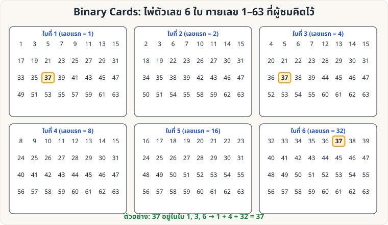

[🏠 หน้าแรก](../Home.md) › [🧮 ไพ่คำนวณ](../Self-Working-Medium.md) › Binary Cards

# Binary Cards (ไพ่เลขฐานสอง)

> 🟡 **ระดับกลาง** · 🧮 ไพ่คำนวณ · ⏱ 30 นาที · 🎴 ใช้ไพ่ไม่กี่ใบ · 🔢 มีการคำนวณ

<!-- title:Binary Cards (ไพ่เลขฐานสอง) -->
<!-- body:start -->
**ผลที่ผู้ชมเห็น:** ผู้ชมคิดเลข 1–63 ในใจ แล้วบอกเพียงว่าเลขนั้น **อยู่ในไพ่ใบไหนบ้าง** (จาก 6 ใบ) คุณบอกเลขได้ทันที

**อุปกรณ์:** กระดาษแข็ง/ไพ่เปล่า 6 ใบ เขียนตัวเลขตามตาราง (สร้างจากโค้ด ตรวจแล้วทุกเลข 1–63)

| ใบ | เลขแรก (บนสุด) | เลขทั้งหมดในใบ |
|---|---|---|
| ใบที่ 1 | 1 | 1 3 5 7 9 11 13 15 17 19 21 23 25 27 29 31 33 35 37 39 41 43 45 47 49 51 53 55 57 59 61 63 |
| ใบที่ 2 | 2 | 2 3 6 7 10 11 14 15 18 19 22 23 26 27 30 31 34 35 38 39 42 43 46 47 50 51 54 55 58 59 62 63 |
| ใบที่ 3 | 4 | 4 5 6 7 12 13 14 15 20 21 22 23 28 29 30 31 36 37 38 39 44 45 46 47 52 53 54 55 60 61 62 63 |
| ใบที่ 4 | 8 | 8 9 10 11 12 13 14 15 24 25 26 27 28 29 30 31 40 41 42 43 44 45 46 47 56 57 58 59 60 61 62 63 |
| ใบที่ 5 | 16 | 16 17 18 19 20 21 22 23 24 25 26 27 28 29 30 31 48 49 50 51 52 53 54 55 56 57 58 59 60 61 62 63 |
| ใบที่ 6 | 32 | 32 33 34 35 36 37 38 39 40 41 42 43 44 45 46 47 48 49 50 51 52 53 54 55 56 57 58 59 60 61 62 63 |

**วิธีเล่น**

1. แจกไพ่ทั้ง 6 ใบให้ผู้ชม ให้คิดเลข 1–63
2. ถามทีละใบ "เลขของคุณอยู่ในใบนี้ไหม?"
3. **บวก "เลขแรก" ของใบที่ตอบ "ใช่"** → ผลรวมคือเลขในใจ

**ตัวอย่าง:** ตอบ "ใช่" กับใบ 1, 3, 6 → 1 + 4 + 32 = **37**

**ทำไมถึงได้ผล:** แต่ละใบแทน "บิต" ของเลขฐานสอง (1, 2, 4, 8, 16, 32) ใบที่ k มีทุกเลขที่บิตนั้นเป็น 1 → ผลรวมของใบที่ตอบ "ใช่" คือการประกอบเลขกลับคืนมา

**ต่อยอด**

- ใช้ 5 ใบ ทายเลข 1–31, ใช้ 7 ใบทายเลข 1–127
- ทำเป็นไพ่ตัวเลขดอกต่าง ๆ ให้ดูเป็นของเล่นเมจิก (มากกว่าการเป็นโจทย์เลข)
- เชื่อมกับหัวข้อ "อ่านวันเกิด": ให้คิดวันที่ 1–31 ใช้เพียง 5 ใบ
<!-- body:end -->

---

⬅️ [🟡 Kruskal Count](sw-medium-kruskal.md)  ·  [📋 ไพ่คำนวณ · ระดับกลาง ทั้งหมด](../Self-Working-Medium.md)  ·  [🟡 Gilbreath (ดอกไพ่)](sw-medium-gilbreath-suit.md) ➡️

**กลที่เกี่ยวข้อง:** [🟢 สี่เหลี่ยมมหัศจรรย์](sw-easy-magic-square.md)
