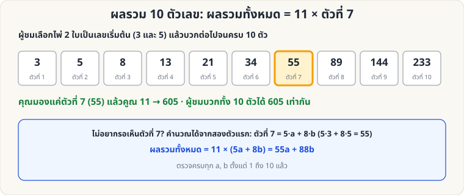

[🏠 หน้าแรก](../Home.md) › [🧮 ไพ่คำนวณ](../Self-Working-Medium.md) › ผลรวม 10 ตัวเลข

# ผลรวม 10 ตัวเลข (Fibonacci)

> 🟡 **ระดับกลาง** · 🧮 ไพ่คำนวณ · ⏱ 15 นาที · 🎴 ใช้ไพ่ไม่กี่ใบ · 🔢 มีการคำนวณ · 📝 เล่นแบบทำนายได้

<!-- title:ผลรวม 10 ตัวเลข (Fibonacci) -->
<!-- body:start -->
**ผลที่ผู้ชมเห็น:** ผู้ชมเลือกเลข 2 ตัวจากไพ่ แล้วบวกต่อเป็นชุด 10 ตัว (ตัวถัดไป = สองตัวก่อนหน้าบวกกัน) — คุณบอกผลรวมทั้ง 10 ตัว **ก่อนที่ผู้ชมจะบวก**

**อุปกรณ์:** ไพ่ 2 ใบ (A–10) กระดาษ ปากกา

**วิธีเล่น**

1. ผู้ชมเลือกไพ่ 2 ใบ เป็นตัวเลขตัวที่ 1 และ 2 (เช่น 3 และ 5)
2. เขียนตัวต่อไปเป็น **ผลบวกของสองตัวก่อนหน้า** จนครบ 10 ตัว: 3, 5, 8, 13, 21, 34, 55, 89, 144, 233
3. คุณมองแค่ **ตัวที่ 7** (55) แล้ว **คูณ 11** → **605**
4. ให้ผู้ชมบวกทั้ง 10 ตัว → **605** เท่ากัน

**ไม่อยากรอเห็นตัวที่ 7:** ให้ a, b = เลขตัวที่ 1, 2 → ตัวที่ 7 = 5a + 8b → ผลรวม = 11 × (5a + 8b) = **55a + 88b** (3, 5 → 165 + 440 = 605)

**ทำไมถึงได้ผล:** เขียนทุกตัวเป็น a กับ b: ตัวที่ 1–10 = a, b, a+b, a+2b, 2a+3b, 3a+5b, 5a+8b, 8a+13b, 13a+21b, 21a+34b → ผลรวม = 55a + 88b = 11 × (5a + 8b) = 11 × ตัวที่ 7 (ตรวจครบ a, b = 1–10 แล้ว)

**ลูกเล่น:** เขียนผลรวมลงกระดาษแล้วพับให้ผู้ชมถือไว้ตั้งแต่ก่อนเริ่ม · ให้ผู้ชมใช้เครื่องคิดเลขตรวจ
<!-- body:end -->

---

⬅️ [🟡 เลข 1001](sw-medium-1001.md)  ·  [📋 ไพ่คำนวณ · ระดับกลาง ทั้งหมด](../Self-Working-Medium.md)  ·  [🟡 ตารางคู่–คี่ 5×5](sw-medium-parity-grid.md) ➡️

**กลที่เกี่ยวข้อง:** [🟡 เลข 1001](sw-medium-1001.md)
