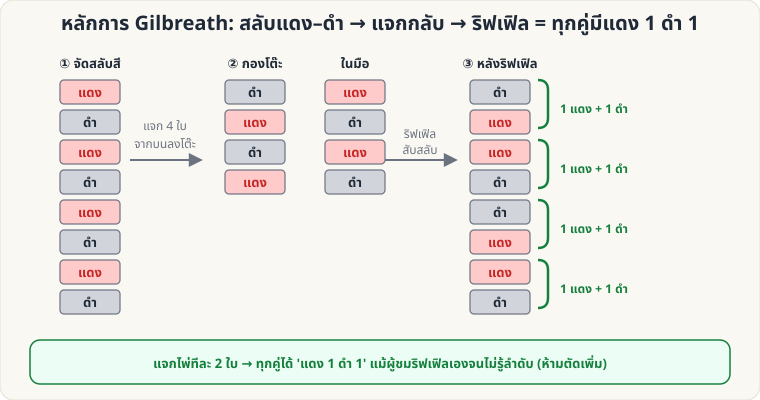

[🏠 หน้าแรก](../Home.md) › [🧮 ไพ่คำนวณ](../Self-Working-Medium.md) › Gilbreath (สีไพ่)

# หลักการ Gilbreath

> 🟡 **ระดับกลาง** · 🧮 ไพ่คำนวณ · ⏱ 30 นาที · 🔧 ต้องจัดสำรับล่วงหน้า

<!-- title:หลักการ Gilbreath -->
<!-- body:start -->
**ผลที่ผู้ชมเห็น:** ผู้ชมสับสำรับเองด้วยการสับแบบริฟเฟิล แต่เมื่อแจกเป็นคู่ **ทุกคู่มีไพ่สีแดง 1 ใบและสีดำ 1 ใบ** (หรือ ไพ่อื่น ๆ ที่คุณจัดไว้)

**อุปกรณ์:** สำรับไพ่ที่จัด **แดง/ดำสลับกัน** 52 ใบ (ใบบนสุดสีไหนก็ได้)

**วิธีทำ**

1. จัดสำรับสลับสี: แดง ดำ แดง ดำ … (ทั้งสำรับ)
2. ให้ผู้ชม **แจกไพ่จากบนสุด ลงโต๊ะ ประมาณครึ่งสำรับ** (เช่น 20–26 ใบ) กองที่แจกจะกลับลำดับไปเอง
3. ให้ผู้ชม **ริฟเฟิลสับ** กองบนโต๊ะเข้ากับไพ่ในมือ **แค่ 1 ครั้ง** ปล่อยให้ผสมกัน *ตามใจ*
4. แจกเป็น **คู่ ๆ** จากบนสุดทันที (ห้ามตัดสำรับเพิ่ม): **ทุกคู่ = แดง 1 + ดำ 1** (ลำดับในคู่อาจกลับกัน)
5. เปิดเผย: "ฉันไม่รู้ลำดับเลย แต่ไพ่เลือกคู่ให้เอง" — ให้ผู้ชมทายสีของใบแรกในคู่ แล้วคุณเดาสีใบที่สองได้เสมอ

**ทำไมถึงได้ผล:** ไพ่ที่แจกลงโต๊ะกลับลำดับ แต่ยังเรียงสีสลับอยู่ทั้งสองกอง และใบบนสุดของ 2 กองมีสี **ตรงข้ามกัน** เมื่อริฟเฟิลสอดสลับ ไม่ว่าจะปล่อยกี่ใบ ทุก 2 ใบ (ใบที่ 1–2, 3–4, …) จะได้สีตรงข้ามกันเสมอ

**ข้อควรระวัง:** ริฟเฟิล **1 ครั้ง** เท่านั้น ถ้าสับ overhand ริฟเฟิลซ้ำ หรือตัดสำรับหลังริฟเฟิล หลักการจะพัง
<!-- body:end -->

---

⬅️ [🟡 ไพ่ 21 ใบ](sw-medium-21-cards.md)  ·  [📋 ไพ่คำนวณ · ระดับกลาง ทั้งหมด](../Self-Working-Medium.md)  ·  [🟡 Si Stebbins Stack](sw-medium-stebbins.md) ➡️

**กลที่เกี่ยวข้อง:** [🟡 Gilbreath (ดอกไพ่)](sw-medium-gilbreath-suit.md) · [🟢 แยกสีแจกสลับ](sw-easy-alternating-deal.md)
