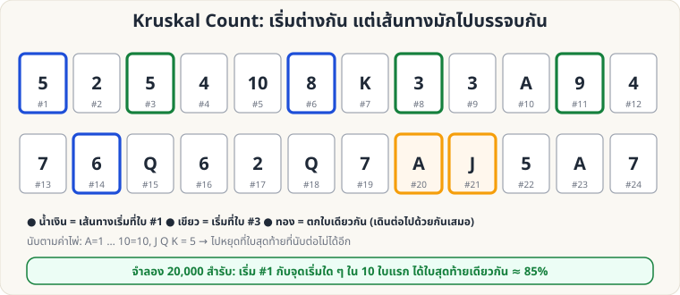

[🏠 หน้าแรก](../Home.md) › [🧮 ไพ่คำนวณ](../Self-Working-Medium.md) › Kruskal Count

# Kruskal Count

> 🟡 **ระดับกลาง** · 🧮 ไพ่คำนวณ · ⏱ 20 นาที · 🔀 ผู้ชมสับสำรับได้ · 📝 เล่นแบบทำนายได้ · 🔢 มีการคำนวณ

<!-- title:Kruskal Count -->
<!-- body:start -->
**ผลที่ผู้ชมเห็น:** ผู้ชมสับสำรับเองจนทั่ว (ไม่มีการจัดสำรับเลย) เลือกเลข 1–10 แล้ว "กระโดดนับ" ตามค่าไพ่เป็นทอด ๆ จนหยุด จำไพ่ใบสุดท้ายที่หยุด — คุณบอกใบนั้นได้

**อุปกรณ์:** สำรับธรรมดา สับโดยผู้ชม

**กติกาการกระโดดนับ**

- ค่าไพ่: **A = 1**, 2–10 ตามเลขบนไพ่, **J Q K = 5**
- เริ่มที่ใบที่เลือก (ตำแหน่ง 1–10 จากบนสุด) → ดูค่าไพ่ใบนั้น → นับต่อไปอีกตามค่า (นับเป็นใบที่ 1, 2, …) → ไปถึงไพ่ใบใหม่ → ดูค่า → นับต่อ
- **หยุดเมื่อกระโดดต่อไม่ได้** (ค่าไพ่มากกว่าจำนวนไพ่ที่เหลือ) ไพ่ใบสุดท้ายที่ยืนอยู่ = ไพ่ของผู้ชม

**วิธีเล่น**

1. ให้ผู้ชมสับสำรับ แล้ว **หงายไพ่เรียงเป็นแถวยาว** บนโต๊ะ (หรือแจกหงายทีละใบเป็นกองเดียวบนโต๊ะ) ให้เห็นค่าทุกใบ
2. ผู้ชมเลือกเลข 1–10 ในใจ (จะเริ่มที่ใบนั้น) แล้วกระโดดนับในใจ **โดยไม่บอกคุณ** จำใบสุดท้าย
3. ระหว่างผู้ชมทำ คุณทำ **ของคุณเอง** เงียบ ๆ: เริ่มที่ **ใบที่ 1** เสมอ กระโดดนับตามกติกาเดียวกันจนหยุด
4. เปิดเผยว่าใบสุดท้ายของคุณคือใบไหน → **มักตรงกับของผู้ชม**

**ตัวเลขจริง (จำลอง 20,000 สำรับสับสุ่ม)**

| เงื่อนไข | ตรงกับของผู้ชม |
|---|---|
| ผู้ชมเริ่มที่ใบ 1–10 (คุณเริ่มใบที่ 1) | **≈ 85%** |
| ผู้ชมเริ่มที่ใบ 1–5 | ≈ 87% |
| ผู้ชมเริ่มที่ใบ 1–3 | ≈ 90% |
| ทุกจุดเริ่ม 1–10 ลงใบเดียวกันหมด | ≈ 59% |

**ทำไมถึงได้ผล (ย่อ):** เส้นทางสองเส้นที่เริ่มต่างกัน ถ้าตกใบเดียวกันสักครั้ง ก็ **เดินต่อเหมือนกันทุกก้าว** — ยิ่งไพ่ค่าต่ำ (A–5) เยอะ ยิ่งตกใบเดียวกันง่าย

**ข้อควรระวัง & แผนสำรอง**

- ไม่ใช่ 100% — เตรียม "แผน B" เสมอ เช่น ถ้าผิด ให้ทำเป็นเกมต่อว่า "ขอพลังอีกรอบ" แล้วเล่นซ้ำกับสำรับอีกชุด
- บอกผู้ชมให้เริ่มจากเลขน้อย ๆ (1–5) เพื่อโอกาสสำเร็จสูงขึ้น
- ใช้ **สำรับเต็มเท่านั้น** (ค่า J Q K = 5 ทำให้เส้นทางบรรจบง่าย)
<!-- body:end -->

---

⬅️ [🟡 Si Stebbins Stack](sw-medium-stebbins.md)  ·  [📋 ไพ่คำนวณ · ระดับกลาง ทั้งหมด](../Self-Working-Medium.md)  ·  [🟡 Binary Cards](sw-medium-binary-cards.md) ➡️
